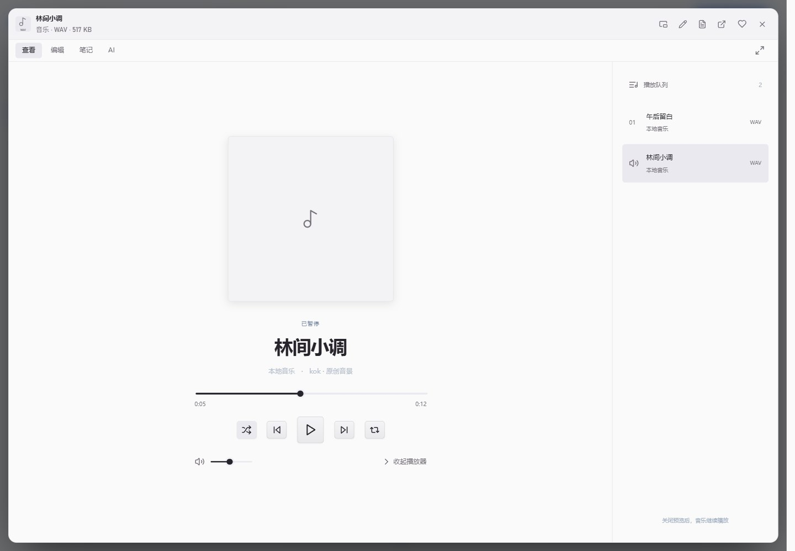
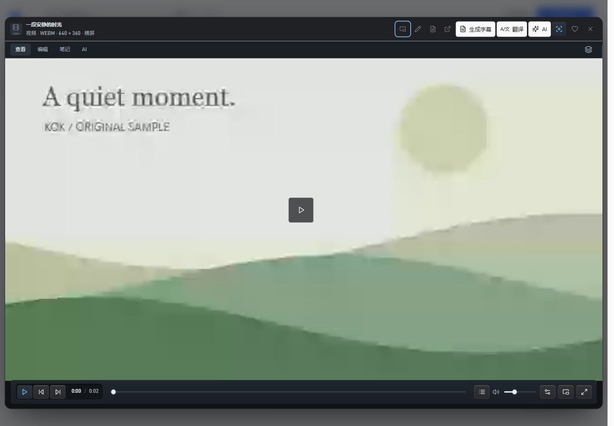
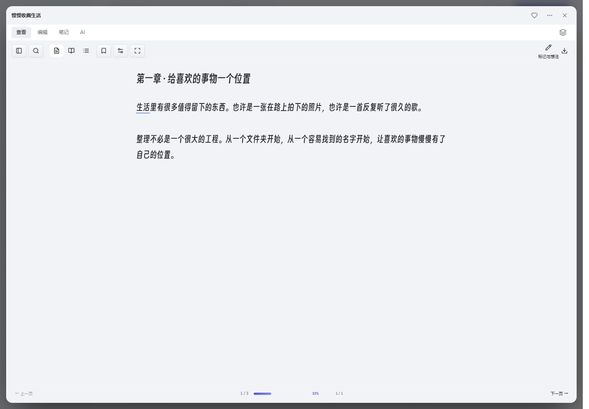

# kok changelog

## v0.14.0 · Preview

- Establish the general Agent foundation with a strictly checked TypeScript runtime on Deep Agents / LangGraph. C# retains desktop integration, approval and actual file operations; the previous loop is isolated for compatibility.
- Add versioned TaskSpec, asset and capability contracts projected from the existing authoritative delivery rules and real file versions.
- Persist new LangGraph checkpoints through public write interfaces, with migration of v0.13.0 checkpoints and approval-boundary recovery.
- Add individually approved background command jobs with durable IDs, local waits, cancellation, actual exit codes and declared output assets. Results are encrypted; interrupted jobs never replay automatically after restart.
- Show truthful status for all nine capability domains, including music. Engines that are still planned are not advertised as available.
- Prevent delayed memory refreshes from reopening a closed dialog; wrap command output and show declared output paths in the job view.
- Add migration, actual process execution, output asset and desktop integration coverage. See [validation and limits](docs/VALIDATION_0.14.0.md) and the [development plan](docs/PROJECT_PLAN_0.14_TO_1.0.md).

## v0.13.0 · Preview

- New tasks use Deep Agents 1.16.4 / LangGraph 1.7.3 for source reading, research and content creation, with the user's configured model provider.
- The SDK owns the model/tool loop. kok enforces scope, approval, actual file writes, saved-artifact validation, undo and request/cost limits. Final answers enter host verification without model-authored formal plan/finish receipts.
- Native tools use resumable interrupts; compressed SDK state is stored in the encrypted task journal. Restarting at approval does not regenerate or duplicate the write.
- Generic subagents and shell are disabled by default. One bundled Node worker starts on demand and exits after the task; no developer runtime installation is required.
- Actual host read-back receipts reach the SDK directly. Fixed Windows Chinese input encoding and source revision metadata being mistaken for a targeted file edit.
- Existing tasks retain their original execution semantics; explicit compatibility JSON uses the native runtime. See [kernel and migration](docs/RESEARCH_KERNEL_0.13.0.md) and [validation](docs/VALIDATION_0.13.0.md) for scope and limits.

## v0.12.2 · Preview

- Task requirements are now a sequential state machine: later messages can add, replace or cancel page counts, length bounds, deliverable kinds, full-source reading and body-edit requirements. "Change it to a report", "don't edit yet, only analyze", "cancel the length limit", "only read the beginning" and "use all sources" apply to the current state instead of accumulating stale requirements.
- Tool profiles, prompts and acceptance read the same current requirement: after switching from a chat reply to saving a file, the creation tool is available again instead of being blocked by an earlier "do not create a file".
- Completion binds to the final deliverable ID and current version: type, format (DOCX/MD/TXT), measured length (characters, CJK characters or English words), page count, existence and read-back must all hold on the same file. Mixing conditions across files, satisfying page counts with an older deck, reading only one slide, or editing without a post-edit read-back no longer pass.
- Presentation reads are unified: `read_presentation` page coverage counts toward full-source coverage, and a created deck's read-back must cover all pages (or the full text).
- Chat replies are checked against measured length requirements; the retained-constraint block prioritizes final revisions and warns that older versions may be void.
- This release is verified with offline native tests, an independent probe and desktop suites; no live model end-to-end rerun was performed. Scope and limits are in [Validation](docs/VALIDATION_0.12.2.md).

## v0.12.1 · Preview

- When the user changes requirements mid-task, delivery acceptance and available tools are re-derived from the latest request: 8 pages changed to 5 validates 5, adding "save it as a document" opens the creation tool, and completed artifacts/reads are preserved.
- Delivery acceptance supports multiple deliverables (report and deck validated separately), narrowed source scope ("use only the second source"), and distinguishes deliverable page counts from source page references. Negated requests ("do not make a PPT") and "reply in chat, do not create a file" are no longer misread as delivery actions.
- Length acceptance is now measured by the host: CJK characters are counted after stripping Markdown formatting, and post-creation read-back must cover the artifact text (at least 8,000 characters or the full document) instead of a two-character read.
- `read_document` and `read_items` share exact-reading and coverage semantics: full-source checks accept either tool, long `read_document` results are no longer cropped again, `max_chars` is enforced, multiple results get a guaranteed share of the task budget, and earlier source openings plus constraint sentences remain visible in later turns.
- Repaired failures: a read retried with corrected parameters resolves the earlier failure; `uncertain_write`, skipped and undone steps still block completion.
- Tool profiles keep configured memory, web, execution, delegation and MCP capabilities instead of silently trimming them to the 14-tool budget; mid-task additions open the tools the new request needs.
- Evaluation separates partial from complete outcomes, reports completed/partial/needs-input/failed counts, renames citation and write-claim metrics to match their actual checks, and adds required-facts and forbidden-items checks. The result card separates input sources from generated artifacts.
- This release is verified with offline native tests, an independent probe and desktop suites; no live model end-to-end rerun was performed. Scope and limits are in [Validation](docs/VALIDATION_0.12.1.md).

## v0.12.0 · Preview

- Artifacts created by a task join that task's readable scope: create, read back, targeted edit and finish can complete inside one task, while restart, undo and out-of-scope reads keep the original boundaries.
- Agent reads are exact and paged: `read_items` supports `offset` / `max_chars`, `has_more` / `next_offset` and per-source coverage, so long sources and their final revisions are no longer lost to sampling; context clipping no longer collapses oversized results into a short note.
- `finish_task(completed)` now includes host-verified delivery: a real artifact, the actual slide count, a current read-back after creation/editing and full-source coverage; a rejected completion names only the failing item. Repaired failures no longer block completion.
- Tool groups are chosen from the goal (report, revision, presentation), so a default report task no longer exposes subtitle or media-index capabilities. The default request limit is unchanged.
- A small DeepSeek live evaluation led to fixes for negated creation requirements, secondary clipping of exact reads and unclear request-budget guidance. The final native suite passes 1053 tests; content completeness and consistency across artifacts still need work. Evidence and limits are in [Validation](docs/VALIDATION_0.12.0.md).

## v0.11.2 · Preview

- Try an example from the empty Agent or My works screen and create an editable Markdown note locally.
- Find older projects by name or goal in All projects. Add an existing managed document or presentation to a project.
- Export history shows saved copies with their time, location and fingerprint. Reveal the file in Explorer directly from the project.
- The Chinese help center adds tutorials for a first note and a source-based report and presentation. [Help center](docs/help/index.md) · [Validation](docs/VALIDATION_0.11.2.md)

## v0.11.1 · Preview

- PPT creation loads the explicitly Apache-2.0 visual guidance distributed in baoyu-design at a pinned commit, with the source and license retained. Four themes and nine native editable compositions share typography and geometry across preview, editor and export.
- Presentation tasks automatically load the design workflow. Dense copy is rejected for revision rather than cropped. Comparisons, processes, cards and metrics keep supplied data and notes; targeted revision preserves other pages.
- Double-click slide text to edit with automatic persistence; properties stay optional. Duplicate, drag-reorder, delete and undo are available beside page thumbnails, with one current-page Agent entry. Saved cover and section titles remain correct.
- Distinguish output truncation from input-context overflow. Automatically adjust output within existing request, cost and reserve limits, with at most two additional attempts; long-form document creation gets a suitable initial allowance.
- Never execute truncated proposals. Complete regenerated changes retain native approval. Streamed final text deltas and trailing usage are retained.
- Response incomplete offers one Continue in parts action that preserves the original goal and current materials without sending automatically. Other failed-task continuation also restores the goal.
- See [output recovery](docs/OUTPUT_RECOVERY_0.11.1.md) and [validation](docs/VALIDATION_0.11.1.md).

## v0.10.13 · Preview

- Creative-project P4 connects three sources, a report, manual and targeted revisions, an eight-page presentation, continuation after a native restart, named-checkpoint restore and DOCX / PPTX export.
- Default project scope includes recent outputs alongside source material, capped at 24 distinct files. Explicit selections and folders retain priority.
- Native session sync tracks task event sequences so continuation after a request for input retains later messages and existing artifacts without duplicates.
- See the [acceptance workflow](docs/CREATIVE_ACCEPTANCE_0.10.13.md) and [validation](docs/VALIDATION_0.10.13.md) for fixture boundaries and results.

## v0.10.12 · Preview

- Creative-project P3: previews combine native project artifacts, durable branch artifacts and current transcript results, deduplicated by file. Project outputs remain accessible across branches, sessions and restarts.
- Session restore retains the selected historical branch and avoids replaying finished task cards. Artifact tree nodes support switching and forking; delayed reads remain bound to their session and library.
- Historical versions support named checkpoints, renaming and removal. Named versions have priority within the 100-entry limit. Encrypted metadata uses atomic replacement and backup; failed writes roll back cached names without changing document content.
- See [validation](docs/VALIDATION_0.10.12.md) and [creative continuation](docs/CREATIVE_CONTINUATION_0.10.12.md). P4 remains the next milestone.

## v0.10.11 · Preview

- Document versions panel: the managed-document editor gains a **Versions** button listing current and historical versions (time/title/source/state); selecting one shows line diffs (`+N/−M`) and any version can be restored. Restore is a compensating operation (itself undoable) and synchronizes editor body/signature/save state; formats without extractable text show hash/size; the private folder is excluded.
- Pre-save diff: the save button / Ctrl+S first shows a **save confirmation** with the saved→pending line diff when content changed; cancel writes nothing and keeps the editor dirty, confirm proceeds. Auto-save and retry logic are unchanged.
- Local-revision entries: select text in a document → **Let Agent revise this passage**; the current slide in a presentation → **Let Agent revise this page**. Prompts contain only that passage/page plus "change only this, preserve the rest" constraints and only fill the composer with document/presentation context — never auto-sent, never starts a task.
- Native actions `documentVersions` / `documentVersion` (with a `current` sentinel) / `documentVersionRestore` (write-classified, rejects `current`); UI native-action catalog updated.
- Limits: diffs are computed locally (no model requests); version lists cap at 100 entries and text diffs have line/character caps; DOCX versions are byte-restore + hash only; named checkpoints and presentation version comparison are not included; approval, evidence review, undo and sandbox semantics are unchanged.
- See [v0.10.11 validation](docs/VALIDATION_0.10.11.md).

## v0.10.10 · Preview

- Creative projects (first version): spaces extend into project records (`kind="project"`: goal, style/acceptance requirements, status, materials, artifacts, related sessions). Create/edit/open projects in **My works** and continue any time; projects live in the existing workspace + Operation audit/undo chain with no new storage table.
- Continue in Agent: `AgentUi.openProject` opens a fresh session with a project banner (goal/material/artifact counts, clearable, kept across new sessions); `agentTaskStart` accepts an optional `projectId`; the host validates the project, builds a <=4000-character project brief (goal/requirements/material count/existing artifacts) injected as the stable first guidance segment (byte-identical per task, cache-friendly), and auto-scopes to project materials (<=24) when the caller omitted scope; explicit scopes are preserved.
- Session/artifact writeback: task start appends the session to project `sessions`; terminal state links created/edited artifacts into `artifacts` (deduped, audited/undoable, failures never break the task). When a project is active the artifact panel prefers durable project artifacts, which stay visible after starting a new session instead of depending on the current conversation.
- Native version-history foundation (UI next round): `ListVersions`/`ReadVersion`/`RestoreVersion` — list a work's versions from Operations + encrypted version files, read before/after texts (MD/TXT/DOCX) and hashes, and restore any version through a compensating operation (itself undoable; disabled in the private folder).
- Limits: projects are space records (the 空间 page may list them too until filtered); the project brief is host-generated and marked untrusted; version UI and manual-edit diffs are not wired this round; approval, evidence review, undo and sandbox semantics are unchanged.
- See [v0.10.10 validation](docs/VALIDATION_0.10.10.md).

## v0.10.9 · Preview

- Codemode: an approved `run_code` can now call **read-only** library tools inside the QuickJS sandbox through `tools.search_library` / `tools.read_items` / `tools.recall_result` / `tools.search_memory` / `tools.list_collections` and combine several reads into one computation. The existing sandbox and limits still apply (no file/network/DOM, 16 MB, 7 s, output <= 16000) with no new write or approval capability. Implementation uses a sync-QuickJS replay protocol (record requests, host executes batches, re-run with cache; <=8 per batch, <=24 per run, <=8000 chars per result, <=32000 total, <=6 rounds); nested reads are ephemeral evidence and never create task receipts/journal entries. See [Codemode](docs/CODEMODE_0.10.9.md).
- Headless RPC: `kok-agent.exe --rpc` starts a long-lived JSONL command loop (`ping` / `prompt` / `steer` / `follow_up` / `abort` / `state` / `compact` / `shutdown`) with serialized `response` / `event` / `result` lines on stdout, one active task, read-only policy and per-task timeout; EOF/Ctrl+C/combination errors have explicit exit codes. Suitable for editors, CI and external tools. See [Headless RPC](docs/AGENT_RPC_0.10.9.md).
- New native action `agentSandboxTools` (nested read batches with whitelist/limits/ticket checks) and the matching UI native-action entry; the `run_code` tool description changed while its schema and approval card stay the same.
- Limits: `tools.*` is read-only and its results cannot serve as current `finish_task` receipts; RPC is read-only and does not load conversation history; event contract and task/session data formats are unchanged; approval, evidence review, undo and sandbox semantics are unchanged.
- See [v0.10.9 validation](docs/VALIDATION_0.10.9.md).

## v0.10.8 · Preview

- Declarative extension packages: a package directory (`plugin.json`) can ship Agent Skills `SKILL.md` skills and Markdown prompt templates. Packages are discovered from `<app>\ui\plugins`, `%USERPROFILE%\.kok\plugins` and `<library>\.kok\plugins` (first root wins on name), up to 32 packages, manifest <= 64 KB, every path must stay inside the package. Skills join `<available_skills>` and `load_skill`; prompt templates expand into the composer with `/prompt:name args`. **No script or code is ever executed**; unknown fields are ignored as inert data.
- Agent gains an **Extensions** panel listing installed packages (name/version/description/skill and prompt counts), the discovered skill count and prompt templates, with a **Reload** action that hot-refreshes (and refreshes the skill picker). `/prompt:` only fills the composer — it never auto-sends and never persists the raw command.
- Native actions `agentPluginsList` / `agentPluginsReload` / `agentPromptRead`; `AgentSkills.Discover` accepts extra (plugin) skill roots and `load_skill` can read them; prompt templates support `$ARGUMENTS` replacement and append-when-missing behavior.
- Limits: packages are declarative text only — no code entry point, no network/file APIs, no hook registration; skills/templates only reach the prompt or the composer; event contract and task/session data formats are unchanged; approval, evidence review, undo and sandbox semantics are unchanged.
- See [v0.10.8 validation](docs/VALIDATION_0.10.8.md).

## v0.10.7 · Preview

- Headless Agent CLI: `kok-agent.exe --goal "..." --print|--json` (the same implementation as `kok.exe agent ...`) runs one read-only task without opening a window and reuses the same native engine, encrypted task records, retrieval and evidence checks. `kok-agent.exe` is a console-subsystem launcher so scripts/CI get reliable exit codes and ordered output; JSON mode emits `header → event → result` JSONL, print mode emits only the final answer; exit codes distinguish completed/partial/failure/interruption; supports `--data-dir`, scope, budget, request limit, context, timeout and session naming. See [Agent command line](docs/AGENT_CLI_0.10.7.md).
- Optional provider cache key: AI service advanced settings add **Enable provider cache key**; when enabled, `prompt_cache_key` is sent per session within a task (normal tools requests only; compaction, JSON-protocol and translation requests never carry it). Off by default and a no-op for providers that do not support the field.
- Cache-hit display: the Agent usage line shows `缓存命中 {tokens} tokens · {percent}%` when `cachedTokens > 0`.
- Limits: the headless entry is read-only; writes still go through desktop per-card approval; `--approval` / `--allow-writes` are rejected; no conversation history is loaded; no headless RPC yet (planned); event contract and task/session data formats are unchanged; approval, evidence, undo and sandbox semantics are unchanged.
- See [v0.10.7 validation](docs/VALIDATION_0.10.7.md).

## v0.10.6 · Preview

- Agent branch-tree UI: a toolbar **Branch tree** button opens the session-branch panel, listing messages in parent/child order with previews, the current branch marker, compaction summaries and labels; task rows show as a subtle line.
- In-place branch switching: **Switch here** on any message calls `agentSessionSwitch`, rebuilds the visible history from the native session projection (user/agent messages), clears draft/pending-continuation state and lets the next task continue on that branch; switching is blocked while a task runs.
- Fork from any node and rename: the tree panel forks from a node through the existing `agentSessionFork` and renames sessions inline (`agentSessionRename`, 1–64 chars); `/tree` opens the panel.
- Native support: new `ProjectionMessages` (keeps Pi `firstKeptEntryId` compaction semantics and returns entry ids); `agentSessionProject` / `agentSessionSwitch` / `agentSessionFork` messages carry `id`; `agentSessionTree` entries gain role, a single-line 160-char preview, label target and compaction reason (all additive).
- Limits: switching rebuilds only the user/agent transcript, so tool cards from other branches are not replayed; no LLM branch summarization this release (`branch_summary` structure stays reserved); event contract and task/session data formats are unchanged; approval, evidence review, undo and sandbox semantics are unchanged.
- This completes M1 (skill directories + session tree UI). See [v0.10.6 validation](docs/VALIDATION_0.10.6.md).

## v0.10.5 · Preview

- Pi / Agent-Skills style skill directories: `SKILL.md` files are discovered recursively from `ui/skills`, `%USERPROFILE%\.agents\skills` and the library's `.agents/skills`; frontmatter name / description / disable-model-invocation are parsed, bodies cap at 20000 chars, at most 100 skills, cached by file revision. Startup injects only an `<available_skills>` index (name, description, location, XML-escaped); the model loads the full body on demand through the read-only `load_skill` tool (untrusted reference text, no script execution).
- Native actions `agentSkillsList` / `agentSkillsReload` / `agentSkillRead`; the Agent skill picker adds a "discovered skills" group and a refresh button; `/skill:name args` starts a task with that skill; selecting a skill sends only the short `[Skill: name] Use load_skill ...` instruction while the body is loaded by the tool, keeping the prompt prefix stable.
- M0-4 internal extension seams: `AgentToolHooks` (PrepareRequest / TransformContext / BeforeToolCall / AfterToolCall / FinishTurn), `AgentToolSpec.Mode` (serial/parallel execution) and reserved `TerminateHint`; with no hooks registered behavior is identical to before, preparing declarative extensions and tool middleware.
- Limits: skills are read-only text and never execute scripts; same-name skills resolve app → user → library first; the four bundled app workflows also appear in the prompt index; event contract and task/session data formats are unchanged; approval, evidence review, undo and sandbox semantics are unchanged.
- See [v0.10.5 validation](docs/VALIDATION_0.10.5.md).

## v0.10.4 · Preview

- Pi-style context compaction: the trigger now uses the latest real request usage (input+output plus an estimate of what followed) and supports `reserveTokens` / `keepRecentTokens` (0 = auto). Recent turns are kept within the token budget and older whole turns are summarized, never splitting a tool call from its results. Context filtering follows: the first user goal message is always kept, while older turns and older user instructions move into the summary.
- Summary format is the fixed six sections (Goal / Constraints & Preferences / Progress / Key Decisions / Next Steps / Critical Context) plus `<read-files>` / `<modified-files>`, merged into the previous summary via an UPDATE instruction; tool results are clipped to 2000 chars per item; summary language follows the task goal.
- Manual compaction `agentTaskCompact` while a task runs (instructions <= 400 chars); a provider context overflow emits `context.recovery`, compacts and retries exactly once. Compaction requests record `purpose=compaction` and do not replace the context-usage baseline.
- Compaction results are persisted into the native session tree as `compaction` entries (`firstKeptEntryId`, `tokensBefore`, reason, read/modified file lists); session projection and fork follow Pi's kept-boundary semantics, with the summary entering the projection as an untrusted assistant message.
- Snapshots add `contextUsage` (tokens/window/reserveTokens/keepRecentTokens/percent/source/lastCompaction); Agent shows the usage row (measured/estimated), a running-only "Compact context" button and a collapsible summary with an untrusted marker; advanced settings expose the reserve/keep tokens.
- Limits: automatic compaction needs at least 2 remaining requests, manual and overflow recovery need 1; summaries must be 20–6000 chars; the event contract moves to v3 (old task records load unchanged); Pi's split-user-span cut is not implemented (the first goal message is always kept), and `stopReason=length` shares the single overflow recovery path. Approval, evidence, undo and sandbox semantics are unchanged.
- See [v0.10.4 validation](docs/VALIDATION_0.10.4.md).

## v0.10.3 · Preview

- Native Agent session tree: each session is written to a local encrypted append-only record (`<data dir>/agent-sessions/<sessionId>.jsonl.sealed`, one DPAPI line per entry) with Pi-style message, task marker, usage/model/label entries and a leaf branch pointer; supports list, read, tree, projection, switch leaf, fork, clone, rename, delete and labels. Legacy UI sessions (`agent-sessions.sealed`) are imported once into linear native entries while the original file is preserved.
- Session actions: `agentSessionList` / `agentSessionTree` / `agentSessionProject` / `agentSessionFork` / `agentSessionSwitch` / `agentSessionRename` / `agentSessionDelete` / `agentSessionLabel`; task start now carries `sessionLeafId` so new messages attach to the active branch. Terminal task events are synced into the session tree idempotently (task markers deduplicate).
- UI: every user or Agent message gains **Fork from here**. Forking creates a new session that keeps only the messages before that point and uses the native branch projection as the next task's model history; the fork title survives later saves. Legacy sessions keep rendering from the existing UI store.
- Limits: at most 64 native sessions per library, 4096 entries / 8 MB per session; records use the current Windows account's DPAPI and do not migrate across accounts or machines; fork creates a new session instead of Pi's in-place `/tree` switch (M1); compaction / branch_summary / context_edit entries are reserved for M0-3. Approval, evidence review, undo and sandbox semantics are unchanged.
- See [v0.10.3 validation](docs/VALIDATION_0.10.3.md).

## v0.10.2 · Preview

- Agent task input now matches Pi: Enter while a task runs inserts a steering message (it enters the same task after the next tool batch without interrupting the reply being streamed and without skipping pending tool calls); the clock button queues a follow-up (when the task would otherwise finish, the same task continues instead of starting a new one); stopping, failing or reaching the request limit returns not-yet-run input to the composer. Native actions are `agentTaskSteer` / `agentTaskFollowUp`; snapshots add `queue` / `restoredInputs`.
- The event contract moves to v2 (`input.queued` / `input.consumed` / `input.restored`). Old task records load unchanged and existing encrypted events are never rewritten.
- Composer and queue drawer updates: while running the drawer shows "pending · N" with "next turn" / "after finish" tags; stopping returns input to the composer instead of leaving it in a local queue that starts a new task.
- No library, document or work data-format changes. See [v0.10.2 validation](docs/VALIDATION_0.10.2.md).

## v0.10.1 · Preview

- The top level is organized by what you are doing: Agent, My works and Library. File types and tools move inside those areas; the rail keeps only the three destinations, the private folder and Settings. Legacy routes (Today, Spaces, Clips, smart collections, Recipes, Review, downloads, smart organize, knowledge graph) remain reachable.
- New My works area: create Markdown/DOCX/TXT/PPTX through the existing new-document flow; continue editing content created or modified in kok; open project spaces, saved clips and creative recipes; start editing existing videos, audio, PDFs or documents in the existing editors. Presentations created in kok are now tracked as owned works too.
- The library home adds continue-watching/reading rows, favorites/recent links, collections and a library-tools menu (smart organize, video downloads, knowledge graph, smart collections, review, operation history, activity, search and library data). Type filters stay inside the library; watching, listening, reading, subtitles, bookmarks and playback queues remain independent.
- Agent home and background playback still share the window: the player bar leaves room for the composer and notifications avoid the send control. Empty/conversation layouts, attachment import and the More menu carry over from the previous round.
- No data format changes. Novel-level chapters/settings and from-scratch audio/video generation remain staged. See [v0.10.1 validation](docs/VALIDATION_0.10.1.md).

## v0.9.8 · Preview

- Interface redesign: unified near-white and muted purple-dark themes, removed promotional welcome copy and redundant labels; kept a short rail at every width with file categories in the library toolbar; the three-column launcher puts Favorites, Recent and Collections first; pinned offline Phosphor duotone destination glyphs with original geometry and MIT license, while compact actions retain Lucide.
- Interrupted transitions continue from the displayed frame. Menus enter over 200ms and exit over 120ms while releasing input immediately; filters retain focus, sorting translates cards, exits preserve surface geometry, and reduced-motion preferences are respected.
- The Agent first screen now defaults to material, the request, suggestions derived from that material and send/stop; skills, usage profiles, protocol and scope live in a collapsed Advanced panel, and selected material becomes the effective scope automatically.
- New read-only native action `agentLocalPlan`: explicit read-only requests such as counts, filtered lists, collection/tag overviews and kind distributions are answered locally with zero model requests, no network and no writes, even before an API key is configured; generative, comparison and suggestion requests still go to the model.
- Fragment-level retrieval: one long file can return up to three anchored excerpts (page/chapter/subtitle time, 12 snippets in total by default, max 24), and `read_items` reports per-source read coverage plus a bounded summary. The per-round catalog combines the user's selection with locally matched goal-related candidates and stays fixed for the task. Knowledge panes and MCP keep one hit per file.
- Tool-call messages now use a stable prefix plus a dynamic tail: the receipt index, checkpoint and task guidance moved to the final host status message while history and prior rounds remain append-only; the JSON fallback protocol is unchanged.
- Every finished task ends with a durable result card (status, sources used, citations, open artifact / view sources / continue editing); local answers show a "completed locally, no model call" card with an AI follow-up entry; batch changes are summarized before confirmation.
- Added a fixed 30-task sample set, an offline validator and an opt-in live evaluation entry. No real-model evaluation was executed in this round, so no savings claim is made. See [Agent focus](docs/AGENT_FOCUS.md) and [evaluation baseline](docs/AGENT_TASK_EVAL.md).
- Validation: **608 native checks**, **16 desktop suites** and **package re-verification** pass. An authorized before/after comparison on the same 30 tasks shows requests falling **100 → 76 (−24%)**, input tokens **566,586 → 431,132 (−24%)**, conservative cost from ¥2.68 to ¥2.11, and 26/30 passed in both rounds, with the saving driven by local task routing; the two passes used 190 requests, moving the project request ledger from 359 to **549**. Application, package metadata and browser-extension versions are synchronized. See [validation scope, usage and boundaries](docs/VALIDATION_0.9.8.md) and the [evaluation baseline](docs/AGENT_TASK_EVAL.md).

## v0.9.3 · Preview

- Local MCP sandbox: each stdio server can use a user-writable portable-runtime directory with AppContainer; the host grants read/execute ACLs, Node.js gets symlink-preservation flags automatically, and non-grantable/system directories fail explicitly with no silent fallback. A native CI gate starts a copied Node runtime and completes an approved MCP call.
- MCP OAuth device code (RFC 8628): user code/verification URI, authorization_pending/slow_down/expired/denied handling, DPAPI tokens and refresh; browser callback or device code is selectable in settings.
- PDF/video batch indexing: approval-gated `index_pdf_pages` (PDFium text layer, up to 25 pages) and `index_video_frames` (FFmpeg + Windows OCR, up to 12 frames) merge limited local text into the content index; no model calls, no source modification, source changes invalidate.
- 542 native checks and 11 desktop suites pass; the real-model ledger remains 359 with no new model calls. See [validation](docs/VALIDATION_0.9.3.md) and [Agent limits](docs/AGENT_0.9.3.md).

## v0.9.2 · Preview

- Remote MCP OAuth: authorization code + PKCE, protected-resource/authorization-server metadata, dynamic client registration, loopback callback, refresh tokens and one refresh retry on 401; tokens stay DPAPI-encrypted and are never shown in the UI.
- PDF page and video-frame vision: `read_image` accepts `page` (local PDFium rasterization with bounds) and `time` (optional FFmpeg extraction), with DPAPI frame caches, source-change invalidation and OCR fallback when vision is disabled.
- Windows AppContainer sandbox: opt-in for approved commands (no network, no user-file access, writes only inside the workspace) and per-server for local stdio MCP; the effective mode is labeled and sandbox failure never silently falls back.
- New PDFium dependency (BSD-3-Clause) pinned by archive and DLL SHA-256 with a full notice; FFmpeg remains optional.
- 527 native deterministic checks pass; no additional real-model calls (ledger 150). See [validation](docs/VALIDATION_0.9.2.md) and [Agent limits](docs/AGENT_0.9.2.md).

## v0.9.1 · Preview

- Scoped vision input via `read_image` with bounded JPEG image messages and Windows OCR fallback; image bytes stay out of the task journal.
- Approval-gated web fetch/search with SmartReader extraction, HTTPS/SSRF/redirect/size/content-type limits and an optional SearXNG-compatible endpoint.
- Opt-in workspace: bounded file reads/writes and commands, default-off, per-call approval, traversal/size/timeout/output limits and Job Object process management.
- Longer tasks: 24 rounds/requests, 48k/64k context budgets, 128k context setting and 8k output; NCrontab schedules and tray completion notices.
- Semantic memory recall with a DPAPI vector cache, near-duplicate merging and source invalidation; memories still require approval.
- `delegate_parallel` starts 2-3 read-only subagents from one approval card with the shared parent budget.
- SharpToken (tiktoken) budgets with a conservative margin and calibration; SmartReader/AngleSharp/NCrontab dependencies are checksum-pinned with licenses.
- Remote MCP over Streamable HTTP with a DPAPI-encrypted bearer token; no OAuth.
- No additional real-model calls (ledger 150). See [validation](docs/VALIDATION_0.9.1.md) and [Agent capabilities and limits](docs/AGENT_0.9.1.md).

## v0.9.0 · Preview

- Versioned source chunks/anchors, incremental PDF/body/subtitle/Clip indexing and visible coverage/failures.
- Local Ollama embeddings and FTS5 hybrid search shared by UI and Agent, revision-aware caching and explicit lexical fallback.
- Portable standard ZIP with Markdown/JSON, stable IDs, optional originals, verified new-library restore, root mapping and undoable relinking.
- Inbox capture, a Chrome/Edge source extension, URL/time/fingerprints, capture deduplication, identical-file checks and offline Windows OCR.
- Default-off scoped read-only stdio MCP server with separate capture/read credentials and private/transition safeguards.
- Interrupted streaming prose, versioned Agent events, limited task/read-only approvals, calibrated token estimates, exact arithmetic and continuous approved-write review.
- Quality replays in checks/CI; separate synthetic live DeepSeek and local retrieval evaluations, preserving failures and fingerprints. Bilingual guidance and consistent runtime/package versions.
- See [scope](docs/LIBRARY_0.9.0.en.md) and [validation](docs/VALIDATION_0.9.0.md).

## v0.8.2 · Development stage, not independently released

- Semantic checkpoints and exact result recall, versioned encrypted memory, approved read-only subagents, offline QuickJS/WASM computation and saved artifacts.
- Shared parent/child/summary/retry budgets, native per-task tool permissions, cancellation/recovery, owned child cleanup and bilingual management UI.

- Persisted Agent plans and explicit evidence-linked outcome review, distinguishing complete, partial, needs-input and request-limited tasks.
- Typed HTTP/network failures, bounded cancellable backoff, explicit-only tools fallback, per-request metrics and redacted diagnostic export.
- Local stdio MCP connections, schema review, encrypted configuration, approval for every external call, definition fingerprints and process-tree lifetime management.
- Bilingual compact task/MCP UI, native/desktop checks, default Agent regressions, a dedicated desktop CI job and optional six-case live-model evaluation.
- Undo after completion and changed local sources invalidate prior review; steering marks old plans stale. Needs-input replies continue the original task and selected sources retain user order.
- Repairable invalid MCP calls, retained local error results, native/UI enforcement of individual external approval, cost estimates and source/runtime fingerprints for desktop and ZIP validation.
- Pure/private boundaries and local write review retained, without a large Agent framework. Automatic publishing remains off. See [scope and limits](docs/AGENT_0.8.2.en.md).

## v0.8.1 · Preview

English · [中文](CHANGELOG.md)

- Document/PPT implementations migrated to ES modules; draft saves serialize, and entry points/formats/Ctrl+N follow module state.
- Consolidated common viewer/photo geometry; preserved toolbar nodes/focus and fixed shortcut interference, Inspector spacing and responsive control state.
- Agent sessions, rendering and task interactions moved into a real ES module; three global scripts removed. Disable/re-enable protects drafts; saves serialize and coalesce.
- Fixed scoped search/smart-collection omissions beyond 5,000 matches. Background searches coalesce requests and discard results from previous library scopes.
- Native registry dispatch, narrow contexts, required schemas/policy, module management and a shared capability catalog.
- SQLite core items, facets, common links and FTS5 search; original JSON/migration backup retained. Private stores are sealed from memory.
- Global review, conflict-safe undo and managed-file byte versions; paged/exportable full history. Unified activity with progress, cancellation and supported pause/resume.
- Today, contextual Inspector, source-linked Clips, four Space views, smart collections, editable Recipes and daily Review. AI summaries have bounded input/output and caching.
- Asynchronous module-owned subtitle tools inherit Agent cancellation and produce durable, undoable receipts. No automatic model installation.
- Workspace, clips and viewer migrated to ES modules; 42 stylesheet sources produce nine ordered runtime bundles. Default Smiley Sans retained.
- Native preview edit/read transitions, tab feedback, real pointer drag/drop and editor-menu scope fixed. Large collections use pages of at most 120 cards.
- Unpublished local preview. See [v0.8.1 coverage](docs/WAREHOUSE_0.8.1.en.md) for implementation and remaining compatibility work.

## v0.7.2 · Local preview, unpublished

- Classic skeuomorphic look by default: stitched leather sidebar, glossy bar and buttons, a wooden bookshelf, framed photos and chat bubbles; Graphite remains in Settings → Interface style. New app mark.
- When several Agent actions wait for confirmation, Run all / Skip all handle them together.
- New Agent home (default in Smart mode, switchable back to the library in Settings): reading files, search and collection lookups run on their own; moving to collections, tagging, writing notes and creating documents or slides each wait for confirmation and can be skipped or undone. Originals are never modified, local paths are never sent, and the private folder and Pure mode stay AI-free.
- One entry point: the library AI tools, the viewer chat, graph analysis and smart organize now hand off to Agent; compare, note review and batch organize remain on the Agent page.
- Upright UI font by default (Microsoft YaHei UI / Segoe UI); Smiley Sans is kept for the mark and page titles. Short library shelves now share a row.
- Passes 168 native checks and a new isolated Agent interface test against a local mock model. See [Agent](docs/AGENT_0.7.2.en.md).

## v0.7.1 · Local preview, unpublished

- Separate the compact context menu from AI editing; restore clipboard/selection commands, keyboard focus and outside dismissal. Invalidate stale instruction reviews, retain exact PPTX substrings and keep sort menus through same-route background refreshes.
- Scoped graphs, intersecting filters and saved views; bounded AI connections, summaries and questions, with send previews, cancellation and local result reuse.
- Ordered type-based shelves, individual vector stamps for 56 import formats and restrained motion; centered private-folder artwork.
- PPTX slides, notes, fullscreen, basic text/page editing, drafts, undo and exported PPTX copies. Complex office layouts are not fully reproduced; legacy PPT remains external.
- Right-click AI text/object editing with review, explicit apply, undo and stale-target cancellation. Import short instruction-only SKILL.md files, loaded on demand without executing scripts.
- Existing features and default Smiley Sans remain. A small PPTX export browser component is loaded on demand, without Office, Remotion or a new codec runtime. See [scope and validation](docs/PRESENTATION_AGENT_0.7.1.en.md).

## v0.6.2-r2 · Quality revision preview

- Use one default palette/material source, clear custom colors when disabled, and retain independent reading paper and fonts. Reduce Graphite force overrides from 30 to 4, reserved for interaction and reduced motion.
- Use one surface-animation entry point; settle active motion when reduced motion is enabled, the page is hidden or native dragging/resizing begins. Prevent delayed loading from replaying a finished entrance.
- Bound an unresponsive renderer snapshot to five seconds. Failed exit saves default to keeping the window and edits open, allowing a retry after recovery. Clarify private-folder encryption and editor export scope; retain bundled fonts inside the private folder.
- Pass 132 native checks and seven isolated silent desktop suites, including actual native timeout/default No/text preservation/retry. The application remains v0.6.2 with a separate revision release tag.

## v0.6.2 · Graphite preview

- Graphite/frost surfaces, labelled/responsive sidebar, typographic covers and records. Restore bundled Smiley Sans as default and fix overrides that prevented font switching.
- Match video/photo/audio chrome; fix light-theme media contrast, missing notification indicators and hidden reading-selection motion. Retain actual music artwork and custom palettes.
- Remove duplicate dialog entrances and include previously local graph/note/document/template/auto-save and native-window fixes, with interruption-safe motion and stable reading positions.
- Isolated silent regression and source/package privacy checks. See [release details](docs/GRAPHITE_0.6.2.en.md).

## v0.6.1 · Local preview, unpublished

- Rework graph/note motion: reveal settled layouts, retain camera position/velocity on zoom retargets, pointer-anchored wheel input, stable filtering and drag release. Fix settings bounds, competing sidebar transitions, repeated completion entrances, dialog reversals and document opening. See [motion](docs/MOTION_0.6.1.en.md).
- Add local global/neighborhood graphs with drag, zoom and filters; note-link completion, unresolved-note creation, backlinks, tags, outline, checkable tasks and daily/meeting/reading templates. Worker layout/rendering become idle when settled and release on close. Available in Pure mode; private content is excluded. See [notes](docs/KNOWLEDGE_0.6.1.en.md).
- Add New / Ctrl+N for Markdown, Word (DOCX) and TXT, collections, source/editing views and preview, auto-save, Ctrl+S, close flushing and reopen-in-editor. Direct saves are limited to managed documents; duplicates receive suffixes and external conflicts retain recovery drafts. See the [guide](docs/DOCUMENTS_0.6.1.md).
- Reading chrome and progress fade without repagination, with matching paper edges and edge/keyboard recovery. Photo editing gains a coherent media palette, clear UI type, visible states and matching popups; fix header-obscured editing buttons and stack compact layouts. See [workspace clarity](docs/WORKSPACE_CLARITY_0.6.1.md).
- Sliding settings underline and reading selections, favorite/bookmark icon feedback, menu exits, subtle sidebar/notification entrances, and smooth photo zoom/rotation with immediate dragging.
- Interrupted transitions honor the latest request; exiting menus become inert. New effects are skipped during window gestures and reduced motion. See [motion scope and references](docs/MOTION_0.6.1.en.md).
- Fix move-only repagination, focus flashes, stale reading width, blank PDF resize frames and redundant rendering; preserve text anchors, toolbar materials and fixed window controls.
- Clear stale pagination spacers on returning to vertical reading; cover closing a file and enabling reduced motion during an animation, plus immediate photo dragging.
- Application, resource-cache and Windows file versions are aligned at v0.6.1. Portable packages exclude personal libraries, API configuration and private data.

## v0.5.1 · Preview

- Quiet reading adds single/adaptive two-page/vertical modes and wheel paging, fixed favorite/window controls and compact menus; coordinated opening, deferred resize work and batched bilingual measurements. See the [guide](docs/READING_FLOW_0.5.1.md).

- Real EPUB NAV/NCX, Word headings and text contents, paged books, visible bookmarks, independent fonts and eye comfort. Paired reading aligns typography and paragraphs, scrolls in both directions and restores local results and annotations.
- Coherent media chrome, idle controls, origin-based opening, compact/maximized/fullscreen and DPI fixes; collection dragging with explicit private-folder confirmation. See the [reading guide](docs/READING_RENEWAL_0.5.1.en.md).

- Translation adds up to four-worker fast mode (three in standard mode), progressive output, reusable segment caches, equal-width original/translation panes, synchronized scrolling and translation-only output. DOCX / EPUB / PDF / TXT / Markdown copies use matching formats.
- Video captions support optional local Whisper and a separately configured timestamped speech API, with installation, progress, cancellation, playback and SRT export. Speech credentials are encrypted separately.
- Finesse-informed toolbar and paper layouts, selection previews, grapheme-safe range adjustments, duplicate/stale-selection guards, undo and damped native animations. See the [guide](docs/TRANSLATION_CAPTIONS_0.5.1.md).

- Bundle Smiley Sans and LXGW WenKai Lite for offline, on-demand selection, with complete font data, OFL notices and build-time verification; guard asynchronous font switches against stale results.
- Add unified editing: photo text/drawing/cover layers, multi-source video/audio clip timelines, joining and clip captions, visual text with DOCX/EPUB exports, and PDF merging/reordering/page-canvas edits. Save local drafts or new copies.
- Redesign albums, artists and personal audio. Read tags and embedded covers offline, retain manual corrections, choose MusicBrainz candidates and preview metadata-only AI grouping before applying. Audio is not uploaded.
- Open photos, videos, documents and books in independent native windows with dragging and resizing. Double-click empty content space to send a viewer behind the library; restore it from the window strip. Viewers share the engine/library, save notes and progress on close, and close during private-folder transitions.
- Compress LXGW WenKai Lite as WOFF2 without subsetting, verifying full glyph and layout data with only required signature/format changes. Use same-version official minified PDF.js modules while retaining decoders, CMaps, standard fonts and notices.

- Compare readable documents, books and video subtitles with an adjustable selection cap of 2–50 files, cross-file citations, context preview, local reports, export and cache reuse.
- Review highlights and notes by file or collection, distinguish source text from personal thoughts, and discover related notes with local keyword matching.
- Generate persistent subtitle-segment chapters with source timestamps, seeking and active-segment markers. Regenerating after subtitle/model changes refreshes the cache.

- Shorter onboarding, download, collection and AI copy; settings grouped into Appearance, Tools and Library.
- Consistent small corners, tactile buttons, square covers and theme materials, with press and disclosure transitions.
- File assistant adds passage retrieval, outgoing-context preview, persistent clickable citations, answer copying, note extraction and retry.
- Retrieval includes the middle of long chapters. PDFs over 80 pages are sampled across the document with an excerpt disclosure.
- Chinese/English UI and AI isolation for Pure mode and private folders remain. Automatic publishing is disabled.
- References, limits and validation: [v0.5.1 design notes](docs/DESIGN_0.5.1.md).

## v0.4.1 · Preview

- Coherent neutral white / graphite materials, custom background / glass colors, opacity / blur and independent light / dark palettes.
- A minimal window bar follows the theme and custom background, replacing the white system title bar while retaining dragging, resizing, double-click maximize and borderless video fullscreen. Buttons have subtle 4px corners, with softly edged fields and menus and less card-like framing.
- Redesigned layouts use compact object icons with bilingual hover / focus hints, small square covers and contextual actions. Players, readers, downloads and settings share neutral colors, spacing and fine dividers, with restrained paper, photo-print and record details plus press feedback.
- Smiley Sans v2.0.1 is bundled as the offline default with its OFL license. System / Chinese font choices, imported fonts and existing selections remain available.
- Category and fallback-cover icons use Microsoft Fluent Emoji Flat vectors, reducing highlights and shadows with subtle hover / press scaling. Original assets, MIT license and source hashes are bundled. Fixed music play-button glyph contrast.
- Redrew the kok brand as a blue geometric folded K without a tile, updating startup, navigation, transparent PNG and 16–256px Windows application icons.
- Sidebar categories and shortcuts share 24px icons, 44px targets and 6px gaps. Fallback-cover icons are 96px; list and toolbar icons align to consistent sizes within their respective contexts.
- Normalize visible artwork bounds and centers; fix legacy collection-icon sizes and video placeholder positioning. Dark mode uses muted icon colors and dark surfaces for import and primary buttons.
- Photo wheel zoom, panning, free crop with eight handles, undo / redo and correct rotated / flipped crop mapping.
- Reading full-text search, chapter filters, PDF outline, persistent bookmarks, typography, paging / scrolling, focus, resume and Markdown note export.
- Bilibili / YouTube / Douyin adapters, split-track merging, official sign-in, DPAPI-encrypted sessions, cookies.txt import and manual browser assistance for Bilibili / Douyin. YouTube uses MIT-licensed YoutubeExplode with pinned package / library hashes; the generic downloader remains.
- A unified kok downloader: public page discovery, source / quality selection, audio export, existing SRT / VTT subtitles, queues, validated file resume, retry and automatic import. No page script execution or external extractor API.
- One-click, automatically detected FFmpeg / FFprobe adds common unencrypted M3U8 / DASH VOD, stream-copied into MP4 / M4A. Paused streams restart with a notice. Live, DRM, inaccessible content and unsupported complex sites remain outside this stage.
- Existing download history and media remain; retired extraction components are no longer installed or executed. Fixed legacy TLS defaults blocking HTTPS downloads. Distributed as a preview with documented compatibility limits.

## v0.3.1 · Pure / Smart and a private folder

- First-run Pure / Smart selector, with a password-protected folder inside the ordinary library and consistent glass UI.
- Pure keeps offline basics and blocks AI natively; Smart explains content sharing and model setup on first use.
- Password-protected private folder inside the library with encrypted index, notes and covers; locks on deactivation, minimize or idle and exports encrypted backups. Original source files remain in place and are not encrypted.
- AI setup adds 12 entries, model discovery, local no-key servers and output-limit compatibility. Credentials use Windows DPAPI and are never reused silently across changed endpoints.
- Selected-folder scanning, AI category/tag previews, timeline/type/custom groups and streamed file chat for videos, documents and books.
- Orientation-aware previews, efficient streaming updates, translation fixes, original-file export protection, cancellation and private-content cleanup.
- Reviewed media, annotations, photo edits, responsive layouts, menus and modes; release packages use an allowlist and audit credential patterns and private files.

## v0.2.1 · Smooth menus, video covers and properties

- Settings and library sorting share animated glass menus with keyboard navigation, themes, Chinese / English and reduced motion.
- Imported and existing videos receive cached real-frame covers when idle. Extraction stays paused and muted, yields to previews or playback, and preserves source files.
- Video context menus show file name, location, size, modification date, and actual duration / resolution from the playback engine.
- Includes the previous local builds: consistent themes, expanded photo editing, configurable video shortcuts, borderless fullscreen, adaptive windows and large-video crash fixes.
- Organizes screenshots, development / testing instructions and version history, with Windows portable builds published through GitHub Actions.

Cover extraction requires a decodable video. This release adds no codecs and does not parse codec or multiple-audio-track details.

## v0.1.9 (local build): Themes, editing and adaptive windows

- Toolbars, settings, photo editing, notes and translation panels share the app theme. Reading follows the interface by default, with optional paper colors.
- Settings use staggered entry and interaction transitions, respecting reduced motion.
- Photos gain soft / vivid / mono / vintage presets, temperature, grayscale, sepia, vignette, crop position, vertical flip, original comparison, undo / redo and reset. Previews fit the window; exported copies keep the original unchanged and support up to 4096 px on the longest edge.
- Video preferences customize play keys (Space / K / P), seek keys (arrows / J L), seek distance (5 / 10 / 15 / 30 / 60 seconds), volume arrows and double-click fullscreen. Shortcuts respect input focus and persist across restarts.
- Photos, editing previews and PDFs adapt to live resizing. PDFs reuse their loaded document while preserving aligned text and annotations. Compact toolbars wrap, with collapsible contents and side panels.

## v0.1.8 (local build): Borderless video and one control row

- Retains the original blue ribbon K across the startup mark, sidebar and multi-size Windows icon.
- Video fullscreen now fills the current monitor with a borderless Windows window. Exiting restores the previous position, size and maximized state.
- One transport row contains playback, skip, time, seek, volume, settings, picture-in-picture and fullscreen. Speed, subtitles and silence acceleration live in a floating glass panel.
- Fullscreen controls fade out during playback and reappear on pointer movement. Double-click or press F to toggle fullscreen; Esc exits.
- Retains the v0.1.7 large-media range limit and crash recovery. Automated playback tests use engine-level silence without changing normal playback.

## v0.1.7 (local fix): Large-video crashes

- Fixes excessive allocations in the WebView2 response bridge when opening multi-GB media files, which could terminate the entire app.
- Video / audio range responses are capped at 4 MiB, preserving the real total size and 64-bit offsets for seeking. Large media requests without a byte range are rejected safely.
- Handles Range preflight and HEAD requests. Renderer crashes restore the library without reopening the video; browser-engine failures show a native error view.
- Bounded local diagnostics in `data/logs/kok.log` exclude file contents, API requests and credentials.
- This fix adds no decoders. HEVC, DTS and embedded subtitles retain their existing compatibility limits.

## v0.1.6 (local build): Playback and reading workspaces

- Video: unified playback controls, seek, 10-second jumps, volume, fullscreen, picture in picture, subtitles and speed settings.
- Music: full album-style player, queue, shuffle / repeat, seek and volume. Collapsing keeps music playing; expanding preserves the paused state and current queue.
- Documents and books: paper layouts, collapsible contents, literal search within the current chapter and reading progress, with existing insertion, highlights and thoughts preserved.
- PDF: page-number navigation, previous / next page, zoom and annotation tools. Scanned documents still require external OCR.
- Consistent glass toolbars and smooth transitions, with bilingual controls, dark mode, compact layouts and reduced-motion support. No interface click sounds.
- Versioned UI assets refresh after an update without resetting local data. Broader decoding remains on the roadmap; this build adds no new decoding engine.

## v0.1.5 (local build): New logo, format compatibility and drag-and-drop import

- Drop files or folders from File Explorer to recognize all five categories, import recursively and skip duplicates while preserving originals.
- Additional decoders are deferred as a [future development goal](ROADMAP.en.md). Common formats play inside kok; unsupported files offer an external-app action.
- A new blue and mint ribbon K, shared by startup, sidebar and multi-size Windows icons. Brand colors remain consistent in both themes.
- **Settings → Supported formats** distinguishes built-in viewers, codec-dependent media and external apps in both languages.
- Real decoding checks cover 25 original media fixtures. All 10 external text subtitle formats have parser tests.
- See the [complete format matrix and measured results](docs/FORMATS.en.md) for extensions and limitations. Importing a file does not guarantee every codec will play.

## v0.1.4: Chinese and English

- Choose **Settings → Interface language → 中文 / English**. The selection takes effect immediately and is remembered.
- Navigation, menus, settings, playback and reading controls, editing tools, tooltips, accessibility labels, notifications and application-owned dialog titles support both languages.
- File names, collections, document text, notes and translations keep their original content when you switch the interface language.
- Built-in help, export descriptions and release instructions are available in both languages.
- Includes the smoother startup and transitions, wider sidebar, glass surfaces and configurable AI translation from v0.1.3.

