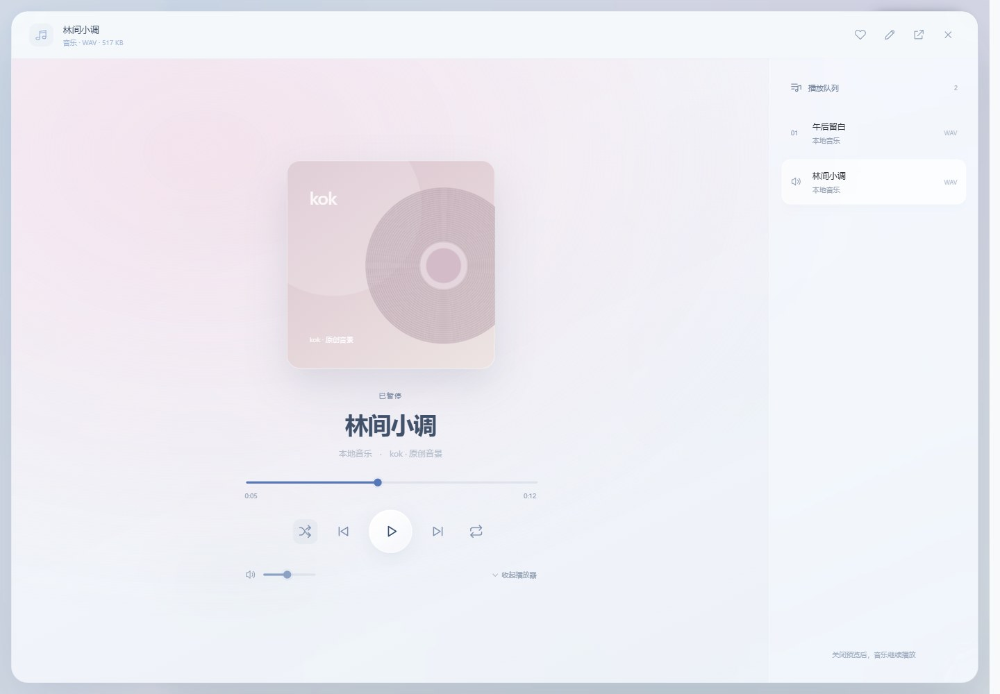
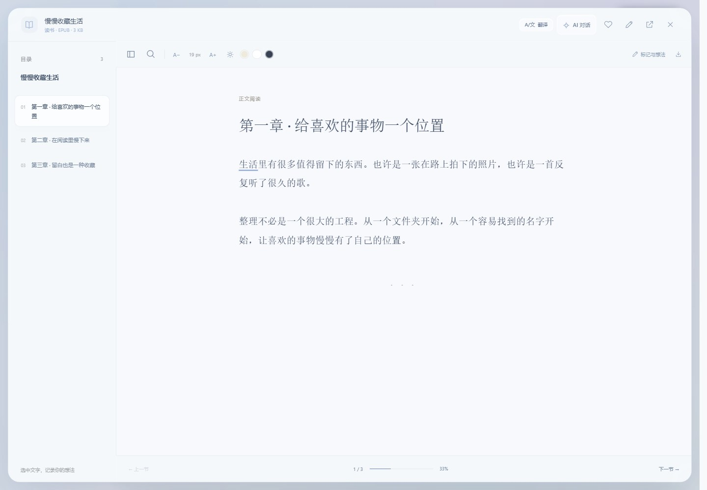

# kok changelog

[中文](CHANGELOG.md)

## v0.3.1 · Pure / Smart and a private folder

- First-run Pure / Smart selector, with a password-protected folder inside the ordinary library and consistent glass UI.
- Pure keeps offline basics and blocks AI natively; Smart explains content sharing and model setup on first use.
- Password-protected private folder inside the library with encrypted index, notes and covers; locks on deactivation, minimize or idle and exports encrypted backups. Original source files remain in place and are not encrypted.
- AI setup adds 12 entries, model discovery, local no-key servers and output-limit compatibility. Credentials use Windows DPAPI and are never reused silently across changed endpoints.
- Selected-folder scanning, AI category/tag previews, timeline/type/custom groups and streamed file chat for videos, documents and books.
- Orientation-aware previews, efficient streaming updates, translation fixes, original-file export protection, cancellation and private-content cleanup.
- Reviewed media, annotations, photo edits, responsive layouts, menus and modes; release packages use an allowlist and audit credential patterns and private files.

## v0.2.1 · Smooth menus, video covers and properties

- Settings and library sorting share animated glass menus with keyboard navigation, themes, Chinese / English and reduced motion.
- Imported and existing videos receive cached real-frame covers when idle. Extraction stays paused and muted, yields to previews or playback, and preserves source files.
- Video context menus show file name, location, size, modification date, and actual duration / resolution from the playback engine.
- Includes the previous local builds: consistent themes, expanded photo editing, configurable video shortcuts, borderless fullscreen, adaptive windows and large-video crash fixes.
- Organizes screenshots, development / testing instructions and version history, with Windows portable builds published through GitHub Actions.

Cover extraction requires a decodable video. This release adds no codecs and does not parse codec or multiple-audio-track details.

## v0.1.9 (local build): Themes, editing and adaptive windows

- Toolbars, settings, photo editing, notes and translation panels share the app theme. Reading follows the interface by default, with optional paper colors.
- Settings use staggered entry and interaction transitions, respecting reduced motion.
- Photos gain soft / vivid / mono / vintage presets, temperature, grayscale, sepia, vignette, crop position, vertical flip, original comparison, undo / redo and reset. Previews fit the window; exported copies keep the original unchanged and support up to 4096 px on the longest edge.
- Video preferences customize play keys (Space / K / P), seek keys (arrows / J L), seek distance (5 / 10 / 15 / 30 / 60 seconds), volume arrows and double-click fullscreen. Shortcuts respect input focus and persist across restarts.
- Photos, editing previews and PDFs adapt to live resizing. PDFs reuse their loaded document while preserving aligned text and annotations. Compact toolbars wrap, with collapsible contents and side panels.

## v0.1.8 (local build): Borderless video and one control row

- Retains the original blue ribbon K across the startup mark, sidebar and multi-size Windows icon.
- Video fullscreen now fills the current monitor with a borderless Windows window. Exiting restores the previous position, size and maximized state.
- One transport row contains playback, skip, time, seek, volume, settings, picture-in-picture and fullscreen. Speed, subtitles and silence acceleration live in a floating glass panel.
- Fullscreen controls fade out during playback and reappear on pointer movement. Double-click or press F to toggle fullscreen; Esc exits.
- Retains the v0.1.7 large-media range limit and crash recovery. Automated playback tests use engine-level silence without changing normal playback.

## v0.1.7 (local fix): Large-video crashes

- Fixes excessive allocations in the WebView2 response bridge when opening multi-GB media files, which could terminate the entire app.
- Video / audio range responses are capped at 4 MiB, preserving the real total size and 64-bit offsets for seeking. Large media requests without a byte range are rejected safely.
- Handles Range preflight and HEAD requests. Renderer crashes restore the library without reopening the video; browser-engine failures show a native error view.
- Bounded local diagnostics in `data/logs/kok.log` exclude file contents, API requests and credentials.
- This fix adds no decoders. HEVC, DTS and embedded subtitles retain their existing compatibility limits.

## v0.1.6 (local build): Playback and reading workspaces

- Video: unified playback controls, seek, 10-second jumps, volume, fullscreen, picture in picture, subtitles and speed settings.
- Music: full album-style player, queue, shuffle / repeat, seek and volume. Collapsing keeps music playing; expanding preserves the paused state and current queue.
- Documents and books: paper layouts, collapsible contents, literal search within the current chapter and reading progress, with existing insertion, highlights and thoughts preserved.
- PDF: page-number navigation, previous / next page, zoom and annotation tools. Scanned documents still require external OCR.
- Consistent glass toolbars and smooth transitions, with bilingual controls, dark mode, compact layouts and reduced-motion support. No interface click sounds.
- Versioned UI assets refresh after an update without resetting local data. Broader decoding remains on the roadmap; this build adds no new decoding engine.

## v0.1.5 (local build): New logo, format compatibility and drag-and-drop import

- Drop files or folders from File Explorer to recognize all five categories, import recursively and skip duplicates while preserving originals.
- Additional decoders are deferred as a [future development goal](ROADMAP.en.md). Common formats play inside kok; unsupported files offer an external-app action.
- A new blue and mint ribbon K, shared by startup, sidebar and multi-size Windows icons. Brand colors remain consistent in both themes.
- **Settings → Supported formats** distinguishes built-in viewers, codec-dependent media and external apps in both languages.
- Real decoding checks cover 25 original media fixtures. All 10 external text subtitle formats have parser tests.
- See the [complete format matrix and measured results](docs/FORMATS.en.md) for extensions and limitations. Importing a file does not guarantee every codec will play.

## v0.1.4: Chinese and English

- Choose **Settings → Interface language → 中文 / English**. The selection takes effect immediately and is remembered.
- Navigation, menus, settings, playback and reading controls, editing tools, tooltips, accessibility labels, notifications and application-owned dialog titles support both languages.
- File names, collections, document text, notes and translations keep their original content when you switch the interface language.
- Built-in help, export descriptions and release instructions are available in both languages.
- Includes the smoother startup and transitions, wider sidebar, glass surfaces and configurable AI translation from v0.1.3.

