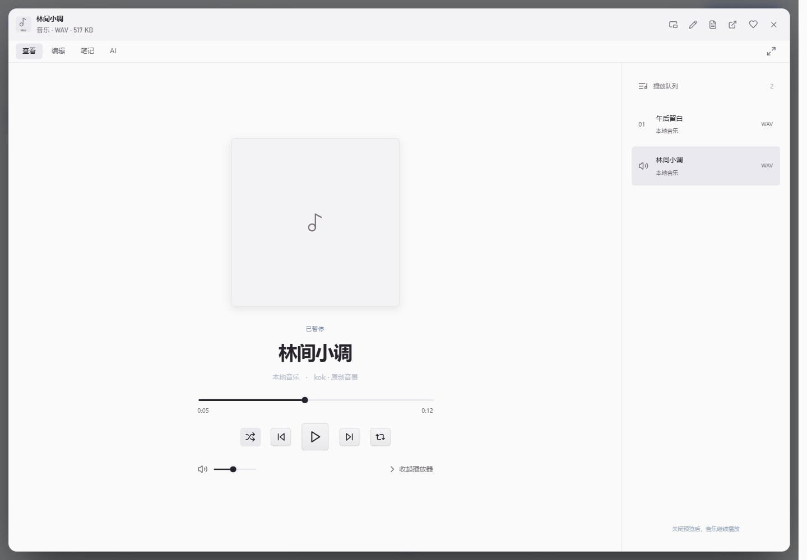
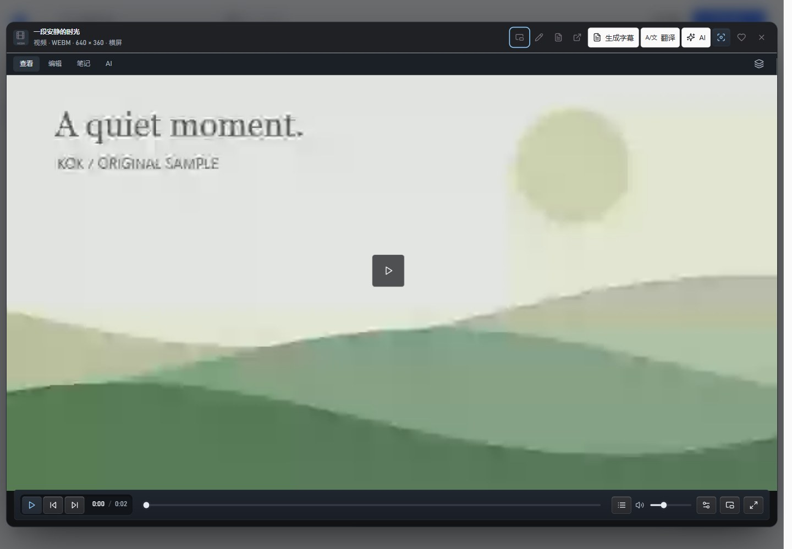
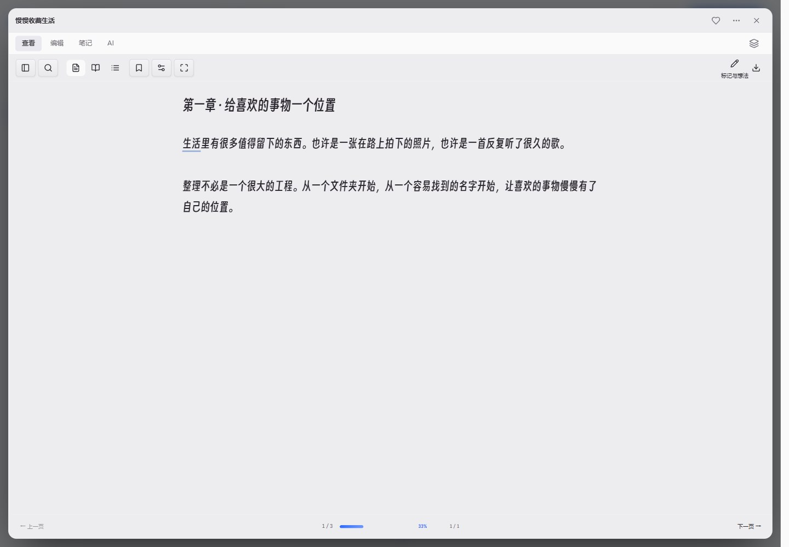

# kok 版本记录

## v0.11.1 · Preview

- PPT 制作接入 baoyu-design 明确以 Apache 2.0 授权的视觉指引，固定上游提交并保留原文和许可。默认杂志风格，四套主题、九种原生可编辑构图，预览、编辑器和导出保持字体与图形一致。
- 演示任务自动加载设计工作流；内容过密时要求精简或放入备注。对比、流程、卡片、指标等布局按信息任务选择，真实数据与备注保留；局部改稿仍只修改指定页。
- PPT 直接双击文字即可修改并自动保存，属性面板默认收起；左侧支持复制、拖动排序、删除与撤销，顶部合并为一个当前页 Agent 入口。保存后封面与章节标题保持正确。
- 输出上限与输入上下文超限分开处理；回答被截断时在原请求、费用与输出预留限制内自动调整，最多额外两次，避免无效压缩。长文档创作提高初始输出额度。
- 截断的正文或工具参数不会成为可执行提案；完整重生成后仍走原审批。流式响应保留末尾增量并记录尾部用量。
- 恢复卡片显示“回答未完成”，提供“分段继续”；填入原目标与分段要求，保留当前资料，不自动发送。其他失败后的继续入口也带回原目标。
- 见[功能说明](docs/OUTPUT_RECOVERY_0.11.1.md)与[验证记录](docs/VALIDATION_0.11.1.md)。

## v0.10.13 · Preview

- 创作项目 P4：完整验证三份资料、报告、手动改稿、选段交给 Agent、八页 PPT、重启后换会话续作、命名版本恢复与 DOCX / PPTX 导出。
- 项目默认范围纳入近期成果，避免成果可见却不能读取或修改；最多 24 份，显式选中范围和文件夹保持优先。
- 原生会话按任务事件序号同步，同一任务等待补充后继续时保留后续对话与既有成果，重复同步不重复消息。
- 真实流程和模型夹具边界见[验收说明](docs/CREATIVE_ACCEPTANCE_0.10.13.md)，结果见[验证记录](docs/VALIDATION_0.10.13.md)。

## v0.10.12 · Preview

- 创作项目 P3：成果面板合并原生项目成果、分支内的持久会话成果与当前对话成果，同一文件去重。切换分支、新建会话和重新打开软件后仍可继续预览实际文件。
- 会话恢复保留用户选定的历史分支；不把最近一次已完成任务的工具卡片重新放回分支。分支树增加可切换、可分叉的成果节点，迟到的成果及项目读取不会覆盖新会话。
- 历史版本支持命名检查点、重命名与移除；100 条历史版本限额内优先保留已命名版本。检查点元数据加密保存，失败时回滚缓存，原子替换保留上一份备份，正文不变。
- 验证范围与数量见 [v0.10.12 验证](docs/VALIDATION_0.10.12.md)；功能边界见 [持续创作](docs/CREATIVE_CONTINUATION_0.10.12.md)。P4 完整创作验收场景后续继续。

## v0.10.11 · Preview

- 文档版本面板：托管文档编辑器新增「版本」按钮，列出当前与历史版本（时间/标题/来源/状态），点选版本显示逐行差异（`+N/−M`），可恢复任一版本；恢复是补偿式新操作（可再撤销），恢复后编辑器正文/签名/保存状态同步；文本不可用格式显示 hash/大小；私密文件夹禁用。
- 手动保存前差异预览：保存按钮/Ctrl+S 且内容有变化时先显示「保存前确认」（已保存→将保存的逐行差异），取消不写文件并保持未保存，确认才写入；自动保存与失败重试逻辑不变。
- 局部改稿入口：文档中选中文字 →「让 Agent 改这段」；演示文稿当前页 →「让 Agent 改这页」。提示词只包含该片段/该页内容与“只改这里、保留其他部分”的约束，仅填充输入框并附带文档/演示上下文，不自动发送、不新建任务。
- 原生 action：`documentVersions` / `documentVersion`（含 `current` 哨兵）/ `documentVersionRestore`（写分类，拒绝 `current`）；UI 原生 action 目录同步。
- 边界：差异在本地计算（无模型请求）；版本列表最多 100 条、文本 diff 有行数/字符上限；DOCX 版本仅字节恢复+hash；命名检查点/PPT 版本对比未做；审批、证据核对、撤销与沙箱语义不变。
- 验证记录见 [v0.10.11 验证](docs/VALIDATION_0.10.11.md)。

## v0.10.10 · Preview

- 创作项目（第一版）：扩展“空间”为项目实体（`kind="project"`：目标、风格/验收要求、状态、资料、成果、相关会话），在「我的作品」新建/编辑项目、打开详情、随时继续创作；项目存于既有 workspace + Operation 审计/撤销链路，无新存储表。
- 从项目继续创作：`AgentUi.openProject` 新建会话并显示项目横幅（目标/资料/成果数，可清除、跨新建会话保留）；`agentTaskStart` 新增可选 `projectId`，宿主校验项目、把目标/要求/资料数/已有成果构成 ≤4000 字项目简报注入 guidance 稳定前缀（同任务内字节一致、利于缓存），未显式指定范围时自动使用项目资料（≤24 份）；项目里发起任务时显式范围不被覆盖。
- 会话/成果回写：任务启动把会话写入项目 `sessions`，任务终态把创建/修改的成果写入 `artifacts`（去重、可审计/可撤销、失败不影响任务）；成果面板在有项目时优先展示项目成果，切新会话仍可见，不再只依赖当前对话。
- 版本历史原生底座（UI 下一轮）：`ListVersions`/`ReadVersion`/`RestoreVersion`——从 Operation + 加密版本文件列出作品版本、读取前后文本（MD/TXT/DOCX）与 hash、以补偿式新操作恢复任意版本（可再撤销；私密文件夹禁用）。
- 边界：项目是空间记录（“空间”页暂也会列出，后续过滤）；项目简报由宿主生成、标记为不可信数据；本轮未接版本 UI 与手改 diff；审批、证据核对、撤销与沙箱语义不变。
- 验证记录见 [v0.10.10 验证](docs/VALIDATION_0.10.10.md)。

## v0.10.9 · Preview

- Codemode：被批准的 `run_code` 现在可在 QuickJS 沙箱内通过 `tools.search_library` / `tools.read_items` / `tools.recall_result` / `tools.search_memory` / `tools.list_collections` 调用**只读**资料库工具，并把多次检索/读取组合成一段计算；仍沿用原有沙箱与限制（无文件/网络/DOM、16MB、7 秒、输出 ≤16000），无新增写入或审批能力。实现采用同步 QuickJS 的“先记录请求、宿主批量执行、带缓存重放”协议（每批 ≤8、每次 ≤24、单结果 ≤8000、累计 ≤32000、最多 6 轮）；嵌套读取是临时证据、不写回执/journal。用法见 [Codemode](docs/CODEMODE_0.10.9.md)。
- Headless RPC：`kok-agent.exe --rpc` 启动长期运行的 JSONL 命令循环（`ping` / `prompt` / `steer` / `follow_up` / `abort` / `state` / `compact` / `shutdown`），stdout 串行输出 `response` / `event` / `result` 行；同一进程一个任务、只读策略、支持每任务超时；EOF/Ctrl+C/参数组合错误有明确退出码。适合编辑器、CI 与外部工具驱动。协议见 [Headless RPC](docs/AGENT_RPC_0.10.9.md)。
- 原生 action 新增 `agentSandboxTools`（嵌套只读批次，白名单/上限/ticket 校验）并同步 UI 原生 action 目录；`run_code` 工具描述更新，Schema 与审批卡片不变。
- 边界：`tools.*` 仅只读、结果不可作为 `finish_task` 当前回执；RPC 只读、不加载历史会话；事件契约、任务/会话数据格式不变；审批、证据核对、撤销与沙箱语义不变。
- 验证记录见 [v0.10.9 验证](docs/VALIDATION_0.10.9.md)。

## v0.10.8 · Preview

- 声明式扩展包：扩展包目录（`plugin.json`）可打包 Agent Skills 的 `SKILL.md` 技能与 Markdown 提示模板；从 `<程序目录>\ui\plugins`、`%USERPROFILE%\.kok\plugins`、`<资料库>\.kok\plugins` 发现（同名先到先得），最多 32 个、清单 ≤64KB、路径必须留在包内；技能进入 `<available_skills>` 与 `load_skill`，提示模板可用 `/prompt:名称 参数` 展开到输入框。**不执行任何脚本/代码**，未知字段仅作为惰性数据忽略。
- Agent 页新增「扩展包」面板：列出已安装扩展包（名称/版本/说明/技能与模板数）、已发现技能数与提示模板列表，支持「重新加载」热更新（同时刷新技能选择器）；`/prompt:` 只填充输入框，不自动发送、不持久化原始命令。
- 原生 action：`agentPluginsList` / `agentPluginsReload` / `agentPromptRead`；`AgentSkills.Discover` 支持额外（扩展包）技能根与 `load_skill` 读取；提示模板支持 `$ARGUMENTS` 替换与无占位符追加。
- 边界：扩展包为纯声明式文本，无代码入口、无网络/文件 API、无钩子注册；模板/技能仅进入提示词或输入框；事件契约、任务/会话数据格式不变；审批、证据核对、撤销与沙箱语义不变。
- 验证记录见 [v0.10.8 验证](docs/VALIDATION_0.10.8.md)。

## v0.10.7 · Preview

- 无界面 Agent CLI：`kok-agent.exe --goal "…" --print|--json`（`kok.exe agent …` 为同一实现）在不打开窗口的情况下运行一次只读任务，复用同一套原生引擎、加密任务记录、检索与证据核对。`kok-agent.exe` 是控制台子系统启动器，脚本/CI 可直接获得可靠退出码与顺序输出；JSON 模式输出 `header → event → result` JSONL，print 模式只输出最终回答；退出码区分 completed/partial/失败/中断；支持 `--data-dir`、范围、预算、请求上限、上下文、超时与会话命名。用法见 [Agent 无界面 CLI](docs/AGENT_CLI_0.10.7.md)。
- 提供方缓存键（可选）：AI 服务高级设置新增「启用提供方缓存键」，开启后按会话在同一任务内发送 `prompt_cache_key`（仅普通 tools 请求；压缩、JSON 协议与翻译请求不带）。默认关闭，服务商不支持时无副作用。
- 缓存命中展示：Agent 用量行在 `cachedTokens > 0` 时显示 `缓存命中 {tokens} tokens · {percent}%`。
- 边界：无界面入口只读，写入仍走桌面逐卡审批；`--approval` / `--allow-writes` 被拒绝；不加载历史会话；无 headless RPC（后续）；事件契约与任务/会话数据格式不变；审批、证据、撤销与沙箱语义不变。
- 验证记录见 [v0.10.7 验证](docs/VALIDATION_0.10.7.md)。

## v0.10.6 · Preview

- Agent 分支树 UI：工具栏新增「分支树」，打开会话分支面板，按父子顺序缩进展示消息预览、当前分支标记、上下文摘要（compaction）与标签（label）；任务记录以轻量行显示。
- 原地切换分支：在任意消息节点点「切换到此」调用 `agentSessionSwitch`，界面历史从原生会话投影重建（user/agent 消息），清空草稿/待接续任务状态，后续任务沿该分支继续；运行中禁止切换。
- 任意节点分叉与重命名：树面板可直接从节点分叉（复用 `agentSessionFork`），可内联重命名会话（`agentSessionRename`，1–64 字符），`/tree` 快捷打开分支面板。
- 原生支持：新增 `ProjectionMessages`（保留 compaction `firstKeptEntryId` 语义并返回 entry id）；`agentSessionProject` / `agentSessionSwitch` / `agentSessionFork` 的消息带 `id`；`agentSessionTree` 的条目增加 role、160 字符单行 preview、label target、compaction reason（均为 additive）。
- 边界：切换只重建 user/agent 消息视图，分支内旧工具卡片不会重放；本版不做 LLM 分支摘要（`branch_summary` 结构保留）；事件契约与任务/会话数据格式不变；审批、证据核对、撤销与沙箱语义不变。
- 本版补齐 M1（技能目录 + 会话树 UI）。验证记录见 [v0.10.6 验证](docs/VALIDATION_0.10.6.md)。

## v0.10.5 · Preview

- Pi / Agent-Skills 风格的技能目录：递归发现 `ui/skills`、`%USERPROFILE%\.agents\skills` 与资料库 `.agents/skills` 下的 `SKILL.md`；解析 frontmatter 的 name / description / disable-model-invocation，正文上限 20000 字符，最多 100 个技能，结果按文件 revision 缓存。启动时只把 `<available_skills>`（名称、描述、位置，XML 转义）注入提示词，模型需要时通过只读 `load_skill` 工具加载全文（不可信参考文本，不执行脚本）。
- 原生 action：`agentSkillsList` / `agentSkillsReload` / `agentSkillRead`；Agent 页技能选择器新增“已发现的技能”分组与“刷新技能”按钮；输入 `/skill:名称 参数` 可直接用该技能发起任务；选择技能时只发送 `[Skill: name] Use load_skill ...` 的简短指令，全文由工具按需载入，保持提示词前缀稳定。
- M0-4 内部扩展缝：新增 `AgentToolHooks`（PrepareRequest / TransformContext / BeforeToolCall / AfterToolCall / FinishTurn）与 `AgentToolSpec.Mode`（串行/并行执行）、`TerminateHint`（预留）；钩子为空时行为与之前完全一致，为后续声明式扩展与工具中间件铺路。
- 边界：技能只读文本、不执行任何脚本；同名技能按 app → user → library 先到先得；app 根下的四个内置 workflow 也会进入提示词索引；事件契约、任务/会话数据格式不变；审批、证据核对、撤销与沙箱语义不变。
- 验证记录见 [v0.10.5 验证](docs/VALIDATION_0.10.5.md)。

## v0.10.4 · Preview

- Pi 式上下文压缩：触发改为基于最近一次真实请求用量（input+output + 之后内容的尾部估算），并支持 `reserveTokens` / `keepRecentTokens` 配置（0=自动）；按 token 预算从最新回合往回保留最近内容，旧回合整体压缩，不把一次工具调用与其结果拆开。上下文过滤随后更新：保留首条用户目标消息，旧回合与旧用户指令进入摘要。
- 摘要格式改为固定六段（Goal / Constraints & Preferences / Progress / Key Decisions / Next Steps / Critical Context）+ `<read-files>` / `<modified-files>`；旧摘要以 UPDATE 方式合并；工具结果单条截断到 2000 字符；摘要内容语言跟随任务目标。
- 手动压缩 `agentTaskCompact`（任务运行中可用，instructions ≤400 字符）；模型上下文溢出时发出 `context.recovery`，自动压缩并重试一次，失败不再次重试。压缩请求以 `purpose=compaction` 记录，不覆盖上下文用量基线。
- 压缩结果写入原生会话树为 `compaction` 条目（含 `firstKeptEntryId`、`tokensBefore`、reason、读/改文件清单）；会话投影与 fork 按 Pi 语义从保留边界读取，摘要作为不可信的 assistant 消息进入投影。
- 快照新增 `contextUsage`（tokens/window/reserveTokens/keepRecentTokens/percent/source/lastCompaction）；Agent 页显示上下文用量（实测/估算）、运行中的「压缩上下文」按钮与可折叠摘要（不可信标记）；高级设置可配置预留与保留 token。
- 边界：自动压缩需要至少 2 个剩余请求，手动与溢出恢复需要 1 个；摘要结果要求 20–6000 字符；事件契约升级为 v3（旧任务记录原样可读）；不实现 Pi 的用户消息内切分（保留首条目标消息），`stopReason=length` 与 overflow 共用一次恢复路径。不改变审批、证据、撤销与沙箱语义。
- 验证记录见 [v0.10.4 验证](docs/VALIDATION_0.10.4.md)。

## v0.10.3 · Preview

- Agent 会话树（原生）：每个会话写入本机加密的 append-only 记录（`<data dir>/agent-sessions/<sessionId>.jsonl.sealed`，逐行 DPAPI），包含消息、任务标记、usage/model/label 等 Pi 式条目与 leaf 分支指针；支持列出、读取、树、投影、切换 leaf、fork、clone、重命名、删除与标签。旧版界面会话（`agent-sessions.sealed`）在首次访问时一次性导入为线性记录，原文件保留。
- 会话操作 action：`agentSessionList` / `agentSessionTree` / `agentSessionProject` / `agentSessionFork` / `agentSessionSwitch` / `agentSessionRename` / `agentSessionDelete` / `agentSessionLabel`；任务启动新增 `sessionLeafId`，用于把新消息挂到当前分支。终端任务的事件在会话操作时幂等同步进会话树（任务标记去重）。
- UI：每条用户或 Agent 消息旁新增「从此处分叉」；分叉生成新会话，只保留该消息之前的消息，并用原生分支投影作为下一次任务的模型历史；分叉标题在同一会话保存后仍然保留。旧版会话仍按原界面存储渲染。
- 边界：每库最多 64 个原生会话、每会话 4096 条 / 8 MB；凭据与记录使用当前 Windows 账户 DPAPI，不跨账户/机器迁移；fork 产生新会话而不是 Pi 的原地 `/tree` 切换（留待 M1）；compaction / branch_summary / context_edit 条目为 M0-3 预留。本版不改变审批、证据核对、撤销与沙箱语义。
- 验证记录见 [v0.10.3 验证](docs/VALIDATION_0.10.3.md)。

## v0.10.2 · Preview

- Agent 任务输入与 Pi 对齐：运行中按 Enter 插入 steering（在下一个工具批次后进入同一任务，不打断正在生成的回复、不跳过待确认工具）；时钟按钮把输入排为 follow-up（任务自然结束时继续同一任务，而不是另起新任务）；停止、失败或达到请求上限时，未执行的输入原样放回输入框。原生 action 为 `agentTaskSteer` / `agentTaskFollowUp`，任务快照新增 `queue` / `restoredInputs`。
- 事件契约升级为 v2（`input.queued` / `input.consumed` / `input.restored`）；旧任务记录按原状态读取，不重写既有加密事件。
- 会话输入区与队列抽屉更新：运行中显示“待处理 · N”和“下回合插入 / 完成后跟进”标签；停止后输入回到输入框，而不是留在本地待办并另起任务。
- 本版不改变资料、文档与作品数据格式；验证记录见 [v0.10.2 验证](docs/VALIDATION_0.10.2.md)。

## v0.10.1 · Preview

- 一级入口按使用场景重组为 Agent、我的作品、资料库；文件类型和工具移入各自区域内部。侧栏只保留三个目的地、私密文件夹和设置；旧路由（今天、空间、摘录、智能集合、配方、回顾、下载、智能整理、知识图谱等）继续可用。
- 新增“我的作品”：新建 MD / DOCX / TXT / PPTX 复用现有新建文档流程；继续编辑在 kok 中新建或修改过的内容；进入项目空间、素材摘录和创作配方；从已有视频、音频、PDF、文档进入现有剪辑或页面整理流程。在 kok 中新建的演示文稿同样记为可继续编辑的作品。
- “资料库”首页新增继续观看与阅读、收藏 / 最近打开、分类，以及资料库工具（智能整理、视频下载、知识图谱、智能集合、回顾、操作历史、活动、资料检索与备份）；类型筛选仍留在资料库内，观看、收听、阅读、字幕、书签与播放队列保持独立。
- Agent 首页与后台播放继续共存：播放条为输入区留出空间，通知避开发送按钮；空白任务与对话布局、附件导入和更多菜单沿用上一轮实现。
- 本版不改变数据格式；小说章节 / 设定管理与音视频从零生成仍分阶段接入。验证记录见 [v0.10.1 验证](docs/VALIDATION_0.10.1.md)。

## v0.9.8 · Preview

- 界面改版：统一偏白浅色与微紫深色主题，移除欢迎页的宣传段落、重复入口说明和多余标签；所有窗口宽度保留短侧栏，文件类型留在资料库工具栏；「更多」改为三列图标面板，收藏、最近打开、分类位于第一排；导航与工具入口采用离线 Phosphor 双层填充图标，保留原始几何与 MIT 许可。
- 动效从当前帧续接；菜单 200ms 打开、120ms 退出，关闭立即释放输入；筛选保留按钮和焦点，排序使用平移，修复退出时内边距与圆角变化引起的跳动，并尊重减少动效设置。
- Agent 首屏围绕资料与结果：默认只保留资料、要求、按资料给出的建议操作与发送/停止；技能、用量档位、调用协议和资料范围收进默认折叠的「高级设置」；选中资料后范围自动按所选执行。
- 新增原生只读动作 `agentLocalPlan`：统计、列表/筛选、分类概览、标签概览和文件类型分布等显式只读请求由本地规则直接回答，零模型请求、零网络、零写入，未配置 API 密钥也可用；生成、比较、建议类请求继续交给模型。
- 检索改为片段级：同一份长文件最多返回 3 个带页码 / 章节 / 字幕时间锚点的命中片段（默认总计 12，上限 24），`read_items` 返回每份来源的读取覆盖与有界摘要；每轮目录按用户所选资料 + 与目标相关的本地词面候选组织，并在任务内固定。知识面板与 MCP 检索保持每文件一条。
- 工具调用消息改为「稳定前缀 + 动态尾部」：回执索引、检查点与任务指导移到最后一条宿主状态消息，历史与已发生轮次保持追加式前缀；JSON 兼容协议不变。
- 任务结束新增成果卡片（状态、使用资料数、来源引用数、打开文档 / 查看来源 / 继续修改），本地任务显示「本地完成 · 未调用模型」卡片并保留 AI 后续入口；批量整理先汇总将改动的项目再确认。
- 新增 30 项固定任务样本、离线校验器和可选的真实模型评测入口；本轮未执行真实模型评测，不给出节省比例。见 [Agent 聚焦](docs/AGENT_FOCUS.md) 与 [评测基线](docs/AGENT_TASK_EVAL.md)。
- 验证：**608 项原生检查**、**16 组桌面套件**与**交付包复验**通过；用户授权的同批 30 项真实模型前后对比：请求 **100 → 76（−24%）**、输入 token **566,586 → 431,132（−24%）**、保守费用 ¥2.68 → ¥2.11，通过数 26/30 持平，节省主要来自本地任务分流；两轮共 190 次请求，项目请求总账 359 → **549**。版本同步至程序、包元数据及浏览器扩展；方法、未达项与边界见[验证记录](docs/VALIDATION_0.9.8.md)与[评测基线](docs/AGENT_TASK_EVAL.md)。

## v0.9.5 · Preview

- 紧凑侧栏：≤820px 只保留今天、Agent、全部文件、空间和「更多」，加上底部设置；图标从 18px 提到 20px，点击目标从 36px 提到 40px，650×520 下不再需要滚动。文件类型筛选留在资料库工具栏，避免和侧栏重复。
- 「更多」浮层从顶部栏下方展开，只显示目的地名称和分隔线；私密文件夹、收藏、最近打开、配方、回顾、知识图谱、新建分类仍可达，当前隐藏入口让「更多」保持活动态。
- 字体与焦点：图标提示 11px→12px，顶部搜索模式、侧栏分组标题与计数 11px→12px；菜单首个项目去掉外框，只保留行高亮；补充 `aria-haspopup`。
- 动效：面板在打开动画中途关闭时保留当前 transform，不再跳回 0；导航指示条只动画 transform/opacity，时长 500ms→240ms；减少动效模式下禁用相关 transition。
- 验证：**542 项原生检查、25 组界面/回归桌面套件、14 组包级门禁**；逐页审计 120 张截图。真实模型总账保持 **359**，本版无新增模型调用。见[验证](docs/VALIDATION_0.9.5.md)。

## v0.9.4 · Preview

- 扁平界面改版：统一视觉语言、分组导航、文件卡片/列表、阅读与媒体工具栏、空状态与创建入口；深浅主题、中英文和 650px 窄窗口逐页复核。旧 classic/graphite 皮肤偏好保留可读，但统一渲染为扁平界面。
- 可访问性与交互：键盘文件导航、Space/Shift 选择、Ctrl+F 搜索、锚定菜单与焦点恢复、减少动效偏好；Lucide 0.468.0 离线图标子集（ISC，许可与来源哈希随包）。
- 英文切换修复：organization 页在后台刷新重绘后仍保持英文；文档私有文件夹与关闭刷新测试稳定化。
- 验证：**542 项原生检查、25 组界面/回归桌面套件、14 组包级门禁**；120 张逐页截图，几何/运行时问题均为 0。真实模型总账保持 **359**，本版无新增模型调用。见[验证](docs/VALIDATION_0.9.4.md)与[界面验证](docs/INTERFACE_VALIDATION.md)。

## v0.9.3 · Preview

- 本地 MCP 沙箱：每个 stdio 服务可指定用户可写便携运行时目录并启用 AppContainer；主程序授权只读执行 ACL，Node.js 自动补充 symlink 标志；系统目录/不可授权目录明确拒绝且不静默降级。新增复制 Node 运行时的原生 CI 门禁。
- MCP OAuth 设备码（RFC 8628）：user code/验证地址、authorization_pending/slow_down/过期/拒绝处理、DPAPI 令牌与 refresh；设置中可选浏览器回调或设备码。
- PDF/视频批量索引：审批型 `index_pdf_pages`（PDFium 文本层，最多 25 页）与 `index_video_frames`（FFmpeg + Windows OCR，最多 12 帧）合并进本地内容索引；不调用模型、不改原文件、源变化失效。
- 542 项原生检查与 11 组桌面套件通过；真实模型总账保持 359，本版未新增模型调用。见[验证](docs/VALIDATION_0.9.3.md)与[能力边界](docs/AGENT_0.9.3.md)。

## v0.9.2 · Preview

- 远程 MCP OAuth：授权码 + PKCE、受保护资源/授权服务器元数据、动态客户端注册、回环回调、refresh token、401 单次刷新重试；令牌 DPAPI 加密，界面不显示明文。
- PDF 页与视频帧视觉：`read_image` 支持 `page`（PDFium 本机栅格化，页码/大小受限）与 `time`（可选 FFmpeg 抽帧）；DPAPI 帧缓存、源变化失效、无视觉模型时同一帧 OCR 回退。
- Windows AppContainer 沙箱：审批命令 opt-in 后无网络、无用户文件访问、只可写工作目录；本地 stdio MCP 可逐服务启用；结果明确标注模式，沙箱失败不静默回退。
- 新增 PDFium（BSD-3-Clause）依赖：GitHub 归档 + DLL 双重 SHA-256 锁定，随包携带完整 NOTICE；FFmpeg 仍按需安装。
- 527 项原生确定性检查通过；未新增真实模型调用（总账 150）。见[验证](docs/VALIDATION_0.9.2.md)与[能力边界](docs/AGENT_0.9.2.md)。

## v0.9.1 · Preview

- Agent 视觉输入：`read_image` 以受限 JPEG 图文消息交给支持图片的模型，未启用时回退 Windows OCR；图片字节不写入任务日志。
- Agent 联网读取：`fetch_url` / `web_search` 逐次审批，SmartReader 提取正文，HTTPS/内网/重定向/大小/类型限制，搜索需自备 SearXNG 兼容端点。
- 受控执行环境：可选工作目录内的文件读写与命令执行，默认关闭、逐次审批，路径穿越/大小/超时/输出限制与 Job Object 进程管理。
- 长任务与计划：24 轮/请求、48k/64k 档位、128k 上下文设置、8k 输出；NCrontab cron 计划任务与托盘完成通知。
- 记忆增强：本机 embedding 语义召回、DPAPI 向量缓存、近似记忆合并与来源失效；记忆仍需批准。
- 并行编排：`delegate_parallel` 单卡启动 2–3 个只读子代理，共享父预算，报告汇总后仍由父任务核对。
- 预算与依赖：SharpToken（tiktoken）估算 + 保守边际 + 校准；新增 SmartReader/AngleSharp/NCrontab 等锁定依赖与许可。
- 远程 MCP：Streamable HTTP + DPAPI 加密 Bearer 令牌，复用逐工具审批与不确定结果规则；不含 OAuth。
- 本版未新增真实模型调用（总账 150），494 项原生检查与 11 组桌面套件见[验证](docs/VALIDATION_0.9.1.md)与[能力边界](docs/AGENT_0.9.1.md)。

## v0.9.0 · Preview

- 新增版本化内容片段、来源锚点、PDF 文字层 / 字幕 / 独立摘录索引、增量失效与覆盖 / 失败面板。
- 本机 Ollama embedding 与 FTS5 混合检索，搜索和 Agent 共用；缓存按模型 / 版本区分，不可用时明确回退。
- 标准 ZIP 便携资料包，提供 Markdown / JSON、稳定 ID、可选原件、哈希校验、新库恢复、根映射与可撤销路径重连。
- 新增 Inbox 快速记录、Chrome / Edge 源码采集扩展、URL / 时间 / 指纹、重复内容复用、完全相同文件检测和按需 Windows OCR。
- 新增默认关闭、明确来源范围的只读 stdio MCP server；采集和读取分别配对，私密 / 切库时拒绝读取。
- Agent 增加流式中断正文保留、版本化事件、有限任务批准 / 只读策略、token 估计校准、精确算术和连续批准写入核对。
- 固定质量回放纳入门禁；真实 DeepSeek 与本地检索独立验收、记录失败和构建指纹。中英文说明、启动诊断、MCP 和包版本统一。
- 范围、验收和未提供能力见[新功能指南](docs/LIBRARY_0.9.0.md)与[验证](docs/VALIDATION_0.9.0.md)。

## v0.8.2 · 未单独发布的开发阶段

- 新增语义检查点与准确结果回查、带来源及版本的加密长期记忆、经确认的只读子代理、离线 QuickJS/WASM 隔离计算及产物保存。
- 父子任务、摘要与重试共用原预算；任务级工具权限、停止 / 恢复、父子记录清理和中英文管理界面。

- Agent 新增持久计划与显式结果核对；区分完成、部分完成、缺少信息和预算耗尽，核对实际工具依据。
- 按类型处理 HTTP / 网络错误，有限退避与取消；只有明确拒绝工具参数才回退 JSON。新增逐请求指标和脱敏诊断导出。
- 新增本地 stdio MCP 管理、工具 schema 审核、配置加密、逐次调用确认、指纹变更检查与子进程生命周期管理。
- Agent 面板、MCP 设置和错误补齐中英文与小窗；新增原生 / 桌面检查、默认 Agent 回归、独立 UI CI 作业及可选六例真实模型评测。
- 修复完成后撤销仍显示核对成功、补充要求仍保留完成计划；本地依据变更会使旧核对失效。需要信息可在原任务补充；所选资料保持选择顺序。
- MCP 参数 / 工具名错误进入有限修复轮，保留实际错误正文与本地结果；外部调用排除批量批准，追踪增加费用列。桌面与 ZIP 验证记录版本和源码 / 运行文件指纹。
- 保留纯净 / 私密边界和本地写入审核；未引入大型 Agent 框架。当前不自动发布，范围与限制见 [v0.8.2](docs/AGENT_0.8.2.md)。

## v0.8.1 · Preview 预览版

中文 · [English](CHANGELOG.en.md)

- 文档与 PPT 的实际实现迁入 ES modules；草稿串行保存，入口 / 格式 / Ctrl+N 跟随模块状态。
- 合并共用查看器和照片布局样式归属，保留工具栏节点与焦点，修复键盘误翻页、侧栏留白和大小窗口按钮状态。
- Agent 会话、渲染与任务实现迁入真正的 ES module；删除三个旧全局脚本，停用 / 重启保护草稿，串行合并保存。
- 修复超过 5,000 个全文结果时智能集合与 Agent 范围筛选漏资料的问题；后台搜索合并请求并隔离旧资料库结果。
- 所有业务动作经过原生注册表；窄上下文、强制参数 / 策略声明、模块管理与能力清单。
- SQLite 核心资料、分面、统一关系和 FTS5 中文搜索；保留原 JSON 和迁移备份，私密库内存处理后加密保存。
- 全局操作审核、冲突安全撤销、托管文件字节版本；完整历史分页和导出。统一活动管理进度、取消和受支持的暂停 / 续跑。
- 今天、上下文检查器、带来源的摘录、四种空间视图、智能集合、可编辑配方和每日回顾；AI 摘要有输入 / 输出上限与缓存。
- Agent 模块工具可异步调用字幕能力，继承任务取消并产生可审核、可撤销的回执；不自动安装模型。
- 工作区、摘录和查看器迁入 ES modules；42 份源样式生成 9 个有序运行时包。默认得意黑。
- 修复独立窗口编辑 / 阅读切换、页签反馈、实际鼠标拖放和编辑右键菜单范围；大集合按页显示，每页最多 120 张卡片。
- 本地预览，不发布。实际覆盖及兼容层剩余工作见 [v0.8.1 进度](docs/WAREHOUSE_0.8.1.md)。

## v0.7.2 · 本地预览，未发布

- 默认改为经典拟物界面：皮革缝线侧栏、亮面导航栏与按钮、木质书架、相框照片和对话气泡；石墨风格可在“设置 → 界面风格”切换。更换应用标识。
- Agent 有多项待确认时可“全部执行 / 全部跳过”。
- 新增 Agent 首页（智能模式默认启动，可在设置改回资料库）：读取资料、搜索与查看分类自动进行；移入分类、添加标签、写入笔记、新建文档和演示文稿逐项确认后执行，可跳过和撤销。原文件不修改，不发送本地路径，私密文件夹与纯净模式禁用。
- 合并入口：资料库“AI 工具”、查看器“AI 对话”、图谱分析和智能整理统一交给 Agent；多文件对比、笔记回顾与批量归纳保留在 Agent 页。
- 界面默认改为正体（微软雅黑 / Segoe UI），得意黑只用于标识和页面大标题；资料库中数量少的分区并排显示。
- 通过 168 项原生检查与新的 Agent 隔离界面测试（本地模拟模型，不消耗真实额度）。见 [Agent 说明](docs/AGENT_0.7.2.md)。

## v0.7.1 · 本地预览，未发布

- 右键先显示简短编辑菜单，再进入 AI 修改；恢复复制 / 剪切 / 粘贴 / 全选与键盘操作，明确修改范围、Esc 焦点返回、点击外部关闭、要求变化后清除旧结果；修正 PPTX 选词范围及后台刷新使排序菜单消失的问题。
- 图谱范围、交集筛选、保存视图；限定资料的 AI 找关联、总结和提问，支持发送预览、用量上限、取消和结果复用。
- 资料库按类型有序陈列；56 种导入格式的矢量印记与受控反馈动画，私密文件夹图形居中。
- PPTX 预览、目录、备注、放映、基础文字和页面编辑、草稿、撤销及另存 PPTX；复杂办公排版不能完整还原，旧版 PPT 仍需系统应用。
- 右键选中文字或幻灯片对象进行 AI 修改，先预览、再应用、可撤销；切页或源内容变化时取消。可导入简短 SKILL.md 指令，按需使用，不执行脚本。
- 保留默认得意黑与现有功能；增加按需加载的 PPTX 导出浏览器组件，无 Office、Remotion 或新增解码器运行时。验证与范围见[PPTX / Agent 说明](docs/PRESENTATION_AGENT_0.7.1.md)。

## v0.6.2-r2 · 质量修订预览版

- 默认配色与材质改为单一来源，修复自定义颜色关闭后的残留；保留独立阅读纸色和字体。石墨组件中的强制覆盖从 30 处减至 4 处，剩余用于交互和减少动态效果。
- 统一窗口动画入口；动画中途开启减少动态效果、隐藏页面或拖动缩放窗口时直接落定，避免加载完成后重播入场。
- 每个窗口的页面保存快照增加 5 秒超时；失败后默认保留窗口与编辑内容，恢复后可重试。补充私密文件夹加密范围、内置字体继承和编辑导出范围提示。
- 通过 132 项原生检查与 7 组隔离静音界面测试，包括真实退出超时、拒绝关闭、文字保留和恢复退出。应用版本仍为 v0.6.2，修订版使用独立发布标签。

## v0.6.2 · 石墨预览版

- 新增石墨 / 霜面界面、宽侧栏与小窗口图标栏、标题封面和唱片；默认字体恢复内置得意黑，修复样式覆盖手动字体选择。
- 统一视频、照片和音乐播放条；修复浅色界面中媒体按钮的对比度、提示灯缺失和阅读滑动指示隐藏，保留真实音乐封面与自定义配色。
- 消除重复弹窗动画，保留平滑中断、稳定图谱和阅读位置；纳入此前本地预览的知识图谱、双向链接、文档创建、模板、自动保存与窗口修复。
- 完成隔离静音回归与源码 / 包隐私检查。见[版本说明](docs/GRAPHITE_0.6.2.md)。

## v0.6.1 · 本地预览，未发布

- 重做图谱与笔记动画：布局后台收敛后淡入，缩放保留当前视图和速度、滚轮锁定鼠标锚点，筛选不重排、节点拖动后不回弹；设置尺寸固定，侧栏 / 内容单一动画控制，补全原位更新，弹窗反向衔接与文档就绪后一次入场。见[动画说明](docs/MOTION_0.6.1.md)。
- 新增本地知识图谱、全局 / 当前笔记关联、拖动缩放和筛选；双向链接补全、未创建笔记、反向链接、标签、大纲、待办与日常 / 会议 / 阅读模板。Worker 布局稳定后停止，关闭时释放；纯净模式可用，私密文件夹排除。见[笔记说明](docs/KNOWLEDGE_0.6.1.md)。
- 新增“新建文档”与 Ctrl+N：创建 Markdown、Word（DOCX）和 TXT，选择分类，创建后编辑；支持源码 / 编辑视图与预览、自动保存、Ctrl+S、关闭保存及重开。直接保存限于新建文档，重名自动编号；外部修改时保留恢复草稿并停止覆盖。见[功能说明](docs/DOCUMENTS_0.6.1.md)。
- 阅读闲置收起上下工具栏与进度条，消除边缘色带，支持边缘 / 键盘唤回且不重新分页；统一照片编辑的深色配色、清晰字体、选中状态和尺寸菜单，修复标题栏遮挡编辑按钮，小窗改为上下布局。见[阅读与照片编辑](docs/WORKSPACE_CLARITY_0.6.1.md)。
- 新增设置下划线、阅读布局与侧栏标签滑动、收藏/书签图标反馈、菜单退出、侧栏及消息轻量动画；照片缩放与旋转平滑过渡，拖拽即时跟随。
- 统一动画中断与退出清理，快速反向操作采用最新状态；移动、缩放窗口与“减少动态效果”时跳过新增动画。参考来源和范围见[动画说明](docs/MOTION_0.6.1.md)。
- 修复纯移动触发排版、重新聚焦闪动、阅读缩放时宽度滞留、PDF 缩放空白与重复渲染；保留文字锚点、工具栏材质和固定窗口按钮。
- 修复分页切回上下滚动后残留的横向滚动条，补测动画中途关闭文件、开启减少动态效果与照片拖拽。
- 应用显示、资源缓存标识及 Windows 文件版本统一为 v0.6.1；便携包继续排除个人资料库、API 配置与私密数据。

## v0.5.1 · 预览版

- 阅读默认收起次要栏，新增单页 / 自适应双页 / 上下滚动与滚轮翻页；固定收藏和窗口控制，窄窗保留更多菜单；同步开窗、快速缩放延后排版与双语分批测量。见[使用与验证](docs/READING_FLOW_0.5.1.md)。

- 重做真实目录与阅读：EPUB NAV / NCX、Word 标题、TXT 章节、默认分页、书签选中反馈、独立字体和护眼配色；修复双语字号、段落对齐、双向滚动与本机恢复，补充两侧标记和选词操作。
- 统一视频 / 照片工具栏颜色、单排按钮、闲置隐藏和点击位置展开；修正小窗、最大化、真实阅读全屏与 DPI 清晰度；新增分类拖入及私密确认。详见[阅读与窗口说明](docs/READING_RENEWAL_0.5.1.md)。

- 翻译默认快速模式最多四路并发（标准模式三路）、分段缓存、渐进显示与停止后复用；新增左右等宽原文 / 译文工作区、同步滚动、仅译文模式与 DOCX / EPUB / PDF / TXT / Markdown 对应格式导出。
- 视频新增本地 Whisper 与独立语音 API 的字幕生成，按需组件安装、进度与停止、自动载入及 SRT 导出；语音密钥独立加密保存。
- 参考 finesse 产品界面规范统一工具栏、纸张区域和主题材质；划线 / 高亮新增选区预览、范围微调、去重与撤销，减少正文重建；阻尼动画用于弹窗与窗口切换。详见[使用说明](docs/TRANSLATION_CAPTIONS_0.5.1.md)。

- 内置得意黑及霞鹜文楷轻便版，离线按需加载，中英文设置可切换；保留完整字体数据、OFL 许可及构建校验，修正快速切换字体时的异步覆盖问题。
- 新增统一编辑入口：照片标注图层、文字和遮挡；跨素材音视频时间线、拼接与片段字幕；可视化正文与 DOCX / EPUB 导出；PDF 合并、编排与页面画布编辑。支持本地草稿和另存副本。
- 重做音乐的专辑、歌手和个人音频视图；离线读取标签和内嵌封面，保留人工修正；MusicBrainz 候选匹配及元数据 AI 整理预览，确认后应用，不上传音频。
- 照片、视频、文档与读书支持独立多窗口，可自由拖动、缩放；双击内容空白处退到主窗口后面，从底部窗口栏唤回。窗口共用内核与资料库，关闭时保存笔记和进度，私密文件夹锁定时清理相关窗口。
- 霞鹜文楷轻便版使用无裁字的 WOFF2 压缩，保留完整字形与排版数据并校验，仅调整规范要求的签名与格式标志；PDF.js 改用同版本官方压缩模块，保留解码器、CMap、标准字体和许可，缩小便携包。

- 新增多文件对比，选择数量可调为最多 2～50 份，支持内置可读文档、电子书与视频字幕；结果包含跨文件引用、预览、保存、导出与缓存。
- 新增按当前文件 / 分类选择的笔记回顾，区分原文划线、个人想法与 AI 建议，并用本地关键词寻找相关旧笔记。
- 视频加入可持久保存的字幕分段目录、时间跳转与当前段标记；更换字幕或模型后重新生成会更新缓存，时间来自实际字幕。

- 精简首次使用、下载、分类及 AI 文案；设置改为外观 / 功能 / 资料库三组。
- 统一小圆角、浅浮雕按钮、方形封面及主题材质，补充按压与展开过渡。
- 内容助手加入全文段落检索、发送内容预览、可点击并持久保存的来源引用、回答复制、笔记提炼和失败重试。
- 长章节不再只截取开头与结尾；PDF 超过 80 页时分布取样并标明节选。
- 保持中英文、纯净模式及私密文件夹的 AI 隔离；本地构建，关闭自动发布。
- 参考来源、使用范围与检查方法见 [v0.5.1 设计说明](docs/DESIGN_0.5.1.md)。

## v0.4.1 · 预览版

- 默认采用统一的中性白 / 石墨灰材质，支持背景、玻璃颜色、透明度、模糊与深浅独立配色。
- 用跟随主题与自定义背景的简洁窗口栏替换系统白色标题栏，保留拖动、缩放、双击最大化及无边框视频全屏；按钮采用 4px 轻圆角，输入框与菜单适度柔化，减少卡片感。
- 重做整体布局：紧凑方形分类图标、中英文悬停 / 聚焦提示、小方形封面和就近操作；播放器、阅读器、下载与设置统一中性色、留白和细分隔线，保留书页、相纸和唱片的轻微拟物细节及按压反馈。
- 默认内置得意黑 Smiley Sans v2.0.1，离线加载并附 OFL 许可；仍可切换系统字体、宋体、楷体或导入字体，已选偏好保留。
- 分类与缺省封面统一采用 Microsoft Fluent Emoji Flat 矢量图标，减少高光与阴影，改用轻微缩放的悬停 / 按压反馈；随包内置原始资源、MIT 许可及版本校验。修正音乐播放按钮的图形对比度。
- kok 主图标重绘为无底板的蓝色折页式几何 K，同步启动页、侧栏、透明 PNG 与 16–256px Windows 程序图标。
- 侧栏分类与快捷入口统一为 24px 图标、44px 点击区域和 6px 间距；缺省封面图标统一为 96px，列表与工具栏按各自尺度居中对齐。
- 图标按实际可见边缘校正尺寸与中心，修复自定义分类旧尺寸及视频占位图标定位冲突；深色模式使用柔和图标配色，导入按钮与主要按钮采用深色底。
- 照片预览 / 编辑支持滚轮缩放、拖动查看、自由裁剪与八向调整、撤销 / 重做，旋转或翻转后的裁剪位置保持正确。
- 文档与读书加入全文搜索、目录筛选、PDF 目录、持久书签、排版、分页 / 滚动、专注、续读与 Markdown 笔记导出。
- 加入 B 站 / YouTube / 抖音站点适配、分轨下载与合并、官方登录窗口、DPAPI 加密会话、cookies.txt 导入，以及 B 站 / 抖音的手动网页辅助解析。YouTube 采用 MIT 许可的 YoutubeExplode，版本和依赖校验固定；保留通用下载引擎。
- 下载统一使用 kok 自主实现：公开网页媒体发现、资源 / 画质选择、仅音频导出、已有 SRT / VTT 字幕、队列、直链安全续传、重试和自动入库；不执行网页脚本、不调用外部解析 API。
- 一键安装并自动识别 FFmpeg / FFprobe；支持常见未加密 M3U8 / DASH 点播，以流复制合并 MP4 / M4A。分段任务暂停后恢复会重下，界面明确提示；直播、DRM、无权限内容与未适配的复杂站点暂不支持。
- 保留旧下载记录及媒体，移除旧解析组件的安装和执行路径；修正旧 TLS 默认值导致的 HTTPS 下载失败。以预览版发布，保留兼容性限制说明。

## v0.3.1 · 纯净 / 智能与私密文件夹

- 首次只选择纯净 / 智能模式；私密功能放在资料库内的文件夹中，保留统一界面。
- 纯净模式保留离线基础功能，原生层阻止 AI；智能模式首次说明内容发送与接口配置。
- 新增密码保护的私密文件夹：加密索引、笔记与封面，离开窗口、最小化或闲置自动锁定，支持加密备份。原始文件仍在原位置，不会被加密。
- AI 配置加入 12 个入口、模型列表读取、本机免密服务和输出参数选择；密钥以 Windows DPAPI 本机加密，地址变更不复用旧密钥。
- 新增指定文件夹扫描、AI 分类与标签预览、时间 / 类型 / 自定义分组，以及视频、文档和读书的流式 AI 内容对话。
- 横竖屏媒体自适应；流式消息只刷新当前回复；补齐文案、导出原文件保护、任务取消与锁定清理。
- 重新检查媒体、阅读批注、照片编辑、窗口适配、菜单和模式切换；发布包按明确清单构建并审计密钥与私密数据。

## v0.2.1 · 顺滑菜单、视频封面与右键属性

- 设置和资料库排序使用统一的玻璃选择菜单，支持打开 / 收起动画、键盘导航、深浅主题、中英文和减少动态效果。
- 视频导入后在空闲时静音提取真实画面并缓存封面；已有资料库也会补齐。打开预览或播放媒体时暂停后台提取，不修改原片。
- 视频右键菜单新增属性：文件名、位置、大小、修改时间，以及内核实际读取的时长、分辨率。
- 汇总此前本地版本的主题统一、照片编辑增强、视频快捷键、无边框全屏、小窗口适配与大视频稳定性修复。
- 整理截图目录、开发 / 测试说明和版本记录，通过 GitHub Actions 构建并发布 Windows 便携包。

封面提取取决于当前内核能否解码视频。本版不新增解码器，编码与多音轨详情暂不解析。

## v0.1.9（本地版本）· 主题、编辑与窗口适配

- 工具栏、设置、照片编辑、笔记和翻译面板统一跟随深浅主题；阅读默认跟随界面，也可单独选择纸色。
- 设置增加逐项入场动画与交互过渡，尊重系统减少动态效果偏好。
- 照片新增柔和 / 鲜明 / 黑白 / 复古滤镜、色温、黑白程度、复古程度、暗角、裁剪位置、垂直翻转、原图对比、撤销 / 重做与重置。预览按窗口适配，另存输出长边最多 4096 px，原片保持不变。
- 视频可设置播放键（空格 / K / P）、跳跃键（方向键 / J L）、跳跃秒数（5 / 10 / 15 / 30 / 60）、方向键音量和双击全屏。输入框和滑块操作不会触发播放快捷键，偏好会持久保存。
- 照片、编辑预览和 PDF 随窗口变化重新适配；PDF 复用已打开的文档，缩放后文字层与批注位置保持对应。小窗口下工具栏可换行，目录与侧面板可收起。

## v0.1.8（本地版本）· 视频全屏与单排控件

- 保留原来的蓝色折带 K 标志，启动页、侧栏与 Windows 多尺寸图标保持一致。
- 视频全屏同步切换 Windows 无边框窗口，覆盖当前显示器；退出后恢复原来的窗口位置、大小和最大化状态。
- 底部只保留一排播放、跳转、时间、进度、音量、设置、画中画和全屏控件。倍速、字幕与静音自动加速收进浮动玻璃面板。
- 全屏播放时控件自动淡出，移动鼠标即可显示；支持双击画面、F 键切换全屏，Esc 退出全屏。
- 保留 v0.1.7 的大视频分块读取与闪退保护；测试始终静音，不改变正常播放音量。

## v0.1.7（本地修复版）· 大视频闪退

- 修复多 GB 视频打开时可能通过 WebView2 响应桥接产生巨大内存分配、导致整个窗口退出的问题。
- 视频 / 音频范围响应最多 4 MiB，保持真实文件总长度与 64 位偏移，支持电影中段、尾部跳转；大媒体的无范围请求安全拒绝。
- 补齐 Range 跨域预检与 HEAD 处理。界面进程异常退出后恢复到资料库，不自动重开视频；浏览器内核停止时提供原生错误界面。
- 本地诊断日志位于 `data/logs/kok.log`，有大小上限，不记录文件正文、API 请求或密钥。
- 此次修复不增加解码器；HEVC、DTS、内嵌字幕等仍按现有兼容范围处理。

## v0.1.6（本地版本）· 播放与阅读工作区

- 视频：统一播放 / 暂停、拖动进度、前后跳转 10 秒、音量、全屏、画中画和字幕 / 倍速设置。
- 音乐：完整专辑封面播放页、队列、随机 / 循环、进度和音量；收起后继续播放，从底栏重新展开会保持暂停状态与原队列。
- 文档与读书：独立纸张版面、可收起目录、当前章节搜索、阅读进度；保留插入文字、下划线、荧光与想法批注。
- PDF：页码输入跳转、前后页导航、缩放和批注工具；扫描版依然需要外部 OCR。
- 统一玻璃工具栏、打开与切换动画，适配中英文、深浅色、小窗口和减少动态效果。所有界面操作不添加点击音效。
- 资源地址加入版本号，升级后更新界面脚本与样式，保留本地数据。更多解码器仍在后续路线图，本版不增加解码引擎。

## v0.1.5（本地版本）· 新 Logo、格式兼容性与拖入导入

- 可直接从资源管理器拖入文件或文件夹，自动识别五种类型、递归导入并去重，原文件保留。
- 更多内置解码器暂缓，已列为[后续开发目标](ROADMAP.md)。当前常见格式直接在 kok 内播放，不兼容时提供系统应用入口。
- 全新蓝青色折带 K 标志，统一开屏、侧栏与 Windows 多尺寸图标，浅色和深色保持品牌颜色。
- 「设置 → 支持格式」逐项区分内置打开、取决于编码和建议系统应用，中英文均可查看。
- 使用 25 个原创文件实测媒体解码，涵盖 H.264 / AAC、VP8 / VP9、常见音频与图片；10 种外挂文字字幕均有解析测试。
- 完整后缀、阅读限制与实测结果见[格式兼容性清单](docs/FORMATS.md)。收录不代表所有编码都能播放。

## v0.1.4 · 完整中英文界面

- 在「设置 → 界面语言」切换中文 / English，立即生效并记住选择。
- 导航、菜单、设置、播放器、阅读和编辑工具、工具提示、无障碍标签、错误提示及应用原生对话框标题均支持两种语言。
- 内置帮助和导出说明提供中文及英文；文件名、分类名、正文、笔记和 AI 译文保留原内容。
- 包含 v0.1.3 的玻璃界面、平滑动画和可配置 AI 翻译。

## v0.1.3 · 流畅玻璃界面与 AI 翻译

- 加宽侧栏，选中背景随分类平滑移动，小窗口保持完整可用。
- 开屏采用玻璃 Logo、柔和显现与分层衔接；页面以新旧内容交叠过渡。
- 统一弹窗、菜单、笔记面板、照片缩放和按钮的动画节奏，连续操作可安全打断。
- 加强侧栏、顶部栏、播放器与批注浮层的半透明玻璃层次，支持浅色、深色与减少动态效果。
- 添加可配置的大模型 API：自动或手动翻译字幕、文档与电子书，双语对照、译文缓存、进度、取消与导出。

### AI 翻译使用方法

1. 打开「设置 → AI 翻译 → 配置 API」，填写接口地址、模型名称、密钥和目标语言。支持 OpenAI 兼容的 Chat Completions 接口；地址可填写到 `/v1` 等服务商提供的基础路径，也可以填写完整的 `/chat/completions` 地址。接口协议参考 [OpenAI 官方文档](https://developers.openai.com/api/reference/resources/chat/subresources/completions/methods/create)。
2. 点击「测试连接」会发送一条简短请求；点击「保存设置」。本机免密模型可使用 HTTP localhost / 127.0.0.1 地址并留空密钥，远程接口使用 HTTPS。
3. 预览文件时点击「翻译」。文档、电子书与有文字层的 PDF 支持当前章节 / 页或全文翻译；扫描版 PDF 需先 OCR。译文单独显示，原文、批注与排版文件保留。
4. 视频会翻译当前选择的文字字幕，保持原始时间轴，可切换双语 / 仅译文并导出 SRT。ASS 等使用文字兼容模式；不识别内嵌、位图字幕或无字幕视频的语音。
5. 可开启「自动翻译打开的字幕、章节或 PDF 当前页」。默认关闭；全文翻译需要手动选择。长内容自动分批，提供进度和取消；相同服务、模型、语言、正文的译文会在本地缓存，避免重复请求。

密钥用 Windows DPAPI 按当前账户加密，保存在 `data/ai-settings.json`，不进入资料库导出或安装包。更换 Windows 账户或电脑需重新填写密钥。接口与模型需支持按提示返回 JSON 译文；认证、额度、格式和截断错误会在译文面板显示。缓存位于 `data/translations/`，其中包含原文对应的译文，请随本地资料库一并管理。

翻译功能已通过本地 HTTP 模拟服务的完整链路测试；发布时未调用用户的付费 API，真实服务的连通性与翻译质量需在填写配置后确认。

## v0.1.2 · 更少干扰

- 首页直接展示文件，删除横幅、每日文案、重复分类卡片、头像与底部标语。
- 侧栏、工具栏与浮层采用克制的毛玻璃；文件卡片保持轻量。
- 原创单色 Logo 与简短开屏，原生图标同步更新。
- 页面和弹窗采用短时透明度 / 位移动画，避免动画模糊滤镜，支持「减少动态效果」。
- 导入文件与文件夹统一到一个入口；设置中的版本、路径和帮助信息折叠显示。

