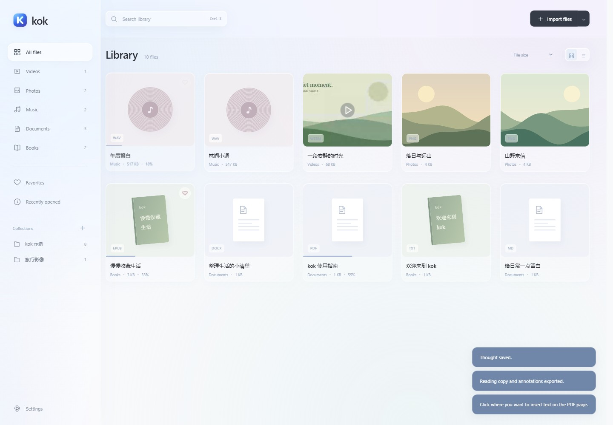

# kok · Your media & reading library

**Videos, photos, music, documents and books, together.** A lightweight Windows desktop app with offline essentials, optional AI and a password-protected private folder.

[Download v0.3.1](https://github.com/ChenShoukang/kok/releases/tag/v0.3.1) · [中文](README.md) · [Supported formats](docs/FORMATS.en.md) · [Changelog](CHANGELOG.en.md)

**v0.3.1 is a preview.** Bug reports are welcome; see [release verification](docs/TESTING.en.md) for machine and codec coverage.

## Get started

1. Download `kok-0.3.1-win-x64.zip` from Releases, extract and run `kok.exe`. Keep the accompanying files.
2. Choose **Pure** or **Smart**; switch later in Settings.
3. Drop files or folders, choose **Import files**, or explore the original samples.

Requires **Windows 10 / 11 x64, .NET Framework 4.8 and [WebView2 Runtime](https://developer.microsoft.com/microsoft-edge/webview2/)**. Node.js and the .NET SDK are not runtime requirements. The unsigned portable ZIP includes a SHA-256 checksum.

<picture>
  <source media="(max-width: 600px)" srcset="docs/assets/features-en-mobile.png">
  
</picture>

## Features

| Area | What you can do |
| --- | --- |
| Video | Borderless fullscreen, resume, 0.5×–3× speed and silence acceleration; matching or manually loaded sidecar subtitles, covers, right-click properties, configurable shortcuts and orientation-aware previews; picture-in-picture when supported by the runtime |
| Photos | Zoom, rotate, browse and slideshows; filters, color adjustments, vignette, crop, flip, original comparison, undo / redo and PNG / JPEG copies |
| Music | Album shelf and details, editable album / artist names, queues, continuous playback, resume, shuffle, repeat, seeking and volume |
| Documents | PDF zoom, text selection, page navigation; DOCX / text reading; underlines, highlights, inserted text, annotations and HTML reading-copy exports |
| Books | EPUB contents, TXT sections, current-chapter search, font size, paper colors and reading progress; underlines, highlights, thought popovers, annotation lists and notes |
| Library | File / folder drops, type detection and duplicate skipping; collections, favorites, recents, search, grid / list and sorting |
| Local organization in Smart | Timeline / type / custom groups and bulk classification; selected-folder scans with pause / resume. Scanning and local groups need no AI calls |
| Appearance | Glass surfaces, smooth transitions and compact layouts; Chinese / English, light / dark / system themes, YaHei / SimSun / KaiTi, TTF / OTF import and reduced-motion support |
| Optional AI | Subtitle / document / book translation, bilingual view, cache, progress, cancellation and TXT / SRT export; streamed file chat, per-file history and answers saved as thoughts; category / tag / summary previews with manual editing |

<details>
<summary>View the actual interface</summary>



</details>

## Choose your experience

- **Pure**: offline playback, editing, reading and notes, with AI requests blocked.
- **Smart**: local features plus optional AI translation, chat and organization. Entering makes no model request; automatic translation defaults off.
- **Private folder**: available inside either mode. Encrypts only its index, notes and covers, with AI disabled; locks on returning to the library, leaving the window, minimizing or five minutes idle. **Original files are not encrypted, existing ordinary entries for the same file are not hidden automatically, and lost passwords cannot be recovered.**

In Smart mode, open **Settings → AI service** to enter an endpoint, model and credential, or load model IDs. Presets cover DeepSeek, OpenAI, Qwen, SiliconFlow, BigModel, Z.ai, Gemini, Groq, OpenRouter, Ollama and LM Studio, plus custom compatible endpoints.

Chat uses video subtitles and an optional current frame, or document / book text, selections and notes. Long content is sampled; **this does not analyze an entire movie**. Organization previews changes before applying them to library records. Selected context goes to your configured service under its billing rules. Credentials are encrypted locally; source and packages exclude personal configuration and data.

## Formats and data

- Common formats include MP4 / WebM / MKV, JPG / PNG / WebP, MP3 / WAV / FLAC, PDF / DOCX and EPUB / TXT. Playback uses WebView2 without a separate decoder engine; **support depends on the actual codec**. Unsupported files can open in installed system apps. See the [format and subtitle matrix](docs/FORMATS.en.md).
- DOCX / EPUB reading focuses on text. Scanned PDFs need external OCR; DRM is not decrypted. Annotations and inserted text belong to kok reading copies; photo edits save copies and preserve originals.
- Importing references originals without moving them; removing entries does not delete files. Export ordinary index / notes as JSON or the private folder as encrypted `.kokvault`. Neither includes originals. See [modes, backups and restoration](docs/MODES.en.md).

Shortcuts: `Ctrl K` search · `Esc` close · video `Space` play / pause, arrows seek, `F` fullscreen · `Ctrl Shift L` lock the private folder. Video shortcuts are customizable.

## Documentation and development

[AI setup](docs/AI_PROVIDERS.en.md) · [Smart organization and file chat](docs/SMART_LIBRARY.en.md) · [Build and tests](docs/DEVELOPMENT.en.md) · [Roadmap](ROADMAP.en.md) · [Report a bug](https://github.com/ChenShoukang/kok/issues/new/choose) · [Security](SECURITY.en.md)

```powershell
npm ci --omit=optional
.\build.ps1 -Test
```

Development uses Node.js 24; output is in `dist/kok/`. Run `.\package.ps1` to package. Original code and samples use [MIT](LICENSE); see [third-party licenses](THIRD_PARTY_NOTICES.md).
