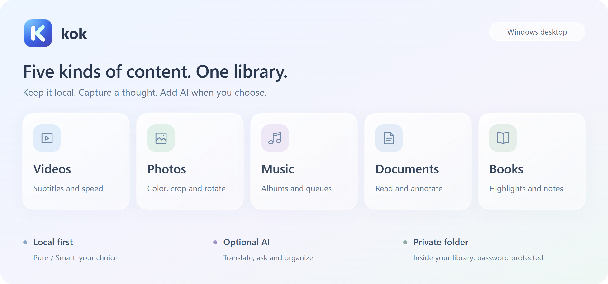
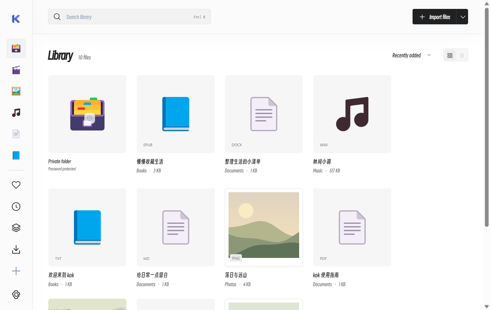

# kok · Media, reading & linked notes

**Videos, photos, music, documents and books, together.** A lightweight Windows desktop app with offline essentials, optional AI and a password-protected private folder.

[Download v0.6.2 preview](https://github.com/ChenShoukang/kok/releases/tag/v0.6.2) · [中文](README.md) · [Supported formats](docs/FORMATS.en.md) · [Changelog](CHANGELOG.en.md)

**v0.6.2 Graphite preview.** Default Smiley Sans, labelled/responsive sidebar and coherent media controls; includes local notes, knowledge graphs and new documents with auto-save. [Release details](docs/GRAPHITE_0.6.2.en.md).

## Get started

1. Download `kok-0.6.2-win-x64.zip` from Releases, extract and run `kok.exe`. Keep the accompanying files.
2. Choose **Pure** or **Smart**; switch later in Settings.
3. Drop files or folders, choose **Import files**, or explore the original samples.

Requires **Windows 10 / 11 x64, .NET Framework 4.8 and [WebView2 Runtime](https://developer.microsoft.com/microsoft-edge/webview2/)**. Node.js and the .NET SDK are not runtime requirements. The unsigned portable ZIP includes a SHA-256 checksum.

<picture>
  <source media="(max-width: 600px)" srcset="docs/assets/features-en-mobile.png">
  
</picture>

## Features

| Area | What you can do |
| --- | --- |
| Video | Borderless fullscreen, resume, 0.5×–3× speed and silence acceleration; matching or manually loaded sidecar subtitles, covers, right-click properties, configurable shortcuts and orientation-aware previews; picture-in-picture when supported by the runtime |
| Photos | Wheel zoom, drag-to-pan, rotation and slideshows; filters, color adjustments, vignette, freehand crop with eight resize handles, fixed ratios, flip, original comparison, undo / redo and PNG / JPEG copies |
| Music | Album, artist and personal-audio views; local tags and embedded artwork, manual corrections, online match candidates and bulk AI organization; queues, resume, shuffle and repeat |
| Documents | Create Markdown / Word (DOCX) / TXT, source and editing views, preview, auto-save and Ctrl+S; PDF zoom, dark/easy text, outline/search; reading, bookmarks, underlines, highlights and inserted text. See [new documents](docs/DOCUMENTS_0.6.1.md) |
| Notes | `[[Note links]]` with completion, backlinks, tags, heading outline, checkable tasks and templates; local global/neighborhood graphs with dragging, zoom and filters. See [usage](docs/KNOWLEDGE_0.6.1.en.md) |
| Books | EPUB contents, TXT sections, chapter filtering, full-text search, bookmarks, scroll / paged layouts, font / line / letter / paragraph spacing, width, focus and resume; existing highlights and thoughts remain available |
| Editing | Photo text, drawing, arrows, masks and layers; audio/video trimming, splitting, multiple-source timelines and clip captions; visual text editing and DOCX / EPUB copies; PDF merge, reorder, rotation and page annotation. Drafts and exported copies preserve originals |
| Library | File / folder drops, type detection and duplicate skipping; collections, favorites, recents, search, grid / list and sorting |
| Local organization in Smart | Timeline / type / custom groups and bulk classification; selected-folder scans with pause / resume. Scanning and local groups need no AI calls |
| Appearance | Flat pages, subtle corners and contextual actions; neutral white / graphite, custom backgrounds and glass; bundled Smiley Sans and LXGW WenKai Lite, Chinese / English; independent movable previews that go behind the main window when blank content is double-clicked |
| Video downloads | Bilibili / YouTube / Douyin adapters, generic pages / file links, source / quality choices, audio and subtitles; site sign-in, encrypted sessions and cookies.txt import, browser assistance for Bilibili / Douyin; queues, resume, retry and import. Optional FFmpeg / FFprobe merges split tracks and M3U8 / DASH |
| Optional AI | Side-by-side or translation-only documents, concurrent requests and segment caches, matching DOCX / EPUB / PDF / TXT / Markdown exports; local Whisper or a separate speech API for timed captions, SRT and bilingual translation; file chat, multi-file comparison, note review and organization |

<details>
<summary>View the actual interface</summary>



</details>

## Choose your experience

- **Pure**: offline playback, editing, reading and notes, with AI requests blocked.
- **Smart**: local features plus optional AI translation, chat and organization. Entering makes no model request; automatic translation defaults off.
- **Private folder**: available inside either mode. Encrypts only its index, notes and covers, with AI disabled; locks on returning to the library, leaving the window, minimizing or five minutes idle. **Original files are not encrypted, existing ordinary entries for the same file are not hidden automatically, and lost passwords cannot be recovered.**

In Smart mode, open **Settings → AI service** to enter an endpoint, model and credential, or load model IDs. Presets cover DeepSeek, OpenAI, Qwen, SiliconFlow, BigModel, Z.ai, Gemini, Groq, OpenRouter, Ollama and LM Studio, plus custom compatible endpoints.

Chat uses video subtitles and an optional current frame, or document / book text, selections and notes. Long content is sampled; **this does not analyze an entire movie**. Organization previews changes before applying them to library records. Selected context goes to your configured service under its billing rules. Credentials are encrypted locally; source and packages exclude personal configuration and data.

## Formats and data

- Common formats include MP4 / WebM / MKV, JPG / PNG / WebP, MP3 / WAV / FLAC, PDF / DOCX and EPUB / TXT. Playback uses WebView2 without a separate decoder engine; **support depends on the actual codec**. Unsupported files can open in installed system apps. See the [format and subtitle matrix](docs/FORMATS.en.md).
- DOCX / EPUB reading focuses on text. Scanned PDFs need external OCR; DRM is not decrypted. Annotations and inserted text belong to kok reading copies; photo edits save copies and preserve originals.
- Canvas-edited PDF pages export as images; untouched pages retain their source content. DOCX / EPUB editing rebuilds simple body text. Audio/video export needs optional local FFmpeg / FFprobe. See [editing scope](docs/EDITING_MUSIC_0.5.1.md).
- Importing references originals without moving them; removing entries does not delete files. Export ordinary index / notes as JSON or the private folder as encrypted `.kokvault`. Neither includes originals. See [modes, backups and restoration](docs/MODES.en.md).

Shortcuts: `Ctrl K` search · `Esc` close · video `Space` play / pause, arrows seek, `F` fullscreen · `Ctrl Shift L` lock the private folder. Video shortcuts are customizable.

## Documentation and development

[AI setup](docs/AI_PROVIDERS.en.md) · [Smart organization and file chat](docs/SMART_LIBRARY.en.md) · [Build and tests](docs/DEVELOPMENT.en.md) · [Roadmap](ROADMAP.en.md) · [Report a bug](https://github.com/ChenShoukang/kok/issues/new/choose) · [Security](SECURITY.en.md)

```powershell
npm ci --omit=optional
.\build.ps1 -Test
```

Development uses Node.js 24; output is in `dist/kok/`. Run `.\package.ps1` to package. Original code and samples use [MIT](LICENSE); see [third-party licenses](THIRD_PARTY_NOTICES.md).
