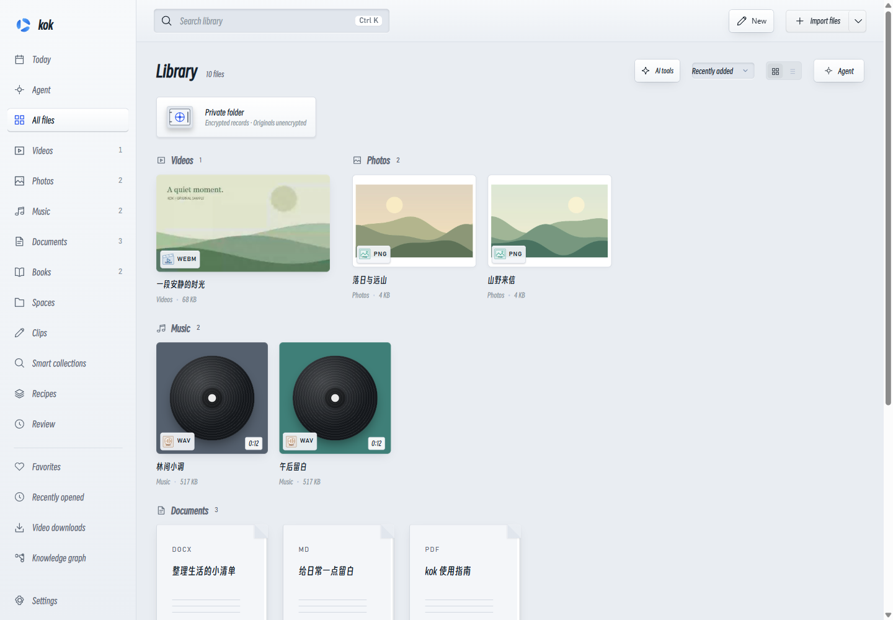

# kok · A local media and knowledge warehouse

**Watch, listen, read and take notes. Turn your collection into something of your own.**

Keep videos, photos, music, documents and books in one local library. Organize topics with Spaces, connect sources to notes with Clips, and bring in AI when you want help translating, organizing or writing.

[Download v0.9.0 Preview](https://github.com/ChenShoukang/kok/releases/tag/v0.9.0) · [User guide](docs/GUIDE.en.md) · [中文](README.md) · [Supported formats](docs/FORMATS.en.md)

**v0.9.0 Preview** adds incremental content indexing, local hybrid search, portable export and restore, browser capture, Windows OCR and scoped read-only MCP. Agent adds versioned events, interrupted prose preservation, approval policies and exact arithmetic. See [features and limits](docs/LIBRARY_0.9.0.en.md), [current validation](docs/VALIDATION_0.9.0.md) and the [roadmap](ROADMAP.en.md).



## From collecting to creating

- **Collect and organize**: drop files or folders, browse by type, classify, favorite and search. Gather a topic's sources in a Space.
- **Read and capture**: resume where you left off. Highlight text, write thoughts and save passages, time ranges or photo regions as source-linked Clips.
- **Connect and create**: link notes, inspect relationships in a graph and bring files or Clips into notes, Spaces or presentations. Continue editing and export your work.
- **Ask AI when useful**: discuss, translate or compare selected sources. Give Agent a task, inspect its evidence and proposed changes, then choose what to apply.

## What you can do

| Area | Practical features |
| --- | --- |
| Library and Spaces | Type detection, collections, favorites and full-text search; mixed files and Clips in grid, canvas, timeline or graph views; saved filters become automatically updated smart collections |
| Search, capture and portability | Source-linked PDF/body/subtitle/Clip chunks; local Ollama embeddings plus FTS5; page/selection/image Inbox; Windows OCR; Markdown/JSON archives with checked restore/relink; scoped read-only MCP |
| Video and music | Resume, playback speed, borderless fullscreen, sidecar subtitles and configurable shortcuts; albums, artists and personal audio, local tags/artwork, online metadata candidates and queues |
| Photos | Wheel zoom, free crop, color adjustments, filters, text, drawing, arrows, masks, layers, undo/redo and PNG/JPEG copies |
| Documents and books | Create Markdown, DOCX, TXT and PPTX; document auto-save, PDF search/annotations and basic slide editing; contents, bookmarks, single/spread/scroll layouts, reading colors and typography |
| Notes, Clips and graphs | Underlines, highlights, thoughts, `[[note links]]`, backlinks, tags, outlines, tasks and templates; Clips return to passages, timestamps or photo regions |
| AI translation and file chat | Selected-text explanations, side-by-side or translation-only documents, matching-format copies, multi-file comparison and note review; subtitle translation/outlines and separately configured speech recognition |
| Agent and Recipes | Scoped search/read, organization, notes and new documents/presentations, with review before changes; instruction skills and usage limits; Recipes connect reading, summaries, notes and slides, with activity and operation history |
| Video downloads | Bilibili/YouTube/Douyin adapters, generic pages and direct links, source selection, queues, resume, sign-in sessions and import; optional components merge split tracks and streams |

See the [user guide](docs/GUIDE.en.md) for workflows, editing/export scope and practical examples.

## Get started

1. Download `kok-0.9.0-win-x64.zip`, check the accompanying SHA-256, extract the full ZIP and run `kok.exe`.
2. Choose **Pure** or **Smart**. Local essentials work without configuring AI.
3. Explore the original samples or drop in your own files, then create a Space or save a Clip.

Requires **Windows 10/11 x64, .NET Framework 4.8 and [WebView2 Runtime](https://developer.microsoft.com/microsoft-edge/webview2/)**. Node.js and the .NET SDK are not required to run the app. This is an unsigned **Preview**.

## Local by default, AI by choice

| Experience | Behavior |
| --- | --- |
| Pure | Local playback, reading, editing and notes, with AI requests blocked; essentials work offline |
| Smart | Adds file chat, Agent, translation and AI organization; entering the mode makes no model request and auto-translation defaults off |
| Private folder | A password-protected folder inside the library, available in either mode; encrypted index, notes, covers and related records, with AI disabled and automatic locking |

Configure a compatible endpoint in **Settings → Tools → AI service**. Use remote providers such as DeepSeek, or an Ollama/LM Studio service you run yourself. See [setup and compatibility](docs/AI_PROVIDERS.en.md). Selected context goes to that service; long content may be sampled and answers need source checks. Credentials are encrypted locally.

Choose light/dark themes, background and glass colors, bundled Smiley Sans/LXGW WenKai Lite, Chinese/English, independent preview windows and enabled modules.

## Files and limits

- **Importing references originals; removing an entry does not delete its file.** The ordinary index, notes and history use local SQLite. An index backup is not a backup of source files.
- The private folder protects application records; **original files are not encrypted**. Earlier independent AI history, exports and external backups are not retroactively encrypted. Lost passwords cannot be recovered. See [privacy and backups](docs/MODES.en.md).
- Playback depends on codecs supported by WebView2/the system; no separate decoder engine is bundled. Scanned PDFs support optional offline Windows OCR and DRM is not decrypted. See [formats](docs/FORMATS.en.md).
- PPTX/imported-document editing is basic. DOCX/EPUB editing rebuilds simple body text; canvas-edited PDF pages export as images. Media export/merging and local speech recognition need extra components; website download coverage has limits. See [editing and components](docs/GUIDE.en.md#editing-exports-and-optional-components).

## Documentation and development

[User guide](docs/GUIDE.en.md) · [Documentation](docs/README.en.md) · [Validation](docs/VALIDATION_0.9.0.md) · [Implementation scope](docs/WAREHOUSE_0.8.1.en.md) · [Issues](https://github.com/ChenShoukang/kok/issues/new/choose) · [Security](SECURITY.en.md)

```powershell
npm ci --omit=optional
.\build.ps1 -Test
```

Development uses Node.js 24; output is in `dist/kok/`. Run `.\package.ps1` to package. Read the [development guide](docs/DEVELOPMENT.en.md) and [roadmap](ROADMAP.en.md). Original code and samples use [MIT](LICENSE); see [third-party licenses](THIRD_PARTY_NOTICES.md).
