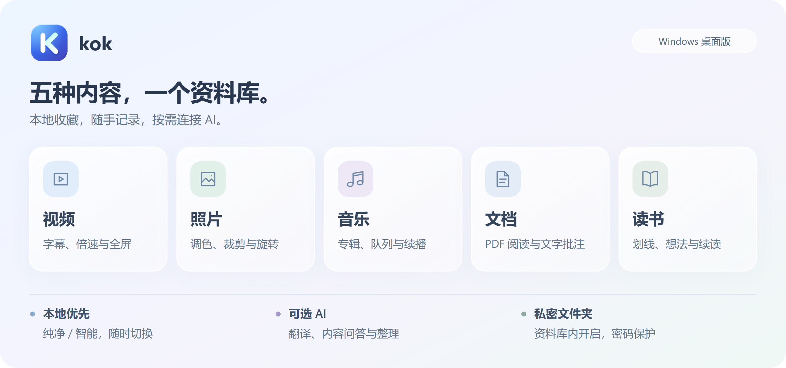

# kok · 影音与阅读资料库

**视频、照片、音乐、文档、电子书，一处收藏。** 轻量 Windows 桌面软件，支持离线使用、可选 AI 和密码保护的私密文件夹。

[下载 v0.5.1 预览版](https://github.com/ChenShoukang/kok/releases/tag/v0.5.1) · [English](README.en.md) · [格式兼容性](docs/FORMATS.md) · [更新记录](CHANGELOG.md)

**v0.5.1 预览版。** 新增安静阅读、单双页与滚轮翻页、流畅多窗口、持久双语翻译、字幕生成、编辑与音乐归纳。[阅读与窗口](docs/READING_FLOW_0.5.1.md) · [编辑与音乐](docs/EDITING_MUSIC_0.5.1.md) · [翻译与字幕](docs/TRANSLATION_CAPTIONS_0.5.1.md)

## 开始使用

1. 下载 Release 中的 `kok-0.5.1-win-x64.zip`，解压后运行 `kok.exe`，保留附带文件。
2. 选择**纯净模式**或**智能模式**，之后可在设置切换。
3. 拖入文件或文件夹；也可以点击“导入文件”或体验原创示例。

需要 **Windows 10 / 11 x64、.NET Framework 4.8、[WebView2 Runtime](https://developer.microsoft.com/microsoft-edge/webview2/)**。运行软件无需 Node.js 或 .NET SDK。便携包未签名，附 SHA-256 校验文件。

<picture>
  <source media="(max-width: 600px)" srcset="docs/assets/features-zh-mobile.png">
  
</picture>

## 功能一览

| 类别 | 可以做什么 |
| --- | --- |
| 视频 | 无边框全屏、续播、0.5×–3× 倍速、静音片段加速；外挂字幕自动匹配与手动加载、封面、右键属性、可配置快捷键、横竖屏适配；内核支持时可用画中画 |
| 照片 | 滚轮缩放、放大后拖动、旋转与幻灯片；滤镜、调色、暗角、拖拽自由裁剪 / 八向调整、固定比例、翻转、原图对比、撤销 / 重做，另存 PNG / JPEG |
| 音乐 | 专辑、歌手与我的音频；读取标签和内嵌封面、人工修正、联网匹配候选、批量 AI 整理；播放队列、续播、随机和循环 |
| 文档 | PDF 缩放、深色显示、易读文字、选字、翻页、目录与全文搜索；DOCX / 文本阅读、书签、排版；划线、高亮、插入文字、批注与 HTML / Markdown 导出 |
| 读书 | EPUB NAV / NCX 真实目录、TXT 章节识别、全文搜索、书签反馈、单页 / 自适应双页 / 上下滚动、滚轮翻页、护眼配色、独立正文字体、字号 / 行距 / 字距 / 段落留白 / 正文宽度、专注与续读；保留划线和想法 |
| 编辑 | 照片文字、画笔、箭头、遮挡与图层；音视频剪切、分割、跨素材拼接及片段字幕；文档可视化改字与 DOCX / EPUB 导出；PDF 合并、重排、旋转和页面标注。草稿与另存副本保留原件 |
| 资料库 | 文件 / 文件夹拖入、类型识别、重复跳过；拖入分类、确认移入私密文件夹、收藏、最近打开、搜索、网格 / 列表与排序 |
| 智能模式的本地整理 | 时间 / 类型 / 自定义分组、批量分类；扫描指定文件夹发现新文件，支持暂停与恢复，扫描和本地分组无需调用 AI |
| 外观 | 扁平页面、轻圆角、就近操作；中性白 / 石墨灰、可调背景与玻璃材质；内置得意黑与霞鹜文楷轻便版、中英文切换；独立可移动预览窗口，双击内容空白处退到主窗口后面 |
| 视频下载 | B 站 / YouTube / 抖音专用解析、通用网页与直链、资源 / 画质选择、仅音频和字幕；站点登录窗口、加密会话及 cookies.txt 导入，B 站 / 抖音可手动网页辅助解析；队列、续传、重试与入库。FFmpeg / FFprobe 按需安装，支持分轨及 M3U8 / DASH 合并 |
| AI 辅助 | 文档 / 电子书对齐双语翻译、双向滚动、本机译文与标记恢复、选词翻译 / 解释、仅译文、并发与分段缓存，DOCX / EPUB / PDF / TXT / Markdown 对应格式导出；本地 Whisper 或独立语音 API 生成字幕，SRT 与双语翻译；内容问答、多文件对比、笔记回顾与分类整理 |

<details>
<summary>查看实际界面</summary>


</details>

## 按自己的方式使用

- **纯净模式**：本地播放、编辑、阅读和记录，阻止 AI 请求，无需联网使用基础功能。
- **智能模式**：保留本地功能，按需启用 AI 翻译、问答与整理；进入模式本身不调用模型，自动翻译默认关闭。
- **私密文件夹**：两种模式中都能打开的密码文件夹。只加密索引、笔记和封面，不接入 AI；返回普通资料库、离开窗口、最小化或闲置 5 分钟自动锁定。**原文件不加密，普通资料库已有的同一文件不会自动隐藏，密码无法找回。**

智能模式下，在 **设置 → AI 服务**填写地址、模型和密钥，可读取模型列表。提供 DeepSeek、OpenAI、通义千问、硅基流动、智谱、Z.ai、Gemini、Groq、OpenRouter、Ollama、LM Studio 及自定义兼容接口入口。

AI 问答支持视频字幕及可选当前画面，或文档 / 读书正文、选文与笔记；长内容会节选，**不代表完整理解整部视频**。AI 归纳先预览，再应用，只更新资料库分类。选定内容会发往配置的服务，费用按服务商规则计算；密钥在本机加密保存，源码和发布包排除个人配置与资料。

## 格式与数据

- 常用格式包括 MP4 / WebM / MKV、JPG / PNG / WebP、MP3 / WAV / FLAC、PDF / DOCX、EPUB / TXT。内置播放使用 WebView2，未集成独立解码器；**能否播放取决于实际编码**，不支持的文件可用系统应用打开。详见[兼容性清单](docs/FORMATS.md)。
- DOCX / EPUB 以文字阅读为主；扫描 PDF 需外部 OCR，不解密 DRM。标记和插入文字保存在 kok 阅读副本，照片编辑另存，保留原文件。
- 编辑过的 PDF 画布页面导出为图像，其余页面保留原有内容；DOCX / EPUB 编辑重建简洁正文。音视频导出需要可选的本地 FFmpeg / FFprobe。完整范围见[编辑说明](docs/EDITING_MUSIC_0.5.1.md)。
- 收录文件不搬动原件，移除记录不删除原件。普通索引与笔记可导出 JSON；私密文件夹可导出 `.kokvault` 加密备份。备份均不含原文件，恢复方法见[模式与私密文件夹](docs/MODES.md)。

快捷键：`Ctrl K` 搜索 · `Esc` 关闭 · 视频 `空格` 播放 / 暂停、`← / →` 跳转、`F` 全屏 · `Ctrl Shift L` 锁定私密文件夹。视频键位可自定义。

## 文档与开发

[AI 服务配置](docs/AI_PROVIDERS.md) · [智能整理与内容问答](docs/SMART_LIBRARY.md) · [构建与测试](docs/DEVELOPMENT.md) · [路线图](ROADMAP.md) · [反馈问题](https://github.com/ChenShoukang/kok/issues/new/choose) · [安全报告](SECURITY.md)

```powershell
npm ci --omit=optional
.\build.ps1 -Test
```

开发需要 Node.js 24，输出位于 `dist/kok/`；打包运行 `.\package.ps1`。原创代码与示例采用 [MIT](LICENSE)，第三方组件见[许可说明](THIRD_PARTY_NOTICES.md)。
