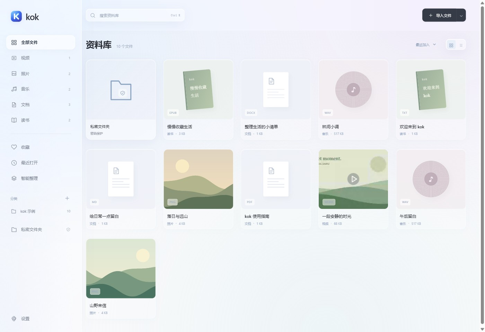

# kok

中文 · [English](README.en.md)

一个轻量的 Windows 本地资料库，在简洁的毛玻璃界面中收藏视频、照片、音乐、文档和电子书。

**v0.3.1** · [下载便携版](https://github.com/ChenShoukang/kok/releases/tag/v0.3.1) · [格式兼容性](docs/FORMATS.md) · [使用模式](docs/MODES.md) · [版本记录](CHANGELOG.md)



## 开始使用

1. 从 Release 下载 `kok-0.3.1-win-x64.zip`，解压到有写入权限的目录，运行 `kok.exe`，保留旁边的文件和文件夹。
2. 第一次选择纯净或智能模式；资料库里的“私密文件夹”可按需用密码打开。
3. 拖入文件或文件夹即可按类型收录；也可点击导入，或体验仓库附带的原创示例。

运行环境：**Windows 10 / 11 x64、.NET Framework 4.8、WebView2 Evergreen Runtime**。应用使用已安装的 WebView2，不打包独立 Chromium；缺少运行环境时请从[微软官网](https://developer.microsoft.com/microsoft-edge/webview2/)安装。运行 kok 不需要 Node.js 或 .NET SDK。便携包未签名，请核对随附的 SHA-256。

## 使用模式与私密文件夹

- **纯净模式**：本地视频、照片、音乐、文档和读书，简洁界面，原生层阻止 AI 请求，应用资源离线加载。
- **智能模式**：本地功能加可选 AI 翻译、内容对话、文件夹扫描和整理预览。进入模式不会调用模型。
- **私密文件夹**：资料库内的密码保护文件夹，加密文件索引、笔记和封面缓存，关闭 AI；离开窗口、最小化或闲置 5 分钟自动锁定。**原始媒体和文档保留在原位置，不会被加密。** 密码无法找回。详见[模式与私密文件夹](docs/MODES.md)。

## 主要功能

| 类别 | 功能 |
| --- | --- |
| 视频 | 单排玻璃控件、无边框全屏、续播、倍速、静音片段加速、自动匹配外挂字幕、可配置快捷键、封面与右键属性、横竖屏适配 |
| 音乐 | 专辑唱片架、专辑详情与队列、持续播放、随机与循环、音量及进度 |
| 照片 | 自适应预览、缩放、旋转、幻灯片；滤镜、色彩调整、裁剪、翻转、撤销与重做、另存 PNG / JPEG |
| 文档与读书 | 本地 PDF 阅读、DOCX / EPUB / 文本正文、目录与搜索、下划线、荧光标记、插入文字、旁侧想法与笔记、导出 HTML 阅读副本 |
| 资料整理 | 时间 / 类型 / 自定义分组、分类、收藏、最近打开、搜索；智能模式提供指定文件夹的自动扫描与 AI 分类预览 |
| 外观 | 中文 / English 切换、浅色 / 深色 / 系统主题、三种常用中文字体、导入 TTF / OTF、玻璃菜单与减少动态效果支持 |

内置打开范围以[格式实测表](docs/FORMATS.md)为准。媒体取决于**容器、编码、内核与系统**，并非 PotPlayer 式全解码器。未来独立解码器目标见[路线图](ROADMAP.md)。不支持的格式可打开已安装的系统应用。

DOCX / EPUB 为文字阅读，不还原复杂原始排版；扫描 PDF 需外部 OCR；不解密 DRM。标记、插入文字和照片编辑保留原文件，导出副本。字幕支持 SRT、VTT、ASS / SSA 文字兼容、MicroDVD SUB、SBV、LRC、TTML / DFXP、SMI；不提取内嵌或位图字幕，不做语音转字幕。

## AI 配置与内容范围

智能模式 → 设置 → AI 服务：选择预设或自定义兼容 Chat Completions 接口，填写地址、模型与密钥，可读取模型列表。提供 DeepSeek、OpenAI、通义千问、硅基流动、智谱、Z.ai、Gemini 兼容接口、Groq、OpenRouter、Ollama、LM Studio 和自定义入口。预设不代表服务商的每种模型都支持所有功能；详见[服务配置](docs/AI_PROVIDERS.md)。

视频问答使用已加载字幕及可选当前画面，**不会将整段电影上传或完整分析**。文档 / 读书可结合当前内容、选文与笔记问答；长内容会截取并在界面说明。AI 整理可选择仅文件名信息或附带有限正文，预览后确认应用；只改资料库记录，不移动原文件。详见[智能整理](docs/SMART_LIBRARY.md)。

远程请求仅发送功能所需的选定上下文，按服务商规则计费。自动翻译默认关闭；连接测试也会发送短请求。密钥只在原生层使用，以 Windows DPAPI 加密存入本地 `data/ai-settings.json`，不会返回给网页界面；更改 API 地址后必须重新填写密钥。源码、便携包与 GitHub Release 排除所有个人模型配置、资料库与缓存。

## 数据与备份

普通资料库在应用目录 `data/` 保存索引、笔记、设置、字体和缓存；索引引用原路径，移除记录不删除原文件。设置可导出普通 JSON 索引与笔记；关闭 kok 后复制整个 `data/` 可备份完整本地状态。JSON 包含路径，不含原媒体及密钥。

私密文件夹的设置提供 `.kokvault` 加密备份，包含加密索引、笔记和封面，不含原文件、AI 配置或浏览器缓存。恢复说明和保护边界见[私密文件夹说明](docs/MODES.md)。可用 `--data-dir "D:\MykokData"` 指定独立目录。

常用快捷键：`Ctrl K` 搜索，`Esc` 关闭预览，视频 `空格` 暂停、`← / →` 跳转、`F` 全屏，私密文件夹 `Ctrl Shift L` 锁定。视频键位和跳跃秒数可在设置修改。

## 构建与检查

```powershell
npm ci --omit=optional
npm run check
.\build.ps1 -Test
.\tools\test-desktop.ps1
.\package.ps1
```

开发需要 Node.js 24；构建使用 Windows .NET Framework 编译器与固定版本的官方 WebView2 SDK。测试使用独立资料库、静音窗口及本地模拟 AI 服务，不使用个人密钥。打包执行私密文件与密钥模式审计。详见[开发与测试](docs/DEVELOPMENT.md)。

## 许可与参考

原创代码与示例采用 [MIT](LICENSE)；PDF.js 与 WebView2 的许可见 [THIRD_PARTY_NOTICES.md](THIRD_PARTY_NOTICES.md)。参考了 [WebView2Samples](https://github.com/MicrosoftEdge/WebView2Samples) 的宿主集成、[Foliate](https://github.com/johnfactotum/foliate) 的阅读体验与 [mpv](https://github.com/mpv-player/mpv) 的播放器功能范围；不附带外部播放器，也未复制它们的 GPL 实现。
