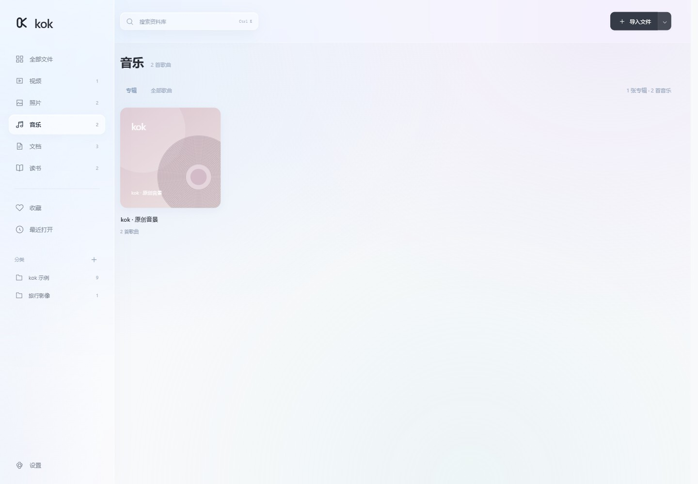
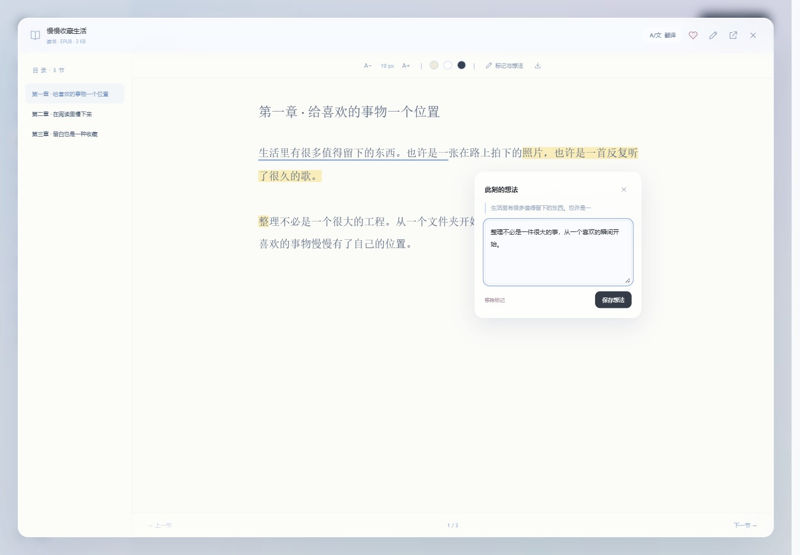

# kok

中文 · [English](README.en.md)

一个轻量的 **Windows 本地资料库**。在简洁的毛玻璃界面中整理视频、照片、音乐、文档和电子书。

本地整理不需要账号。原文件按路径收录，不会被移动或复制；日常使用无需联网。可选 AI 翻译会将选中的字幕或正文发送到你配置的 API，按服务商规则计费。


**[下载 GitHub 已发布的 Windows 便携版](https://github.com/878kouyier/kok/releases/latest)** · 私有仓库下载时需要登录有权限的 GitHub 账号。

文档：[格式兼容性](docs/FORMATS.md) · [开发与测试](docs/DEVELOPMENT.md) · [版本记录](CHANGELOG.md) · [路线图](ROADMAP.md)

## 使用

1. 获取本地便携包 `kok-0.2.1-win-x64.zip`，解压到你有写入权限的目录。
2. 双击 `kok.exe`。请保留旁边的 DLL、`ui` 和 `samples` 文件夹。
3. 点击「导入文件」，或打开旁边的菜单选择「导入文件夹」。文件夹会包含子目录，自动跳过重复路径与不支持的文件。
4. 也可把文件或文件夹直接拖入 kok 窗口，松开导入；可多选，文件夹包含子目录。重复路径和不支持的文件会跳过。
5. 想先体验时，点击空资料库中的「体验示例资料」，或在设置中添加示例。

**运行环境：Windows 10 / 11 x64、.NET Framework 4.8、微软 WebView2 Evergreen Runtime。** 多数 Windows 11 环境已具备这些组件。如果出现运行环境提示，请从[微软官网下载 WebView2 Runtime](https://developer.microsoft.com/microsoft-edge/webview2/)。首次安装运行环境需要联网。应用本身不需要 Python、Node.js、Rust 或 .NET SDK。

未使用代码签名证书，Windows 可能显示未知发布者。请仅从你信任的项目 Release 下载，并核对随附的 SHA-256。

## 功能与兼容性

| 类别 | 内置功能 | 范围与限制 |
| --- | --- | --- |
| 视频 | 播放、跳转、音量、全屏、续播、0.5×–3× 倍速、静音片段自动加速、同名字幕自动加载 | MP4 / M4V / MOV / MKV 的 H.264 / AAC、WebM 的 VP8 / VP9 / Opus 已实测；其他编码依赖内核与系统。内嵌或位图字幕及特殊编码可使用系统播放器 |
| 照片 | 缩略图、预览、缩放、旋转、前后切换、幻灯片；滤镜、亮度 / 对比度 / 饱和度 / 色温 / 暗角、裁剪、旋转 / 翻转、撤销 / 重做、另存副本 | 常见 JPG / PNG / GIF / WebP / BMP 等；HEIC / TIFF 等特殊格式可调用系统应用。编辑长边最多 4096 px，原片保留 |
| 音乐 | 专辑唱片架、专辑详情、专辑队列、持续播放、切歌、随机、单曲循环、音量与续播 | 按文件夹自动组成专辑，可编辑专辑名与歌手；识别 MP3 / WAV / FLAC / M4A / OGG / OPUS 等，实测 MP3 / PCM WAV / FLAC / Vorbis OGG / Opus / AAC M4A / ADTS AAC |
| 文档 | PDF 文字层与缩放、下划线 / 荧光标记、位置插入文字；DOCX / 文本正文阅读、插入文字、标记与批注 | PDF 使用本地 PDF.js；DOCX 不保留原版式；标记和插入内容保存为阅读副本，原文件保留，可导出 HTML。XLSX / PPTX / DOC 等使用系统应用 |
| 读书 | EPUB 目录、TXT 分节、字号、三种纸色、续读；选中文字划线 / 荧光标记、旁边的想法弹窗、批注列表 | EPUB 为文字阅读，暂不还原图片、复杂排版与脚注交互；不解密 DRM；MOBI / AZW / FB2 等使用系统应用 |
| 分类归纳 | 按文件类型与来源文件夹自动归纳；新建主题分类、手动重新归类；收藏、最近打开、搜索、网格 / 列表、排序 | 索引引用原路径；移动或重命名原文件后，请移除旧记录并重新导入 |
| 字体与界面 | 磨砂玻璃、浅色 / 深色 / 跟随系统；微软雅黑 / 宋体 / 楷体；导入本地 TTF / OTF 字体 | 字体应用于界面和正文阅读，PDF 原始文字不重新排版。导入字体最多 20 MB，需有使用权 |
| 随手记 | 每个文件独立笔记、每处标记独立想法、本地保存、随索引导出 | 正常关闭预览或窗口时保存当前笔记与进度；断电或强制结束进程可能丢失最后尚未保存的修改 |

TXT 支持 UTF-8、UTF-16 与 GB18030。文件内容不会作为脚本执行。阅读器对大文本、章节和 XML 设置了读取上限；超过上限时可使用系统应用。

字幕支持 SRT、VTT、ASS / SSA（文字兼容模式）、MicroDVD SUB、SBV、LRC、TTML / DFXP 和 SAMI SMI。将字幕命名为与视频同名，或者加语言后缀（如 `电影.zh.srt`），放在视频旁边即可自动加载；也可点击「载入字幕」手动选择。ASS 的特效、复杂定位、IDX / SUB 位图字幕不在内置范围。静音加速依据音频音量，不做语义分析或语音转字幕。

文档插入与批注属于 **kok 阅读副本**：不会写回原 DOCX / PDF。DOCX / 文本可导出含插入正文与标记的 HTML；PDF 可导出批注摘要 HTML。扫描版 PDF 需要先进行 OCR 才能选择文字。照片编辑另存为 PNG 或 JPEG，并自动收录新文件。





「识别 / 收录」不代表某种容器内的所有编码都可以内置播放。系统应用入口需要你已安装相应软件，例如 VLC、mpv、Office、WPS 或其他阅读器。kok 不包含它们，也不自动安装解码器。

## 轻量化设计

- 原生 WinForms 窗口搭配系统 WebView2，不附带独立 Chromium。
- C# 后端 + 原生 HTML / CSS / JavaScript，没有前端框架，应用运行时无需 Node.js / npm；PDF.js 资源随包离线提供。
- 媒体通过可定位的文件流读取，支持 HTTP 字节区间，避免将整个视频读入内存。
- 缩略图按需在导入时生成并缓存，列表分批显示。
- Windows 专用实现；当前没有声称提供 macOS / Linux 版本。

体积以实际发布包为准。WebView2 运行时体积不包含在发布包中；运行内存取决于浏览器内核、打开的媒体和资料库大小。

## 数据与备份

应用目录下的 `data/` 保存索引、笔记、偏好和内核用户数据（含 `library.json`、缩略图缓存、导入字体、AI 配置与译文缓存、WebView2 缓存）。备份可在设置中导出 JSON，也可以在**退出 kok 后**复制整个 `data/`。JSON 导出包含本地文件路径，不包含原文件。恢复时退出 kok，再将有效备份放回 `data/library.json`。

「从资料库移除」只删除索引记录，不删除磁盘上的原文件。资料库读取损坏时会报错并保留原文件，不会自动以空库覆盖。使用不同资料库目录可加 `--data-dir "D:\MykokData"`。

## 快捷键

- `Ctrl K`：搜索。
- `Esc`：关闭预览或弹窗。
- 照片预览中的 `← / →`：上一张 / 下一张。
- 阅读中的 `← / →`：上一节 / 下一节。
- 音乐中的 `空格`：播放 / 暂停。
- 视频默认 `空格` 播放 / 暂停，`← / →` 跳跃 10 秒，`↑ / ↓` 调节音量，`F` 全屏。可在设置 → 播放偏好或视频设置中修改 / 关闭。
- 照片编辑中 `Ctrl Z` 撤销，`Ctrl Shift Z` / `Ctrl Y` 重做。

## 从源码构建

在 Windows PowerShell 或 PowerShell 7 中运行：

```powershell
npm ci --omit=optional
.\build.ps1 -Test
```

首次构建前需安装 Node.js 24，并执行 `npm ci --omit=optional` 以准备本地 PDF.js 资源。构建使用 Windows 自带的 .NET Framework C# 编译器，无需安装 .NET SDK。首次构建从 NuGet 下载固定版本的微软官方 WebView2 SDK（`1.0.4258.31`），验证 SHA-256 后缓存。输出在 `dist/kok/`。

```powershell
.\package.ps1
```

生成便携压缩包和 SHA-256 文件，明确排除开发测试程序、用户资料库与内核缓存。

## 验证

`build.ps1 -Test` 运行 59 项原生测试，涵盖去重、中文文件名、编码、持久化、备份、DOCX / EPUB、字节区间、损坏索引保留、批注与插入正文恢复、分类、字幕解析与自动匹配、照片副本保存和原片保护、字体导入，以及密钥加密、翻译分批 / 缓存 / 顺序校验、取消、接口异常、语言偏好与原生文本本地化。

真实 WebView2 桌面窗口的集成检查、全部测试脚本与截图生成见 [开发与测试](docs/DEVELOPMENT.md)。界面测试会重置隔离的测试资料库，请勿指向日常 `data/`。

## 参考项目与许可

研究了以下开源项目的定位与组织方式，代码为本项目独立实现：[MicrosoftEdge / WebView2Samples](https://github.com/MicrosoftEdge/WebView2Samples)（原生窗口与 WebView2 集成）、[tauri-apps / tauri](https://github.com/tauri-apps/tauri)（复用系统 WebView 减小体积的思路，未使用 Tauri）、[johnfactotum / foliate](https://github.com/johnfactotum/foliate)（阅读体验参考，未复制其 GPL 代码）、[mpv-player / mpv](https://github.com/mpv-player/mpv)（媒体播放器功能范围参考）、[mozilla / pdf.js](https://github.com/mozilla/pdf.js)（Apache-2.0，随包打包）。

项目原创源码与示例使用 [MIT License](LICENSE)。WebView2 SDK 使用微软自己的许可，见 [THIRD_PARTY_NOTICES.md](THIRD_PARTY_NOTICES.md)。
