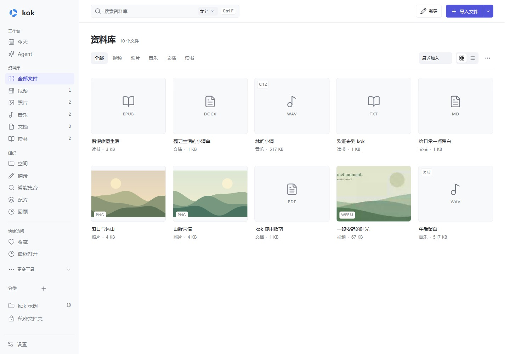

# kok · 本地媒体与知识仓库

**看、听、读、记，再把资料变成自己的内容。**

把视频、照片、音乐、文档和电子书收进同一个本地资料库；用空间组织主题，用摘录连接原文与笔记，需要时再让 AI 帮你翻译、整理和写作。

[下载 v0.9.4 Preview](https://github.com/ChenShoukang/kok/releases/tag/v0.9.4) · [使用指南](docs/GUIDE.md) · [English](README.en.md) · [格式支持](docs/FORMATS.md)

**v0.9.4 Preview** 完成界面改版：统一的扁平视觉、分组导航、文件卡片/列表、阅读与媒体工具栏，并做了 25 组逐页/回归检查与 120 张截图复核；新增的界面套件已纳入 14 组包级门禁。本版不改变数据格式，也没有新增真实模型调用（总账 359）。见 [扁平界面说明](docs/FLAT_UI.md)、[界面验证](docs/INTERFACE_VALIDATION.md)、[当前验证](docs/VALIDATION_0.9.4.md) 与 [路线图](ROADMAP.md)。



## 不只是把文件放在一起

- **收集与整理**：拖入文件或文件夹，按类型浏览、分类、收藏和检索；把同一主题的资料放进空间。
- **阅读与记录**：接着上次的位置看、听、读；选中文字做标记、写想法，把段落、时间段或照片区域保存成带来源的摘录。
- **关联与创作**：用双向链接连接笔记，在图谱中查看关系；把资料和摘录加入笔记、空间或 PPT，继续编辑和导出。
- **按需交给 AI**：围绕当前资料提问、翻译或对比；也可以给 Agent 一个任务，查看它读取的来源和修改预览，再决定是否执行。

## 现在能做什么

| 功能 | 实际用途 |
| --- | --- |
| 资料库与空间 | 类型识别、分类、收藏、全文检索；同一个空间混放文件和摘录，切换网格、画布、时间线或图谱；保存筛选条件为自动更新的智能集合 |
| 检索、采集与可迁移 | PDF / 正文 / 字幕 / 摘录的来源片段；本机 Ollama 语义＋FTS5 混合；网页 / 选区 / 图片收件箱；Windows OCR；Markdown / JSON 便携包、校验恢复与重连；只读 MCP |
| 视频与音乐 | 视频续播、倍速、无边框全屏、外挂字幕、可配置快捷键；音乐按专辑、歌手和个人音频整理，读取标签 / 封面、联网匹配信息，支持播放队列 |
| 照片编辑 | 滚轮缩放、自由裁剪、调色、滤镜、文字、画笔、箭头、遮挡和图层，撤销 / 重做后另存 PNG / JPEG |
| 文档与读书 | 新建 Markdown、DOCX、TXT、PPTX；文档自动保存，PDF 搜索与批注，PPTX 基础编辑；电子书目录、书签、单页 / 双页 / 滚动、护眼与阅读排版 |
| 笔记、摘录与图谱 | 划线、高亮、想法、`[[双向链接]]`、反向链接、标签、大纲、待办与模板；摘录可跳回段落、时间点或照片区域 |
| AI 翻译与内容助手 | 选词解释、文档左右对照 / 仅译文、对应格式副本、多文件对比、笔记回顾；视频字幕翻译与字幕目录，也可配置语音识别生成字幕 |
| Agent 与配方 | 限定资料范围后检索、阅读、整理、写笔记或创建文档 / 演示；修改先审核。内置指令技能与用量限制；配方串联读取、摘要、笔记和演示，活动与历史展示进度和可撤销修改 |
| 视频下载 | Bilibili / YouTube / 抖音适配、通用网页与直链；资源选择、队列、续传、登录会话与下载后入库，分轨 / 流媒体合并使用可选组件 |

完整操作、编辑导出范围和常见使用场景见[使用指南](docs/GUIDE.md)。

## 开始使用

1. 下载 [最新 Release](https://github.com/ChenShoukang/kok/releases/latest) 中的 `kok-0.9.4-win-x64.zip`，核对随附 SHA-256，完整解压后运行 `kok.exe`。后续版本号以 Release 页面为准。
2. 首次选择**纯净模式**或**智能模式**；不配置 AI 也能使用本地基础功能。
3. 点击“体验示例”或拖入自己的文件，先浏览资料，再试着创建一个空间或保存一条摘录。

需要 **Windows 10 / 11 x64、.NET Framework 4.8、[WebView2 Runtime](https://developer.microsoft.com/microsoft-edge/webview2/)**。运行软件不需要 Node.js 或 .NET SDK。当前是未签名的 **Preview 预览版**。

## 本地使用，AI 由你选择

| 方式 | 有什么不同 |
| --- | --- |
| 纯净模式 | 本地播放、阅读、编辑和记录，阻止 AI 请求；基础功能可离线使用 |
| 智能模式 | 在本地功能上启用内容助手、Agent、翻译和 AI 整理；进入模式本身不请求模型，自动翻译默认关闭 |
| 私密文件夹 | 位于资料库内的密码文件夹，两种模式都可使用；加密索引、笔记、封面和关联数据，禁用 AI，支持自动锁定 |

在 **设置 → 功能 → AI 服务**配置兼容接口，可使用 DeepSeek 等远程服务，或自己运行的 Ollama / LM Studio。[配置方式与兼容边界](docs/AI_PROVIDERS.md)。选定内容会发给配置的服务；长资料可能节选，结果需要核对来源。密钥在本机加密保存。

深浅主题、背景与玻璃材质、内置得意黑 / 霞鹜文楷轻便版、中英文、独立预览窗口和模块开关，都可按自己的习惯调整。

## 文件与能力边界

- **收录不搬动原件，移除记录不删除原件。** 普通索引、笔记和历史使用本地 SQLite；备份索引不等于备份原文件。
- 私密文件夹保护应用内记录，**不会加密原文件**，也不会追溯加密此前独立 AI 历史、导出或外部备份。密码无法找回。[私密与备份说明](docs/MODES.md)。
- 播放依赖 WebView2 / 系统支持的实际编码，未内置独立解码器；扫描 PDF 可按需使用本机 Windows OCR，不处理 DRM。[格式清单](docs/FORMATS.md)。
- PPTX 与导入文档提供基础编辑；DOCX / EPUB 编辑重建简洁正文，编辑过的 PDF 画布页面导出为图像。音视频导出 / 合并和本地语音识别需要额外组件；网站下载适配也有范围限制。[编辑与组件说明](docs/GUIDE.md#编辑导出与可选组件)。

## 文档与开发

[使用指南](docs/GUIDE.md) · [文档目录](docs/README.md) · [Agent 能力与边界](docs/AGENT_0.9.3.md) · [验证记录](docs/VALIDATION_0.9.4.md) · [实现进度](docs/WAREHOUSE_0.8.1.md) · [反馈](https://github.com/ChenShoukang/kok/issues/new/choose) · [安全报告](SECURITY.md)

```powershell
npm ci --omit=optional
.\build.ps1 -Test
```

开发使用 Node.js 24，输出位于 `dist/kok/`，打包运行 `.\package.ps1`。架构与模块契约见[开发文档](docs/DEVELOPMENT.md)，后续计划见[路线图](ROADMAP.md)。原创代码与示例采用 [MIT](LICENSE)，第三方组件见[许可说明](THIRD_PARTY_NOTICES.md)。
