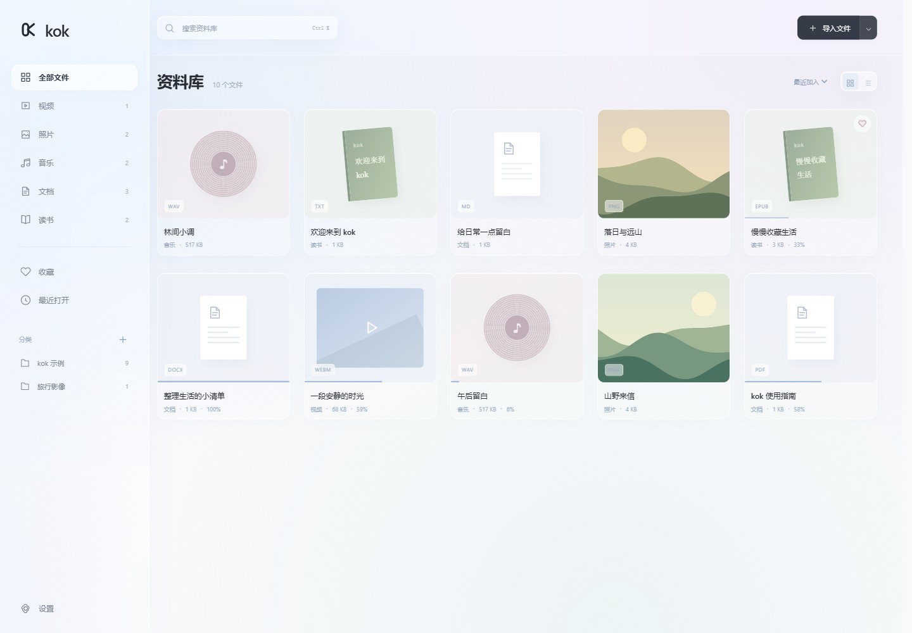
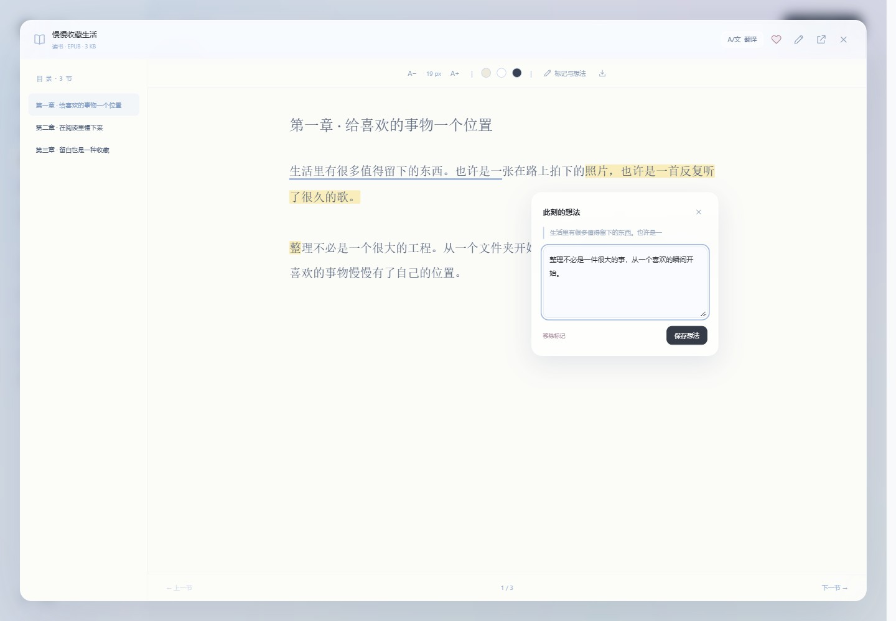
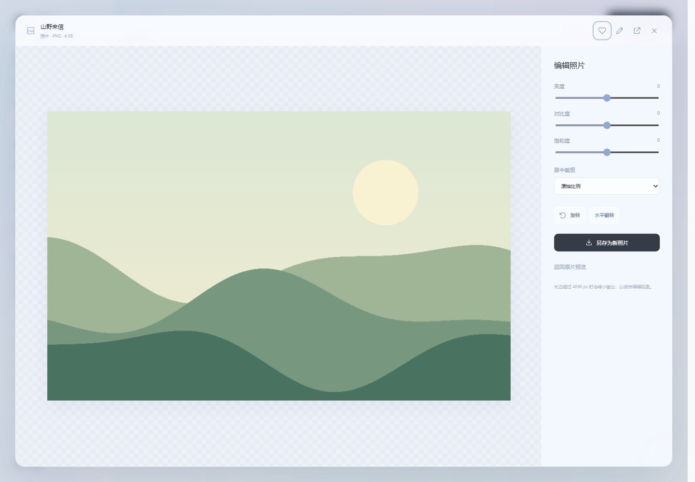

# kok

一个轻量的 **Windows 本地资料库**。在简洁的毛玻璃界面中整理视频、照片、音乐、文档和电子书。

本地整理不需要账号。原文件按路径收录，不会被移动或复制；日常使用无需联网。可选 AI 翻译会将选中的字幕或正文发送到你配置的 API，按服务商规则计费。



**[下载 Windows 便携版](https://github.com/878kouyier/kok/releases/latest)** · 私有仓库下载时需要登录有权限的 GitHub 账号。

## v0.1.3 · 流畅玻璃界面与 AI 翻译

- 加宽侧栏，选中背景随分类平滑移动，小窗口保持完整可用。
- 开屏采用玻璃 Logo、柔和显现与分层衔接；页面以新旧内容交叠过渡。
- 统一弹窗、菜单、笔记面板、照片缩放和按钮的动画节奏，连续操作可安全打断。
- 加强侧栏、顶部栏、播放器与批注浮层的半透明玻璃层次，支持浅色、深色与减少动态效果。
- 添加可配置的大模型 API：自动或手动翻译字幕、文档与电子书，双语对照、译文缓存、进度、取消与导出。

### AI 翻译使用方法

1. 打开「设置 → AI 翻译 → 配置 API」，填写接口地址、模型名称、密钥和目标语言。支持 OpenAI 兼容的 Chat Completions 接口；地址可填写到 `/v1` 等服务商提供的基础路径，也可以填写完整的 `/chat/completions` 地址。接口协议参考 [OpenAI 官方文档](https://developers.openai.com/api/reference/resources/chat/subresources/completions/methods/create)。
2. 点击「测试连接」会发送一条简短请求；点击「保存设置」。本机免密模型可使用 HTTP localhost / 127.0.0.1 地址并留空密钥，远程接口使用 HTTPS。
3. 预览文件时点击「翻译」。文档、电子书与有文字层的 PDF 支持当前章节 / 页或全文翻译；扫描版 PDF 需先 OCR。译文单独显示，原文、批注与排版文件保留。
4. 视频会翻译当前选择的文字字幕，保持原始时间轴，可切换双语 / 仅译文并导出 SRT。ASS 等使用文字兼容模式；不识别内嵌、位图字幕或无字幕视频的语音。
5. 可开启「自动翻译打开的字幕、章节或 PDF 当前页」。默认关闭；全文翻译需要手动选择。长内容自动分批，提供进度和取消；相同服务、模型、语言、正文的译文会在本地缓存，避免重复请求。

密钥用 Windows DPAPI 按当前账户加密，保存在 `data/ai-settings.json`，不进入资料库导出或安装包。更换 Windows 账户或电脑需重新填写密钥。接口与模型需支持按提示返回 JSON 译文；认证、额度、格式和截断错误会在译文面板显示。缓存位于 `data/translations/`，其中包含原文对应的译文，请随本地资料库一并管理。

翻译功能已通过本地 HTTP 模拟服务的完整链路测试；发布时未调用用户的付费 API，真实服务的连通性与翻译质量需在填写配置后确认。

## v0.1.2 · 更少干扰

- 首页直接展示文件，删除横幅、每日文案、重复分类卡片、头像与底部标语。
- 侧栏、工具栏与浮层采用克制的毛玻璃；文件卡片保持轻量。
- 原创单色 Logo 与简短开屏，原生图标同步更新。
- 页面和弹窗采用短时透明度 / 位移动画，避免动画模糊滤镜，支持「减少动态效果」。
- 导入文件与文件夹统一到一个入口；设置中的版本、路径和帮助信息折叠显示。

## 使用

1. 下载 `kok-0.1.3-win-x64.zip`，解压到你有写入权限的目录。
2. 双击 `kok.exe`。请保留旁边的 DLL、`ui` 和 `samples` 文件夹。
3. 点击「导入文件」，或打开旁边的菜单选择「导入文件夹」。文件夹会包含子目录，自动跳过重复路径与不支持的文件。
4. 想先体验时，点击空资料库中的「体验示例资料」，或在设置中添加示例。

**运行环境：Windows 10 / 11 x64、.NET Framework 4.8、微软 WebView2 Evergreen Runtime。** 多数 Windows 11 环境已具备这些组件。如果出现运行环境提示，请从[微软官网下载 WebView2 Runtime](https://developer.microsoft.com/microsoft-edge/webview2/)。首次安装运行环境需要联网。应用本身不需要 Python、Node.js、Rust 或 .NET SDK。

未使用代码签名证书，Windows 可能显示未知发布者。请仅从你信任的项目 Release 下载，并核对随附的 SHA-256。

## 功能与兼容性

| 类别 | 内置功能 | 范围与限制 |
| --- | --- | --- |
| 视频 | 播放、跳转、音量、全屏、续播、0.5×–3× 倍速、静音片段自动加速、同名字幕自动加载 | MP4 / WebM 等依赖内核与编码；实测 WebM / VP8。内嵌或位图字幕及特殊编码可使用系统播放器 |
| 照片 | 缩略图、预览、缩放、旋转、前后切换、幻灯片；亮度 / 对比度 / 饱和度、居中裁剪、旋转 / 翻转、另存副本 | 常见 JPG / PNG / GIF / WebP / BMP 等；HEIC / TIFF 等特殊格式可调用系统应用。编辑长边最多 4096 px，原片保留 |
| 音乐 | 专辑唱片架、专辑详情、专辑队列、持续播放、切歌、随机、单曲循环、音量与续播 | 按文件夹自动组成专辑，可编辑专辑名与歌手；识别 MP3 / WAV / FLAC / M4A / OGG / OPUS 等，实测 WAV |
| 文档 | PDF 文字层与缩放、下划线 / 荧光标记、位置插入文字；DOCX / 文本正文阅读、插入文字、标记与批注 | PDF 使用本地 PDF.js；DOCX 不保留原版式；标记和插入内容保存为阅读副本，原文件保留，可导出 HTML。XLSX / PPTX / DOC 等使用系统应用 |
| 读书 | EPUB 目录、TXT 分节、字号、三种纸色、续读；选中文字划线 / 荧光标记、旁边的想法弹窗、批注列表 | EPUB 为文字阅读，暂不还原图片、复杂排版与脚注交互；不解密 DRM；MOBI / AZW / FB2 等使用系统应用 |
| 分类归纳 | 按文件类型与来源文件夹自动归纳；新建主题分类、手动重新归类；收藏、最近打开、搜索、网格 / 列表、排序 | 索引引用原路径；移动或重命名原文件后，请移除旧记录并重新导入 |
| 字体与界面 | 磨砂玻璃、浅色 / 深色 / 跟随系统；微软雅黑 / 宋体 / 楷体；导入本地 TTF / OTF 字体 | 字体应用于界面和正文阅读，PDF 原始文字不重新排版。导入字体最多 20 MB，需有使用权 |
| 随手记 | 每个文件独立笔记、每处标记独立想法、本地保存、随索引导出 | 正常关闭预览或窗口时保存当前笔记与进度；断电或强制结束进程可能丢失最后尚未保存的修改 |

TXT 支持 UTF-8、UTF-16 与 GB18030。文件内容不会作为脚本执行。阅读器对大文本、章节和 XML 设置了读取上限；超过上限时可使用系统应用。

字幕支持 SRT、VTT、ASS / SSA（文字兼容模式）、MicroDVD SUB、SBV、LRC、TTML / DFXP 和 SAMI SMI。将字幕命名为与视频同名，或者加语言后缀（如 `电影.zh.srt`），放在视频旁边即可自动加载；也可点击「载入字幕」手动选择。ASS 的特效、复杂定位、IDX / SUB 位图字幕不在内置范围。静音加速依据音频音量，不做语义分析或语音转字幕。

文档插入与批注属于 **kok 阅读副本**：不会写回原 DOCX / PDF。DOCX / 文本可导出含插入正文与标记的 HTML；PDF 可导出批注摘要 HTML。扫描版 PDF 需要先进行 OCR 才能选择文字。照片编辑另存为 PNG 或 JPEG，并自动收录新文件。





「识别 / 收录」不代表某种容器内的所有编码都可以内置播放。系统应用入口需要你已安装相应软件，例如 VLC、mpv、Office、WPS 或其他阅读器。kok 不包含它们，也不自动安装解码器。

## 轻量化设计

- 原生 WinForms 窗口搭配系统 WebView2，不附带独立 Chromium。
- C# 后端 + 原生 HTML / CSS / JavaScript，没有前端框架，应用运行时无需 Node.js / npm；PDF.js 资源随包离线提供。
- 媒体通过可定位的文件流读取，支持 HTTP 字节区间，避免将整个视频读入内存。
- 缩略图按需在导入时生成并缓存，列表分批显示。
- Windows 专用实现；当前没有声称提供 macOS / Linux 版本。

体积以实际发布包为准。WebView2 运行时体积不包含在发布包中；运行内存取决于浏览器内核、打开的媒体和资料库大小。

## 数据与备份

应用目录下的 `data/` 保存索引、笔记、偏好和内核用户数据：

```text
kok.exe
ui/                         界面资源
samples/                    原创示例，可选导入
data/library.json           文件路径、收藏、进度、笔记与偏好
data/library.json.bak       上一次保存的自动备份
data/thumbs/                照片缩略图缓存
data/fonts/                 用户导入的字体
data/ai-settings.json       AI 接口配置与 Windows 加密密钥
data/translations/          本地译文缓存
data/WebView2/              浏览器内核缓存与用户数据
```

备份可在设置中导出 JSON，也可以在**退出 kok 后**复制整个 `data/`。JSON 导出包含本地文件路径，不包含原文件。请同时备份你需要保留的媒体与文档。恢复时退出 kok，再将有效备份放回 `data/library.json`。

「从资料库移除」只删除索引记录，不删除磁盘上的原文件。资料库读取损坏时会报错并保留原文件，不会自动以空库覆盖。使用不同资料库目录可加 `--data-dir "D:\MykokData"`。

## 快捷键

- `Ctrl K`：搜索。
- `Esc`：关闭预览或弹窗。
- 照片预览中的 `← / →`：上一张 / 下一张。
- 阅读中的 `← / →`：上一节 / 下一节。
- 媒体播放中的 `空格`：播放 / 暂停。

## 从源码构建

在 Windows PowerShell 或 PowerShell 7 中运行：

```powershell
npm ci --omit=optional
.\build.ps1 -Test
```

首次构建前需安装 Node.js 24，并执行 `npm ci --omit=optional` 以准备本地 PDF.js 资源。构建使用 Windows 自带的 .NET Framework C# 编译器，无需安装 .NET SDK。首次构建从 NuGet 下载固定版本的微软官方 WebView2 SDK（`1.0.4258.31`），验证 SHA-256 后缓存。输出在 `dist/kok/`。

```powershell
.\package.ps1
```

生成便携压缩包和 SHA-256 文件。打包明确排除开发测试程序、用户资料库与内核缓存。附带示例为本项目原创，可随程序分发。重新生成大部分示例可运行 `python tools/generate_samples.py`；WebM 示例由本机 WebView2 的 Canvas + MediaRecorder 创建。

## 验证

`build.ps1 -Test` 在标准 Windows 用户账户环境中运行 41 项原生测试，涵盖去重、中文文件名、编码、持久化、备份、DOCX / EPUB、字节区间、损坏索引保留、批注与插入正文恢复、分类、字幕解析与自动匹配、照片副本保存和原片保护、字体导入，以及密钥加密、翻译分批 / 缓存 / 顺序校验、取消和接口异常。DPAPI 加密测试需要已加载的正常 Windows 用户配置文件。

真实 WebView2 桌面窗口的集成检查：

```powershell
npm ci
.\dist\kok\kok.exe --debug --data-dir "$PWD\test-output\ui-data"
# 在另一个终端运行：
npm run test:ui
npm run test:design
npm run test:translation
```

调试端口仅在 `--debug` 下开启。请为测试使用专门的资料库目录；UI 测试会重置测试资料库的进度、批注、正文编辑、笔记和偏好，并导入示例。两组测试覆盖基础资料管理与播放，以及文字选择标记、想法弹窗、DOCX 插入、PDF 文字层 / 标记 / 插入、照片编辑输出、专辑、分类、三种字体、自动字幕与静音加速。截图生成在 `test-output/`。`test:design` 另外检查启动 Logo、精简首页、导入菜单、毛玻璃、导航动画和减少动态效果。

PDF 检查验证实际 Canvas 渲染、文字层、标记和插入恢复；不代表对所有 PDF 版式、表单或扫描件的认证。媒体测试使用原创示例，不代表支持所有编码。另存照片与 HTML 导出的原生文件选择对话框需人工选择位置；原生保存逻辑和图片输出另有测试。

`test:translation` 启动临时本地 HTTP 模拟服务，覆盖配置、连接测试、真实本地桥接请求、双语对照、PDF 提取、自动字幕翻译与时间轴保留、导出、取消、额度错误、切换文件和重载后缓存。仅使用测试数据与模拟密钥，不调用付费 API。

## 参考项目

研究了以下开源项目的定位与组织方式，代码为本项目独立实现：

- [MicrosoftEdge / WebView2Samples](https://github.com/MicrosoftEdge/WebView2Samples)：原生桌面窗口与 WebView2 的集成方式。
- [tauri-apps / tauri](https://github.com/tauri-apps/tauri)：复用系统 WebView 以减小分发体积的设计思路；本项目没有使用 Tauri。
- [johnfactotum / foliate](https://github.com/johnfactotum/foliate)：电子书章节、目录与阅读体验的组织参考；未复制其 GPL 代码。
- [mpv-player / mpv](https://github.com/mpv-player/mpv)：了解专业媒体播放器的功能范围；本项目没有内嵌 mpv。
- [mozilla / pdf.js](https://github.com/mozilla/pdf.js)：以 Apache-2.0 许可随应用打包的 PDF 渲染与文字选择组件。

## 许可

项目原创源码与示例使用 [MIT License](LICENSE)。WebView2 SDK 使用微软自己的许可，见 [THIRD_PARTY_NOTICES.md](THIRD_PARTY_NOTICES.md)。
