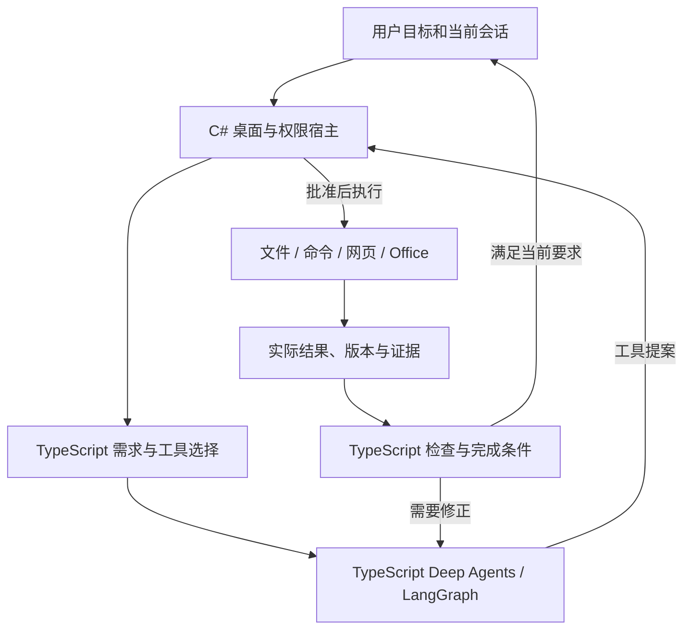

# v0.16.0 Agent 主体语言迁移

## 当前结论

按“先迁 Agent 业务主体，桌面壳分步迁移”的取舍，v0.16.0 已把默认新任务的需求判断、工具选择、交付验收和成果检查迁到 TypeScript。模型循环继续采用仓库锁定的 Deep Agents 1.16.4 / LangGraph 1.7.3，沿用 v0.13–v0.15 的上下文、检查点、调用额度和原生工具协议。

C# 继续负责 Windows 窗口、权限、持久任务记录、实际文件/进程/浏览器与 Office 接口。旧任务和显式 native / JSON 兼容路径保留原有规则。当前产品仍是 Windows 应用，业务语言迁移不表示桌面宿主已完全重写。

## 职责与入口

| 层 | 实现 | 主要入口 | 职责 |
| --- | --- | --- | --- |
| 模型执行 | TypeScript / Deep Agents | `runtime/research/src/worker.ts`、`kernel.ts` | 模型调用、工具等待、上下文与检查点 |
| 需求与工具 | TypeScript | `runtime/research/src/business/planning.ts` | 按用户消息顺序更新目标、来源、格式、长度、工具和接续上下文 |
| 完成条件 | TypeScript | `runtime/research/src/business/completion.ts` | 判断实际文件、当前版本验证、回读与完整阅读是否满足目标 |
| 结构与来源检查 | TypeScript | `runtime/research/src/business/review.ts` | 文档结构、PPT 原生对象问题、来源阅读状态与检查范围 |
| 业务进程协议 | TypeScript | `runtime/research/src/business-worker.ts` | 有版本的 JSON 输入输出；不调用模型、不加载插件、不自行读文件 |
| 原生业务适配 | C# | `src/AgentBusinessCore.cs`、`AgentBusinessDelivery.cs` | 提供实际环境和文件证据，调用 TypeScript，约束原生可用工具与资料范围 |
| 操作底座 | C# | `AgentTaskHost`、`AgentJournal`、工具模块 | 审批、日志、恢复、版本保护、真实 I/O 与撤销 |
| Windows 界面 | C# + JavaScript/CSS | `Program`、WebView2、`ui/` | 窗口、本地预览与可检查的交互 |

运行时信息通过 `agentRuntimeInfo` 返回 `businessCoreLanguage`、`businessCoreVersion`、`businessCoreReady` 与 `desktopHostLanguage`，可以检查实际包里的组件。

## 为什么保留这部分 C#

文件版本、任务日志、权限和撤销都有现成实现及大量回归覆盖，直接影响用户数据。先保留这些适配器，能够让业务迁移与桌面迁移分别验证。Office COM 和 WebView2 也能继续使用当前成熟的 Windows 接口。

TypeScript 规则通过纯函数接收事实，便于单独运行和测试。原生适配器仍以当前资料范围、注册工具和真实文件版本为上限，不能因为业务层返回一个名称就扩大权限。组件缺失或协议不匹配会明确失败，不静默改用另一套新任务规则。

当前业务桥为短生命周期 Node 进程，任务计划按当前输入缓存；结构检查和验收只传必要的原生事实。它不会为这些规则增加模型请求。本版没有把语言更换描述成已证明的速度提升，后续根据任务耗时、模型轮次与本地启动成本决定是否合并为长期驻留服务。

## 哪些旧实现仍有用

- `AgentTaskIntent`、`AgentToolProfiles`、`AgentAcceptance` 和 `AgentCodeDelivery` 的旧分支用于已有日志及显式兼容执行，新默认任务进入 TypeScript 分支。
- `AgentTaskEngine` 保留原生持久化和审批状态迁移。它不是新建的另一套通用模型推理循环。
- `AgentContinuation` 从原生会话分支和真实任务事件提取候选上下文；TypeScript 依据当前目标决定保留或切换任务领域。旧审批、命令与验证不会带入新任务。
- 文档、PPT、照片、视频与音乐的有效编辑/预览代码继续保留；是否已成为完整 Agent 工具，以能力状态和验收记录为准。

不能仅凭 C# 文件数量判断“没有迁移”，也不能把旧路径还在就当作已完成删除。移除兼容代码应先有日志升级和回放证明。

## 后续分步实施

2026-11-16 更新：以下步骤已纳入[总规划 3.0](PROJECT_PLAN_0.14_TO_1.0.md)和[近期详细执行计划](NEXT_PHASE_0.16_TO_0.18.md)。版本窗口是计划，实际切换以验收为准。

| 窗口 | 任务 | 实施结果要求 |
| --- | --- | --- |
| v0.16.x | R07/H01：业务桥测量、原生工具与事件契约 | 有性能证据，保持唯一权威日志和原生权限 |
| v0.17 | H02/H03：新壳原型与选择记录 | 优先验证 Tauri 2 + TypeScript/Node；Electron 备选；测完整应用而非空壳 |
| v0.18 | H04：达标后提供可选试用壳 | 复用现有 UI 和原生适配器；逐步迁移业务调度，旧数据可恢复 |
| v0.19 | H05：默认壳切换评审 | 两个连续候选包通过功能、资源、数据迁移和恢复门槛 |
| v0.20–v0.21 | H06：退出已替代代码 | 历史任务可读/导出/接续，删除有调用与替代证据 |

### 第一步：稳定当前业务边界

在后续领域版本开发中，优先把任务规划、检查、修复策略放进 TypeScript。C# 增加的是具体 I/O 适配器。保持业务协议版本、真实证据结构和失败行为明确。

验收要求：新任务走 TypeScript；旧任务可读取和恢复；中途改变目标、只读模式、取消、额度、审批、文件冲突不回归。持续测量完成率、无效模型轮次、修复轮次和本地启动成本。

### 第二步：把原生工具边界做成可替换服务

逐步将工具描述、批准、执行、取消、事件流与结果读取整理为稳定接口，先通过现有进程桥运行。评估哪些持久化或任务投影适合迁入 Node 服务，避免复制第二套日志和版本系统。

验收要求：同一任务仅有一份权威状态；进程重启不重复写文件或重放旧点击；新旧服务的日志回放结果一致；实际文件与会话范围不能因协议重构改变。

### 第三步：单独验证桌面壳替换

业务接口稳定后，再做新的桌面壳原型，验证启动、空闲内存、包体、拖放、文件关联、窗口与多屏、中文输入法、辅助功能、更新与 Windows 工具连接。优先复用现有 Web 界面和业务服务。

验收要求：能在同一份资料副本上完成研究、代码、PPT 与恢复流程；实际包和桌面回归通过；已有用户数据可迁移；达到可衡量的开发或运行收益后再替换默认壳。

当前将 Tauri 作为原型首选，不预先决定正式替换结果。Node、原生适配器、可选媒体组件都要计入包体与资源；若收益不成立，可保留当前薄宿主或选择 Electron。照片、视频、音乐的工具建设不以换壳为前提，具体测量与切换门槛见近期执行计划的 H01–H06。

## 领域推进与质量

详细的通用 Agent 规划见[项目计划](PROJECT_PLAN_0.14_TO_1.0.md)。先在 v0.16.x 改善任务完成、重复调用和文档/PPT 质量，再推进 v0.17 照片、v0.18 视频、v0.19 音乐以及 v0.20 表格和更通用的电脑操作。每项能力均需实际可用文件、可继续编辑的工程、真实检查与局部修复。

v0.16 的结构检查与 PowerPoint 渲染只是高质量交付的基础。引用支撑、事实冲突、专业排版、图表语义及视觉自动评审仍需专门实现和样例评测；不能通过“检查通过”四个字代替这些工作。

本版验证和部署限制见 [v0.16.0 验证记录](VALIDATION_0.16.0.md)。
