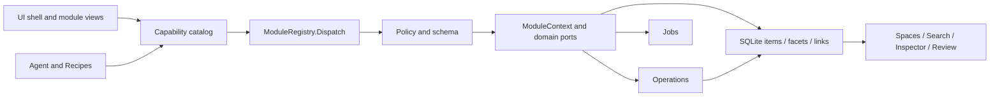

# v0.8.1 · Architecture

[中文](ARCHITECTURE_0.8.1.md) · [Implementation status](WAREHOUSE_0.8.1.en.md)

The current source of implementation and acceptance status is the linked warehouse document. Earlier JSON-only / seven-module descriptions are superseded.

Every bridge action enters the registry. Modules receive Library, policy, Operations, Jobs and service ports, not MainWindow. Existing source/private-transition guards remain before dispatch; legacy domain validators are retained behind explicit declarations. Agent tools remain transport adapters of the capability catalog rather than a second business registry.

SQLite is canonical; Entry remains the compatibility DTO reconstructed from core/facet records. Ordinary and private stores share the schema. Private databases use an encrypted serialized in-memory image. Original JSON inputs and migration copies remain intact. Readable source bodies and metadata use separate FTS indexes; notes/backlinks and workspace relationships share links.

Operations own conflict checks and global undo; encrypted file versions cover managed-document byte restoration. Jobs retain checkpoints and results, never replay after restart. Agent sessions keep encrypted native tool observations once; handoff is explicitly selected, not automatic session forking.

UI modules declare routes, navigation, commands, card descriptors and Inspector sections. The shell renders declarations and dispatches one event stream. Named extension and snapshot pipelines preserve old implementations while preventing direct reassignment. This is a migration boundary, not proof that every legacy source has become an isolated module. Agent session, rendering and task implementations now use one real ES module behind AgentUi rather than three global scripts. CSS consolidation remains unfinished.

Workspace, clip and viewer implementations live in ui/modules, exposing explicit Warehouse / Inspector / AgentUi / DocumentUi / PresentationUi compatibility accessors. The style builder emits nine ordered runtime resources from 42 sources; packaging excludes the style sources. Common viewer/photo geometry now belongs to viewer-shell.css; competing definitions were removed from warehouse.css and the old workspace-clarity.css. Other semantic component cleanup remains incremental.

Document and presentation implementations live in document-runtime.mjs / presentation-runtime.mjs. The registry emits catalogChanged after refresh/dispose/start completes, so viewer controls reflect the updated catalog.
