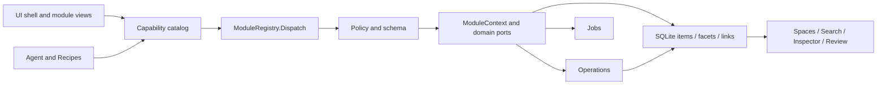

# v0.8.1 · 仓库架构

[English](ARCHITECTURE_0.8.1.en.md) · [实际进度与验收边界](WAREHOUSE_0.8.1.md)

本文取代早期“保留 JSON、仅七个模块”的说明。当前实现与验证范围以仓库进度文档为准。

所有桥接业务动作先进入注册表。模块接收 Library、策略、Operations、Jobs 和服务端口，不接收 MainWindow。原有来源、私密切换安全门仍在分发前执行；兼容处理器的领域校验继续保留。Agent 工具是能力清单的传输适配器，不另立业务注册表。

SQLite 为主存储；Entry 是从核心与分面重建的兼容 DTO。普通与私密库共享结构，私密库通过内存映像加密落盘。原 JSON 和迁移副本保留。正文与元数据分开建索引，笔记引用、反向链接和空间关系共用 links。

Operations 负责冲突检查与全局撤销，加密版本负责托管文档的字节恢复。Jobs 保存检查点和结果，重开不自动重放。Agent 的完整工具结果在原生日志中保存一次，交接由用户明确选择，不自动 fork 会话。

界面模块声明路由、导航、命令、卡片和检查器分区，壳层渲染声明并转发事件。具名扩展和快照管道为旧实现提供迁移边界，禁止直接覆盖全局函数；这不代表所有兼容文件已经独立模块化。Agent 实现已收进单个 ES module，对外使用 AgentUi，原来的会话、渲染与任务全局脚本不再加载。多代 CSS 的进一步收敛仍未完成。

工作区、摘录与查看器实现位于 ui/modules；旧适配器保留 Warehouse / Inspector / AgentUi / DocumentUi / PresentationUi 明确入口。样式构建将 42 份源表合成 9 个有序运行时资源，打包排除原样式源；共用查看器和照片布局已归到 viewer-shell.css，移除 warehouse.css 与旧 workspace-clarity.css 的竞争定义；其余组件的语义收敛仍可继续。

文档和 PPT 实现迁入 document-runtime.mjs / presentation-runtime.mjs；模块清单刷新、停用和启动完成后统一发出 catalogChanged，查看器再刷新能力按钮，避免按旧清单显示入口。
