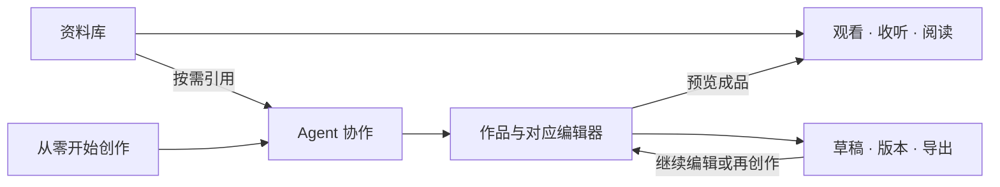

# kok 功能结构方案：Agent、作品与资料库

状态：产品结构草案。下文区分已有能力与建议补齐的能力，不代表所有创作功能已实现。

## 产品定位

Agent 是主要协作入口，作品承载创作过程，资料库提供独立的观看、收听、阅读和管理体验。
资料既可以直接欣赏，也可以按用户选择成为任务上下文和作品素材。生成的作品同样可以播放、阅读和再次创作。

## 一级功能

| 入口 | 用户的主要意图 | 内部组织 |
| --- | --- | --- |
| Agent | 描述目标、获得帮助、继续任务 | 当前任务、历史任务、待确认操作、成果 |
| 我的作品 | 新建、继续编辑、查看版本和导出 | 草稿、进行中、成品；按作品类型筛选 |
| 资料库 | 看视频、听音乐、读书、看文档和照片 | 全部、视频、音乐、文档、电子书、照片；继续观看/阅读与收藏 |

模型、MCP、用量、媒体组件等放在设置；空间作为可选的项目组织方式。
创作按钮是动作，作品类型是新建时的选择；资料类型是资料库中的筛选。

## 共享内容与两条完整路径

欣赏路径：打开资料 → 直接进入对应播放器/阅读器 → 保留进度和收藏；Agent 按需介入。
AI 操作保持已有的范围与授权约束；默认观看本身不增加模型调用。用户已启用的自动翻译等偏好独立生效。

创作路径：描述目标或选择作品类型 → 自动建立作品草稿 → Agent 生成/调整与手动编辑 → 预览 → 保存版本/导出。
素材可在任何适当阶段加入；用户不用先整理资料库才能创作。

每份内容保留一个资产身份，作品引用素材；草稿、原文件与导出副本有清楚关系。
生成作品不需要在“作品区”和“资料库”各复制一份文件。作品可以使用同一套播放器和阅读器预览。

## 作品类型与实际能力

| 类型 | 当前基础 | 建议补齐 |
| --- | --- | --- |
| 文档/演示 | 新建 MD、TXT、DOCX、PPTX；Agent 可修改唯一正文片段、PPT 指定元素或页面，支持预览、确认和撤销 | 继续完善作品级版本浏览与更多版式；当前实现见 [创作流程](AGENT_CREATIVE_WORKFLOW.md) |
| 小说 | 可用文本编辑器写作，已有 EPUB 导出基础 | 作品级大纲、人物设定、章节管理和连续性检查；按章生成和修改 |
| 音乐/音频 | 已有音频播放、已有片段的剪辑/拼接与导出 | 从零作曲需要音乐生成引擎；录音、配音或多轨能力按实际实现提供 |
| 视频 | 已有观看、已有片段的剪辑/拼接、字幕与导出基础 | 从零生成视频需要生成引擎；增加脚本、分镜、素材与时间线的对应关系 |

文字模型承担内容规划与文字生成；可播放的音频/视频需要相应生成引擎或已有媒体素材。
音乐方案、歌词和分镜属于创作中的中间成果，不能当作已经生成的音频/视频成品。

能力依据：`ui/modules/document-runtime.mjs`、`src/AgentRuntime.cs`、
`src/CreativeEdits.cs`、`src/MediaSequence.cs`、`src/TextDocumentExport.cs`。

## 体验约束

- 打开资料默认观看/阅读；编辑、引用片段与交给 Agent 有明确的独立动作。
- 视频全屏、阅读排版、章节/书签、音乐队列和后台播放保持独立可用。
- 一边听音乐一边使用 Agent 时，播放器和任务输入区互不遮挡。
- 从正在观看的内容发起任务时保留来源和进度，能明确引用章节、页码或时间段。
- 作品入口区分“继续编辑”和“预览成品”，资料入口保留直接打开内容的短路径。
- 支持手动编辑与 Agent 协作来回切换，保留用户修改；新增变更有预览、版本和可恢复性。
- 按片段、章节、场景处理；重复使用未改变的上下文，减少整份小说/整部视频的重复处理。

## 当前落地状态（v0.10.1）

本轮完成第 1 步：统一作品、资料和任务的入口及关系，保留现有观看/收听/阅读功能。

- 一级入口为 Agent、我的作品、资料库；文件类型与工具移入各自区域内部。侧栏另有私密文件夹和设置。
- 我的作品（`ui/modules/works-page.mjs`）：新建 MD/TXT/DOCX/PPTX 作品复用现有新建文档流程；继续编辑 kok
  中新建或修改过的内容；进入项目空间、素材摘录和创作配方；从已有视频、音频、PDF、文档进入现有剪辑/整理流程。
  kok 中新建的文档与演示文稿带 `ownedDocument` 标记，会出现在“继续创作”。
- 资料库（`ui/app.js`）：类型筛选、继续观看与阅读、收藏与最近打开、分类、资料库工具（智能整理、视频下载、
  知识图谱、智能集合、回顾、操作历史、活动、资料检索与备份）。
- 观看、收听、阅读、笔记、字幕、书签、播放队列等既有体验保持独立可用；后台播放与 Agent 输入区、通知互不遮挡。
- Agent 的任务记录、成果与待确认操作仍留在 Agent 区域。

分阶段接入（本轮未做）：

- 小说作品级大纲、人物设定、章节管理与连续性检查；按章生成与修改。
- 从零生成可播放的音乐或视频（需要对应生成引擎）；当前只支持已有媒体的剪辑与拼接。
- 作品级原生数据模型（草稿/进行中/成品状态、版本与导出记录）。本轮“我的作品”按已有资料与编辑草稿推导，
  导出成品仍进入资料库，使用同一套播放器和阅读器欣赏。

## 建议的落地次序

1. 统一作品、资料和任务的入口及关系；保留现有观看/收听/阅读功能。
2. 以文档与小说先完成“新建—生成—编辑—版本—导出”闭环。
3. 把已有音视频剪辑整理进作品流程，保留可播放的真实预览。
4. 接入可验证的音频/视频生成能力，再启用相应的从零生成路径。

验收分别沿两条路径进行：一组用户只观看/收听/阅读即可独立完成任务；另一组用户可从空白目标创作、编辑、找到并导出作品。
