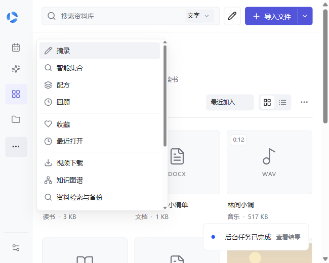

# Interface references and review method

This refresh uses specific interaction patterns rather than reproducing another
application's appearance. All UI remains local, using kok's existing native bridge.

| Reference | Pattern adopted in kok |
| --- | --- |
| [Lucide specification](https://lucide.dev/contribute/icons/specification) and [source](https://github.com/lucide-icons/lucide/tree/0.468.0/icons) | Consistent 24-unit outline icons with round caps and joins. A pinned offline subset replaces individually drawn paths and object illustrations. Original geometry is preserved, including circles in the ellipsis icon. |
| [Radix Dropdown Menu](https://www.radix-ui.com/primitives/docs/components/dropdown-menu) | Menus anchored to their triggers, arrow/Home/End navigation, Escape dismissal, focus restoration and a single active popover. The existing plain-JavaScript menu is retained rather than introducing a React dependency. |
| [Zotero quick start](https://www.zotero.org/support/quick_start_guide) | Separate navigation, the file collection and details. Global search/creation are distinct from filters and sorting. The existing inspector provides file details. |
| [Immich thumbnail implementation](https://github.com/immich-app/immich/blob/main/web/src/lib/components/assets/thumbnail/Thumbnail.svelte) | Quiet thumbnails, contextual selection/actions and keyboard focus movement. Real content is preserved while decorative fallback artwork uses neutral icons. |
| [VS Code Activity Bar](https://code.visualstudio.com/api/ux-guidelines/activity-bar) and [Views](https://code.visualstudio.com/api/ux-guidelines/views) | The Activity Bar holds a small set of top-level view containers, not every leaf view; one clear icon per container, names on hover/focus, no duplicated icons. Keep views to a minimum. |
| [tldraw OverflowingToolbar](https://github.com/tldraw/tldraw/blob/main/packages/tldraw/src/lib/ui/components/Toolbar/OverflowingToolbar.tsx) | Cap the main toolbar (min/max items), move the rest into a "More" overflow, and promote the most recently used overflow item back into the main toolbar. Responsive by measured width, not by guessing. |
| [AFFiNE RootAppSidebar](https://github.com/toeverything/AFFiNE/blob/185b4826fc5ae7dcc1ba8a7c9d315d45b75e1b32/packages/frontend/core/src/components/root-app-sidebar/index.tsx) | A fixed primary region, a separately scrollable secondary region of collapsible sections, and fixed settings entry; avoids growing the icon rail without continuing to add icons. |
| [Excalidraw Actions](https://github.com/excalidraw/excalidraw/blob/master/packages/excalidraw/components/Actions.tsx) | Related tools share one visible slot and expand through a flyout/popover; the compact surface stays readable while advanced tools remain one step away. |
| [Radix Dropdown Menu](https://www.radix-ui.com/primitives/docs/components/dropdown-menu) | The active row is communicated with a background highlight; menu focus does not add a second outline ring. |
| [Material motion](https://m3.material.io/styles/motion/overview) | Animate transform and opacity, avoid layout properties, and respect reduced-motion. |

Lucide is pinned to 0.468.0 and distributed under its ISC license. The source
URLs and hashes are recorded in `ui/icons/lucide/manifest.json`; the license is
in `docs/licenses/Lucide-ISC.txt`. No application code was copied from Zotero,
Immich or Radix. These are design references, not runtime dependencies.

## Compact navigation (≤820 px)

The wide sidebar keeps its labelled groups. Below 820 px the rail now has five visible
controls: Today, Agent, All files, Spaces and a single overflow entry, plus Settings at
the bottom. The rail no longer tries to show every destination at once.

- Library type filters (Videos, Photos, Music, Documents, Books) remain in the library
  toolbar tabs; they are not repeated in the rail or the overflow.
- The overflow opens a label menu to the right of the rail, with separators for Organize,
  Quick access, Tools and Collections. It has no extra headings or descriptions.
- Private folder, collections and New collection stay reachable in the same overflow.
- When the current destination lives in the overflow, the overflow control carries the
  active state; primary destinations keep their direct state.
- The compact rail has no scrollbar at 650×520; the overflow menu scrolls when needed.
- The pattern follows VS Code's small top-level Activity Bar, tldraw's measured overflow,
  AFFiNE's fixed-primary/scrollable-secondary split, and Excalidraw's grouped flyouts.

## Motion and focus

- Panel exits now start from the panel's current transform rather than forcing it to `none`; interrupting an opening animation therefore continues from the current position instead of jumping back.
- The navigation indicator only transitions `transform` and `opacity` (240ms), not width/height; reduced-motion disables the transition entirely.
- The overflow menu uses a row highlight for keyboard focus instead of an additional outline ring; `Escape` restores focus to the overflow trigger.
- Tooltips are 12px, and the compact rail uses 40px targets with 20px glyphs. Small sidebar labels and counts are 12px.

## Behavior and layout decisions

- Frequent destinations remain visible; secondary tools are in a disclosure that
  remembers its state during navigation. Current destinations expose `aria-current`.
- A single library toolbar owns file-type filters, sorting, view switching and
  additional tools. Comparison and Agent entry points no longer compete beside
  the page title.
- File menus open next to the file, with common actions first and additional
  capabilities one level deeper. Commands still use their existing module gates.
- Arrow keys move between files; Space toggles selection; Shift + arrows extends
  it; Ctrl + A selects displayed files; Escape clears selection. Shift + F10 opens
  the focused file's menu. Enter keeps the existing open/play behavior.
- Ctrl + F focuses library search; Ctrl + K keeps the existing command palette.
  The visible search shortcut now matches the action.
- Interaction transitions use 120–180 ms. Menu dismissal is immediate, preventing
  a stale closing menu from occupying the top layer. Text does not scale during
  navigation, and reduced motion disables entrance effects.
- Equal-sized previews preserve global sort order. Format labels, hover prompts
  and per-card commands are not repeated unnecessarily. Audio duration metadata
  belongs inside its preview or list row.
- Empty collection screens explain their purpose and provide a relevant next step.

## Review and verification

`tests/interface-usage.cjs` covers continuous keyboard and pointer workflows,
trigger focus recovery, selection, filters, search, contextual tools, menu bounds,
rapid interruption and reduced motion. `tests/interface-audit.cjs` captures every
main route and sample-file viewer at multiple widths and in both themes. It also
captures settings, module management, private-folder entry, commands and mode
selection, including long file names and English layouts.

Screenshots are reviewed visually as well as checked for viewport overflow.
`tools/interface-contact-sheets.cjs` creates local contact sheets for that review.
The gallery and geometry report are saved under `test-output/interface-audit`.
Broader existing desktop suites check reading, annotations, media playback,
translation with local mocks, import/drag, file editing, private scopes, Agent,
module switches, spaces and library services. Real paid model requests are outside
this interface verification.

The first 99-screen pass exposed a narrow PDF toolbar that placed actions beyond
the viewport. Visual review additionally found compressed Agent empty-state
content, residual record artwork in the music library, misaligned duration badges
and unhelpful empty collection pages. These findings are handled in the interface
and followed by another capture pass; geometry success alone is not visual approval.
