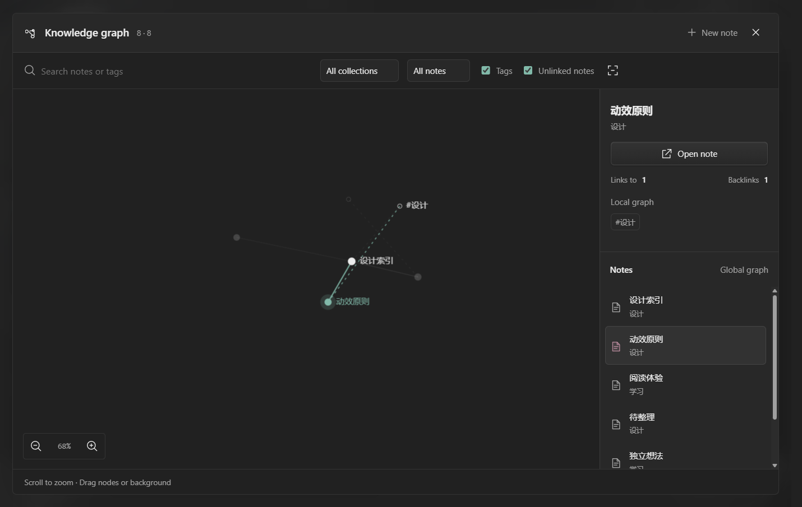

# Notes and knowledge graph

[中文](KNOWLEDGE_0.6.1.md) · [Back](../README.en.md)

Open **Knowledge graph** in the sidebar for all notes, or use the editor’s graph button for the current note’s neighborhood. Everything runs locally, including in Pure mode.

| Feature | Usage |
| --- | --- |
| Note links | Type `[[`, search, then choose a note. Arrows select, Enter / Tab confirms, Esc cancels. `[[note#heading\|label]]` is supported |
| Linked-note creation | Click an unresolved link or choose Create note, then confirm its name and collection. Duplicate names prefer the current collection; ambiguous links show choices |
| Links and outline | The editor sidebar shows outgoing links, backlinks and heading navigation |
| Tags and tasks | Write `#tag` or `- [ ] task`; check tasks in the preview. Inline frontmatter fields `tags: [tag]` and `aliases: [alias]` are recognized |
| Templates | Ctrl+N creates blank, daily, meeting or reading notes as Markdown / Word (DOCX) / TXT |
| Graph | Scroll to zoom, drag nodes/background, click to inspect and double-click to open. The adjacent list also supports selection/opening. Filter by search, collection, tags, unlinked notes and one/two-hop neighborhoods |

Source/editing views, preview, auto-save, Ctrl+S and reopening use the [managed-document workflow](DOCUMENTS_0.6.1.md). Fenced/inline code, images and external URLs do not generate relationships. Local Markdown file links participate in indexing. Note scripts are never executed.

**Scope:** lightweight notes rather than full Word or Obsidian compatibility. DOCX edits rebuild simple body text. Common Markdown headings, emphasis, lists, quotes, tasks and code blocks are supported; plugins, block embeds and full CommonMark support are not included. Imported originals use drafts or exported copies. Direct auto-save applies only to documents created by kok.

**Data and performance:** relationships come from ordinary-library metadata, notes, annotation thoughts and readable bodies, without AI calls. Body indexing supports Markdown / TXT / DOCX / EPUB; PDF bodies are excluded. Each body is bounded to 120,000 characters, with a 6 Mi-character total budget and 2,000 library entries. Skipped or truncated bodies retain metadata and show a notice. Graph views cap at 500 nodes. A Worker calculates a settled layout before reveal. Filters reuse geometry, released nodes stay put, and rendering becomes idle. Closing terminates the Worker. Reduced-motion mode computes a settled layout before presenting it.

The private folder is excluded from the graph and its body cache. Switching libraries clears the UI index and cached geometry. No unimported folders are scanned and nothing is uploaded.

Design references: [Logseq local/global graphs](https://github.com/logseq/logseq/blob/master/src/main/frontend/components/graph.cljs), [SiYuan linked notes](https://github.com/siyuan-note/siyuan), [d3-force cooling](https://github.com/d3/d3-force/blob/main/src/simulation.js), and [Radix Presence interruption handling](https://github.com/radix-ui/primitives/blob/main/packages/react/presence/src/presence.tsx). kok uses its own Canvas/Worker implementation and existing WAAPI motion; their component code and runtimes are not bundled.
