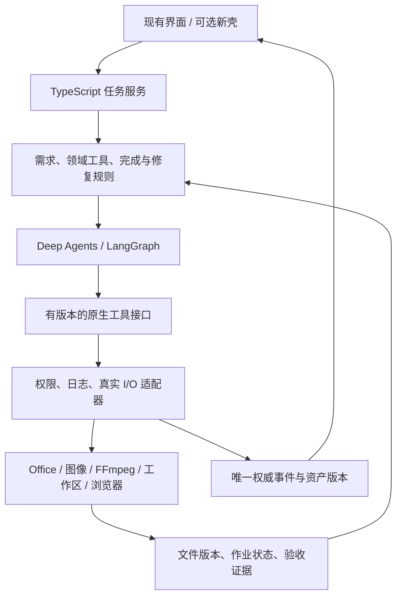

# kok 下一阶段详细执行计划：v0.16.x–v0.18

> 计划版本：1.0，与[总规划 3.0](PROJECT_PLAN_0.14_TO_1.0.md)配套
> 更新日期：2026-11-16（Asia/Taipei）
> 实施基线：已发布的 v0.16.0 Preview，提交 `2392876129bbe049747819ae2510fbdfee768389`
> 本文状态：v0.16.1 首批已实施，后续任务待验收；任务表中的整体目标不等于当前成绩
> 核心问题：任务要做得完，成果要能直接使用，继续修改要少重做

2026-11-17 调整：按用户要求，v0.16 全部收尾前暂不发布。当前 0.16.3 是内部候选，发布开关已关闭；逐项状态和整体门槛见 [v0.16 完成清单](V016_COMPLETION_CHECKLIST.md)。

## 首批实施进展：v0.16.1

已实施需求取消/替换修复、未执行提案取代、严格模型工具恢复协议、稳定读取循环防护、完全相同成功回执的 HTTP 投影和时间/用量诊断。18 项确定性规划检查由 11/18 到 18/18；3 个真实 DeepSeek 调整场景最终交付通过，本轮累计 16 次请求，含前期 3 次协议错误。范围、测试和限制见[v0.16.1 验证](VALIDATION_0.16.1.md)。

这是 R01/R02/R03/R05/R06 的首批实现及 R07 的测量结果；完整两轮真实评测、更广的缺项修复和上下文优化继续推进。下文的整体阶段门槛保持待验收，不能因本批修复通过而全部勾选。

## 1. 判断与推进顺序

kok 已有可用的 TypeScript Agent 内核、原生文件/进程工具、代码验证、文档/PPT 编辑和恢复基础。下一阶段应在真实任务上消除无效步骤、补齐成品检查，再逐个扩展领域。继续更换 Agent 框架本身，无法替代这些工作。

1. **v0.16.1：稳定完成。** 固定样例，减少需求误判、重复上下文和无进展循环，保留已完成成果。
2. **v0.16.2 起：交付质量。** 让报告有依据、PPT 有设计和真实数据，并将渲染、评审、局部修复接起来。范围较大的部分延续到 v0.17。
3. **v0.17：照片与海报。** 用户交给 Agent 一组图片，得到准确尺寸的成品、可重开的工程和可继续调整的对象。
4. **v0.18：短视频。** 用户从已有素材得到可播放的 1080p 短片、字幕和工程，并能只修改指定片段。

音乐维持 v0.19 独立主线；表格、远程网页及桌面操作在 v0.20 完整加固。基础 CSV 数据与音频处理分别提前服务 PPT 和视频。各领域共用任务、资产、作业、用量和验收机制。

版本号表达实施顺序。若一个批次过大，应拆成小版本或后移增强项；不通过降低验收标准凑版本。

## 2. 当前事实与待验证假设

| 当前事实 | 对下一阶段的含义 |
| --- | --- |
| 默认新任务的规划、工具选择、交付判断与结构检查已是 TypeScript | 新业务继续进入现有模块，不再复制一套 C# 规则 |
| Deep Agents 1.16.4 / LangGraph 1.7.3 已有固定版本与恢复测试 | 先使用现有组合；升级单独验证，不与换壳、媒体工程同时进行 |
| v0.16 单个真实任务用 8 次请求完成 DOCX、8 页 PPT 与渲染 | 能作为一个基线样例，不能代表总体完成率 |
| 该任务输入 199,679 tokens，其中缓存 161,280；先前调试有未完成任务 | 量化回执大小、缓存、重复步骤和失败成本，不能只统计最终成功的 8 次 |
| 业务桥是短生命周期 Node，任务计划已有缓存 | 先测启动/序列化占比，再决定是否常驻；本地桥不调用模型 |
| C# 持有任务日志、权限和真实 I/O，旧任务仍有兼容分支 | 迁移服务不能产生两个权威写入者；历史数据必须可用 |
| PPT 已有结构检查和实际 PNG，但 `visualReviewed=false` | 增加真正读取渲染的评审记录，不能把渲染完成当作审美检查 |
| 照片导出与提示存在 8192/4096 px 不一致 | I02 用真实图片打通预览、导出、提示及格式文档 |
| 本地网页仅支持受约束的本机来源 | 远程网页、下载、上传与桌面操作需要单独实现和验证 |

依据：[v0.16 验证](VALIDATION_0.16.0.md)、[业务迁移](AGENT_TYPESCRIPT_0.16.0.md)、[v0.15 边界](VALIDATION_0.15.0.md)。性能瓶颈、模型之间的效率差异、新壳的资源收益都属于待测假设。

## 3. 目标架构和实际修改入口

### 3.1 复用现有分层



这是演进目标；当前任务调度与权威日志仍有 C# 实现。近期保留日志写入者，通过接口逐步迁移业务服务。图状态、产品日志和媒体工程各有职责，不能互相冒充。

### 3.2 模块清单

| 工作 | 已有入口 | 修改原则 |
| --- | --- | --- |
| 需求与工具范围 | [planning.ts](../runtime/research/src/business/planning.ts)、[contracts.ts](../runtime/research/src/contracts.ts) | 基于已有契约演进；新字段有默认值和兼容样例 |
| 成果、来源与验收 | [review.ts](../runtime/research/src/business/review.ts)、[completion.ts](../runtime/research/src/business/completion.ts) | 接收真实事实；明确哪些是测量、估计或模型评审 |
| 模型与上下文 | [kernel.ts](../runtime/research/src/kernel.ts)、[worker.ts](../runtime/research/src/worker.ts)、[checkpoints.ts](../runtime/research/src/checkpoints.ts) | 保留公开 SDK 接口、用量许可和中断恢复 |
| 业务桥 | [business-worker.ts](../runtime/research/src/business-worker.ts)、[AgentBusinessCore.cs](../src/AgentBusinessCore.cs) | 先测量，再改进程生命周期；不增加模型循环 |
| 任务接续 | [AgentContinuation.cs](../src/AgentContinuation.cs) | 只继承可信分支和当前作用域；重新核对当前文件版本 |
| 后台命令 | [AgentCommandJobs.cs](../src/AgentCommandJobs.cs)、[AgentExecution.cs](../src/AgentExecution.cs) | 等待/取消不消耗额外模型调用；确认真实输出 |
| PPT | [AgentPresentationXml.cs](../src/AgentPresentationXml.cs)、[PresentationRenderer.cs](../src/PresentationRenderer.cs) | 定点修改保留无关内容；渲染与源版本绑定 |
| 照片 | [photo-editor.js](../ui/photo-editor.js)、[photo-tools.js](../ui/photo-tools.js)、[canvas-editing.js](../ui/canvas-editing.js) | 复用编辑交互，补工程和可供 Agent 调用的执行器 |
| 媒体 | [MediaSequence.cs](../src/MediaSequence.cs)、[media-timeline.js](../ui/media-timeline.js) | 复用探测/导出，逐步加入结构化时间线与作业 |
| 界面与结果 | [agent.mjs](../ui/modules/agent.mjs)、[agent-presentation-view.mjs](../ui/modules/agent-presentation-view.mjs) | 展示已保存成果、缺项与可继续修改的入口 |

新增逻辑目录可在必要时设为 `runtime/research/src/capabilities/`、`services/` 和 `adapters/`，它们是建议位置，目前不代表已经存在。暂保留 `runtime/research` 路径和已发布协议名称，避免无收益的全仓更名。

## 4. v0.16.1：任务完成与效率

### 4.1 R01 — 建立可解释的基线（P0）

**产物：** 固定任务清单、素材哈希、预期交付、用量/耗时报告与失败分类。优先复用既有评测脚本和请求账本，不另造相同系统。

每个任务记录：目标版本、模型配置、任务/工具/作业 ID、首次成品时间、最终状态、请求次数、缓存/非缓存输入、输出用量、模型等待、本地处理、审批等待、修复次数、结果文件版本。

失败至少区分：需求误判、资料不足、工具/组件不可用、上下文或额度耗尽、循环无进展、产物不合格、版本冲突、用户取消。工具执行成功与任务完成分别记录。

**验收：** 同一个失败任务可以解释失败在哪一步、已保存什么、花费多少、能从哪里继续。没有实际用量或价格数据的字段标为未知。

### 4.2 R02 — 稳定需求与顺序修改（P0）

**产物：** 基于现有 TaskSpec 的明确需求版本和交付条件，避免持续堆叠互相覆盖的关键词正则。

- 区分新建、读取、检查、修改既有文件和历史叙述。
- 明确格式、页数、长度单位、已有资产、允许修改范围和是否需要执行验证。
- 用户修改要求时，仅使受影响的交付条件失效。
- 简单确定的指令走本地规则；复杂指令可在既有模型轮次中提出结构化需求，由主机校验后采纳，不给每个任务固定增加一次“规划模型”。
- 缺少关键信息时只问影响执行的内容；可从已有文件和会话查到的信息先查。

**验收：** “检查已经生成的 8 页 PPT，再写报告”不新建 PPT；“只修改第 3 页”保留其余页；“先不运行测试”与后续“现在运行”按顺序生效；“继续优化”绑定真实工作区；换工作区不能沿用旧验证。

这些边界在 v0.16 已有部分修复和回归，应复用。新增实现针对基线暴露的表述/组合问题与契约演进，不重复编写同义测试或把旧修复记成新功能。

### 4.3 R03 — 减少重复上下文（P1）

**产物：** 按任务加载的工具集、精简且可追溯的工具回执、按需读取原文/完整结果的能力。

- 提示词固定部分保持稳定，任务变化放入明确的增量位置。
- 不在每一轮重新注入所有工具、整份来源和完整历史输出。
- 大结果在原生记录中保留；模型先收到状态、关键内容、版本和读取指针。
- 错误、截断、范围不足和缺失输出不能从摘要中丢失。
- “完整阅读”仍须按实际返回内容计算，不能因有摘要或缓存就增加覆盖率。

**验收：** 相同素材与目标下，事实和结果不退化；来源可以定位到同版本原文。长回执跨进程恢复不丢失必要状态，且不会重复执行已完成工具。

### 4.4 R04 — 确定性步骤交给执行器（P1）

**产物：** 明确区分“需要模型决定下一步”和“只需等待/读取已有结果”。

命令等待、已提交渲染的状态查询、文件哈希、长度统计、格式探测与已知结果读取使用本地执行路径。只有新信息需要判断、失败需要制定不同方案或要形成最终交付说明时，再请求模型。

现有命令等待已经有本地执行机制；本任务重点检查模型在其上反复轮询、重复确认的路径，以及新媒体作业是否沿用相同机制。基线没有出现的问题不为优化而重写。

**验收：** 一个 60 秒后台作业的中间轮询不增加模型请求；取消及时传递到任务拥有的进程；真实完成后才发布成果；外部生成请求仍遵守供应商的查询和幂等条件。

### 4.5 R05 — 按缺项修复（P0）

**产物：** 每项交付的验收结果和具体修复目标，例如“DOCX 缺预算章节”“第 4 页对象越界”“命令声明输出不存在”。

- 用测量单位核对长度，不反复改写已符合要求的文档。
- 已完成且版本未变的成果不重复创建或重渲染。
- 只修改指定页面、段落、对象或数据项。
- 修复后重跑相关检查，原检查与修复记录均保留。

**验收：** 一个任务要求 DOCX 和 PPT，PPT 失败时 DOCX 仍可访问；重试从缺项继续；相同内容不会每轮生成一份带序号的新文件。版本冲突先读取当前状态，不能套用旧补丁。

### 4.6 R06 — 停止无进展循环并能继续（P0）

**产物：** 基于目标版本、工具参数、输入/输出版本及问题变化的进展判断。

初始策略建议：同一问题连续两次修复没有新证据或改进时，改用另一条可验证路径，或带具体缺项结束；两次只是可调初值，不代替任务总额度。文件已变化、分页读取或作业仍在推进时，不能误判为无效重复。

**验收：** 无限“检查—重写—检查”被有界处理；预算耗尽仍保留成果和接续信息；用户继续后先核对现状，旧审批和旧测试结果不会自动继承。错误完成和无意义提前停止分别检查。

### 4.7 R07 — 优化业务桥，但先证明收益（P1）

**产物：** 冷/热启动、序列化、规则执行、进程数量和内存的分解报告，以及保留现状或优化的决定记录。

若短进程启动占本地调度耗时的显著部分，可依次尝试缓存、批量纯规则计算，再试单个按需常驻业务服务。建议以本地调度中位耗时下降至少 20%、空闲资源不过度增长、完整任务不变慢作为原型目标；这是待测目标，不是已有收益。

常驻服务必须具备请求 ID、超时、退出清理、损坏响应处理与恢复；纯业务计算可重试，实际写文件/提交作业不能因进程重启就重放。纯规则接口无需拿到模型密钥。

**验收：** 旧任务、中文路径、取消、包内 Node、缺组件和恢复回归通过。若收益小于维护成本，明确保留短进程。

### 4.8 R08 — 冻结候选与交付（P0）

**产物：** 候选包、验证记录、实际用量及新旧任务兼容说明。

先通过相应确定性测试，再运行有明确预算的真实模型样例；修复失败后保留原账本，报告全部尝试。发布前核对候选 SHA、运行时清单和实际 ZIP，通过现有双 Windows 构建与桌面门禁。

**验收：** 不能用 v0.16.0 的历史通过数代替新版本检查；新增工具或变更打包时，检查包含对应的包内执行。纯文档修改不重跑付费评测或完整桌面套件。

### 4.9 任务依赖

R01 先固定评价口径；R02–R06 依据基线中的真实失败逐项实施。R03 和 R04 共享工具结果协议，应顺序审查，避免同时更改消息结构和作业状态。R07 在完成耗时分解后决定是否需要改代码。R08 在候选冻结后执行，修复导致候选变化时只先补跑受影响验证，最终发行包仍执行发布必需检查。

## 5. v0.16.2–v0.17：报告和 PPT 的实际质量

v0.16.3 落实 OS01 的首批有类型需求补齐、版本与用户原话校验、幂等恢复及当前验收保护，并通过公开 SDK 中间件限制临时文件成品替代；见[实现与边界](VALIDATION_0.16.3.md)。不是 OS01 全面替换或 OS02 Pi 运行时接入。

实施方法按[开源复用优先路线](OPEN_SOURCE_REUSE_PLAN.md)调整：先推进 OS01 有类型的需求变更和 OS02 公开会话机制对照，专业工具优先复用 SDK/worker；以真实评测选择替换项，避免继续把关键词规则作为长期主架构。

v0.16.2 首批实现：Q01 的当前文本引文定位、版本及真实阅读记录校验，含已保存报告原句定位；Q02 的必需章节标题/正文检查和主机缺项反馈。新增完整任务真实模型评测入口。各项实测、旧任务兼容与剩余限制见 [v0.16.2 验证](VALIDATION_0.16.2.md)。语义支撑判读、用途/受众的完整契约、PPT 设计/图表/视觉评审仍待后续，不将 Q01/Q02 整体标为完成。

| ID / 优先级 | 工作与可交付结果 | 依赖 | 验收 |
| --- | --- | --- | --- |
| Q01 / P0 | 关键结论—原文位置—来源版本的对应记录；区分直接依据、推论、冲突和无支持 | R02、R03 | 最终修订不被旧预算覆盖；引用位置实际存在；模型判断不冒充确定性证明 |
| Q02 / P1 | 文档用途/受众/章节要求，编辑后检查相关段落及全文一致性 | R05、Q01 | 报告可直接打开使用；保持事实、长度单位、标题层级和未改部分 |
| Q03 / P1 | 首批 6–8 种 PPT 布局组件、字体/色彩/间距规则与页面对象身份 | R05 | 实际可编辑文字/形状；覆盖封面、观点、对比、流程、数据、总结 |
| Q04 / P1 | 结构化数据/CSV → 确定性计算 → PPT 图表与来源记录 | Q01、Q03 | 数值、单位、排序和合计一致；要求可编辑的图表可在目标软件修改 |
| Q05 / P1 | 有版本的逐页渲染与视觉评审记录 | R04、Q03 | 缺字体、文字裁切、错误比例等可定位；渲染与视觉评审分别显示 |
| Q06 / P1 | 按真实对象 ID 定向修复并重新检查 | Q03、Q05 | 不以整体重建损坏未改页面；高风险对象无法保真时给出明确限制 |

Q01 的“支撑”包含人工或模型判读，记录评审者/模型、输入版本和不确定性；数值与引用定位可做确定性校验。不能承诺自动证明每句话真实。

Q04 首版支持明确列类型、少量汇总和常用图表；金额采用明确精度策略。完整 XLSX 公式重算保留给 S01–S06，避免将读取公式缓存当作计算。

Q05 优先复用已有空闲 PowerPoint 渲染。8 页以内直接验收；8 页以上先实现有版本的分批渲染并核对全部目标页，再宣称支持对应数量。无 Office 时显示尚未完成实际渲染。接入视觉模型后，仅标记它实际看过的页面；人工复核也绑定页面版本。模板和几何规则不能代替渲染评审。

**代表任务：** 两份有冲突和最终修订的资料 → 约定长度的报告 → 8 页项目方案；真实小型 CSV → 数据汇报；已有演示只改第 3 页，并保留其余页面。12 页以上、复杂动画/嵌入内容和其他办公软件分别列入增强样例。

## 6. v0.17：照片与海报工作流

### 6.1 用户能完成的第一批工作

1. 对 12 张已有照片统一调整、按要求裁剪并导出，保留每张例外参数和原图。
2. 用产品图制作三种尺寸的封面或海报，中文标题正确、边距一致，文字可继续修改。
3. “只把第二张的色温降低、标题上移”，重开后继续修改，不重做其他图片。

### 6.2 首版与增强范围

| v0.17.0 必做 | v0.17.x 或后续增强 |
| --- | --- |
| JPG/PNG、sRGB、EXIF 方向与透明度 | RAW、HDR、复杂 CMYK 和专业印刷 |
| 裁剪、旋转、翻转、基础明暗/色彩、指定尺寸 | 专业降噪、曲线与复杂局部蒙版 |
| 中文文字、简单图层、对齐与对象级修改 | 任意 PSD 工程导入导出 |
| 批处理、前后对比、版本和工程重开 | 图像生成、扩图和高级修复适配器 |
| 原图与导出分离，清楚显示实际输出规格 | 未验证的任意大图和无限批量 |

### 6.3 I01–I06 实施表

| ID / 优先级 | 产物 | 依赖 | 验收 |
| --- | --- | --- | --- |
| I01 / P0 | PhotoEdit 工程、原图哈希、操作序列、图层 ID 与导出关系 | R02、现有资产投影 | 重启还原；原图变更使相关预览/导出过期；不覆盖原图 |
| I02 / P0 | 与预览一致的图像执行器及尺寸/色彩契约 | I01、R04 | 八种 EXIF 方向、透明 PNG、大图、裁剪+旋转组合；实际像素与界面数值一致 |
| I03 / P1 | 文字与简单对象编辑、字体依赖和尺寸变化规则 | I01、I02 | 中文完整、无未声明字体替换；只改一层，其余对象和版本关系保留 |
| I04 / P1 | 批作业、每项进度、失败项恢复与缓存 | I01、I02、R06 | 第 7 张失败或取消后，已完成 6 张保留；相同规格续做不全量重跑 |
| I05 / P2 | 可选图像引擎适配与能力状态 | I01、用量/作业契约 | 真正得到图片；超时先查询已提交作业；无配置也能使用基础编辑 |
| I06 / P0 | 成品与工程的真实样例评审 | I01–I04；启用生成时另测 I05 | 实际打开图片、核对像素/方向/色彩、重开工程和定点再编辑 |

工具接口覆盖读取属性、创建/读取工程、修改对象、预览、导出、检查、查询/取消作业。名称在实现时与现有注册表统一，不为一个用户动作暴露大量低层参数工具。

### 6.4 技术选择与工程契约

优先复用 Canvas 交互预览，验证 Sharp/libvips 作为最终像素执行器。Sharp 提供输出与元数据/ICC 接口、平台相关安装方式；实际支持和打包必须用 kok 的 Windows/Node 环境验证。[输出接口](https://sharp.pixelplumbing.com/api-output/)、[安装说明](https://sharp.pixelplumbing.com/install/)

先制作限时技术样例，比较现有 Canvas 与候选执行器的相同操作。统一方向归一化、裁剪坐标、色彩转换、文字排版和透明度规则；不能让两端各自实现一套近似算法却声称一致。预览必要时也使用执行器生成的代理图。

工程至少保存：schemaVersion、projectId、source asset/version、工作色彩空间、顺序操作、对象 ID/变换、字体/素材版本、输出规格和执行器版本。导出缓存包含这些信息；结构升级保留读取旧工程的路径。

源图片保留，导出元数据策略明确。Sharp 默认会移除元数据，方向/ICC 不能依赖默认行为；是否保留位置等信息由明确导出设置决定。[元数据规则](https://sharp.pixelplumbing.com/api-output/)

### 6.5 I06 的最小验收集

- 至少 12 张固定图片，覆盖八种 EXIF 方向、透明图、中文海报、不同 ICC 输入和大图。
- 包含 6000×4000 与长边 8192 px 的样例；核对支持范围内不被静默降为 1600/4096 px。
- 对解码像素、并行数和内存设明确上限，超限在执行前说明。
- 实际导出、重开与一处修改都执行；成品由人工或具备能力的视觉评审检查，自动尺寸检测单列。
- 确定性变换应可复现；随机生成固定输入记录但不要求像素可复现。无损往返检查像素，压缩/调色检查约定容差和实际观感。

## 7. v0.18：短视频成片与可继续修改的工程

### 7.1 首版工作流

素材探测 → 确认用途与规格 → 时间线 → 低成本预览 → 输出 MP4/字幕 → 实际解码和播放 → 指定区间修复。

首版支持已有视频/图片、主画面、字幕、旁白和配乐，少量基础转场，30—180 秒、1080p 横/竖屏。原始音频处理与配乐音量先实现；独立音乐创作不被取消或混入“加背景音乐”一个按钮。

### 7.2 V01–V07 实施表

| ID / 优先级 | 产物 | 依赖 | 验收 |
| --- | --- | --- | --- |
| V01 / P0 | FFprobe 素材事实与版本索引 | 现有媒体组件 | 流、时长、旋转、时间基、帧率、音轨及缺失素材正确识别 |
| V02 / P0 | VideoTimeline、稳定片段/轨道 ID、素材入出点与工程位置 | I01 的资产版本模式、V01 | 重开一致；明确帧/采样时间；剪辑不修改原件 |
| V03 / P0 | 验证后的时间线编译器、代理预览与最终渲染 | V02、后台作业 | 模型不直接拼任意 FFmpeg 命令；相同工程的预览/导出规格一致 |
| V04 / P1 | 字幕、旁白、配乐与音量包络 | V02、V03 | 中文字体、断句、安全区与声音同步；没有 ASR/TTS 时支持已有字幕/录音 |
| V05 / P0 | 取消、恢复、缓存及版本失效 | R04、R06、V03 | 输入变化后不复用过期片段；重启不会重复提交有效云端作业 |
| V06 / P0 | 成品技术检测与观看/试听记录 | V03、V04 | 完整解码、实测输出规格、已知同步样例；未观看范围明确标出 |
| V07 / P1 | 产品介绍、旅行混剪、口播、照片短片四组样例 | V01–V06 | 视频、字幕、封面和工程可用；只改字幕/音量时保持无关成果 |

FFprobe 负责读取流和媒体事实；FFmpeg 的实际滤镜/编码能力取决于所安装构建。首版先固定一组验证过的编解码配置，记录构建、硬件路径与参数。[FFprobe 官方文档](https://ffmpeg.org/ffprobe.html)

### 7.3 缓存和恢复的实际约束

缓存以源哈希、入出点、变换、字体、时间线、音频参数和执行器版本组成。字幕/音量修改可以复用素材分析和部分中间结果；最终容器可能仍需要重封装或重新编码，不能承诺每次编辑都只改输出文件的几秒字节。

本地进程中断后先检查临时输出与已完成中间段，再决定重做范围；云端作业用已有作业 ID 对账。只对任务自己拥有的进程做取消，停止按钮反馈实际停止阶段。

### 7.4 发布验收

- 四类固定任务均交付 MP4、工程与相关字幕/封面；视频可实际打开、完整解码。
- 已知恒定帧率样例的剪辑时长误差目标不超过一帧；可变帧率和音频编码延迟另做时间基转换测试。
- 已知同步素材建议将音画误差控制在一帧与 40 ms 中较宽的一项内；这是测试目标，需实际测量，不是任意素材保证。
- 音量、静音、黑帧等检测允许用户有意设计的例外；异常不能简单由单个阈值自动删掉。
- 人工观看/试听整个首批短片，核对节奏、断句、主体裁剪、混音和结尾；自动检测不替代这些判断。
- 至少在一台声明硬件上记录渲染耗时/峰值内存。没有实测前不宣称实时、4K 或专业长片性能。

## 8. 语言迁移与桌面壳：H01–H06

### 8.1 候选与选择方法

| 方案 | 对 kok 的潜在收益 | 需要证明的成本 | 当前安排 |
| --- | --- | --- | --- |
| 现有 C# / WebView2 薄宿主 | 现成窗口、Office、权限、数据保护与回归 | 日常开发仍需跨语言；接口需要整理 | 迁移前的可用基线与回退路径 |
| Tauri 2 + TypeScript/Node | 复用 Web 界面和 Node 业务，薄 Rust 核心管理桌面 | Rust/插件开发、Node sidecar、Windows 适配、总包体与升级 | 第一候选，限时原型后决定 |
| Electron + TypeScript | 桌面主进程与业务共用语言，Node 工具易接入 | Chromium/进程资源、原生模块打包、隔离与迁移 | Tauri 关键阻碍或效率不足时的备选 |

Tauri 的核心使用 Rust、界面使用系统 WebView，支持捆绑外部程序；Electron 的主进程和 utility process 具备 Node 环境。这些是框架职责，**实际包体、内存和维护收益必须实测**，不能用空壳示例替代完整 kok。[Tauri 进程模型](https://v2.tauri.app/concept/process-model/)、[Sidecar](https://v2.tauri.app/develop/sidecar/)、[Electron 进程模型](https://www.electronjs.org/docs/latest/tutorial/process-model)

### 8.2 分步任务

| ID | 版本窗口 | 具体工作 | 交付与门槛 |
| --- | --- | --- | --- |
| H01 | v0.16.x | 固定请求、审批、执行、取消、事件和资产接口 | 单一权威日志；协议版本与错误结构；旧路径回归 |
| H02 | v0.17 | 新壳限时原型，先接现有 UI、Node 和原生适配器 | 同一合成资料副本跑通研究/代码/PPT/照片；建议 3–5 个开发日后评审 |
| H03 | v0.17 | 比较资源、功能、开发成本并记录架构决定 | 有测量脚本和失败清单；选一个候选继续，不长期维护两个新壳 |
| H04 | v0.18 | 可选试用壳，迁移通用业务调度的一个完整切面 | 通过同一日志接口读写；重启/停止/权限/成果访问一致 |
| H05 | v0.19 | 默认壳切换评审、用户数据迁移与回退 | 两个连续候选包达标；明确默认壳、保留旧只读读取器与恢复办法 |
| H06 | v0.20–v0.21 | 逐项删除已替代的 UI/兼容代码 | 有调用/字符串路由/反射清单、替代证明、历史数据回放与相关测试 |

H02 的 3–5 日用于证明连接和发现阻碍，不代表能在此时间完成生产迁移。新壳工作在相应版本内分迭代进行，不与高风险媒体/存储改造同时大改。

### 8.3 新壳切换门槛

1. **功能：** 文件导入/拖放、中文输入法、键盘与辅助功能、100/150/200% DPI、多窗口、深浅主题、取消、恢复、Office/媒体工具均有检查结果。
2. **资源：** 相同机器、资料与可用能力下，至少 10 次启动；空闲 5 分钟采样，合计全部子进程。分别报告冷/热启动、可操作时间、私有内存、CPU、压缩/解压包体。
3. **预算：** 初始以启动与空闲内存相对基线不恶化超过 20%、压缩包增加不超过 30 MiB 作为评审线；越线要提供具体维护/兼容收益并更新决定记录，不能隐藏组件开销。
4. **维护：** 代表性功能修改主要在 TypeScript 完成；不维护两份需求、权限判断或日志规则。
5. **数据：** 资料、作品、版本、设置、任务记录和仍支持的凭据保护可迁移；导入后核对数量与内容哈希。
6. **恢复：** 在发布包演练中途退出、原生子进程失联和新壳启动失败。旧版本回退使用迁移前备份，不能直接写入它不理解的新结构。

数值是项目建议，R01 测到真实基线后冻结。若发现不可接受的维护/兼容取舍，应先修订决定记录再用新候选重测，不能为放行当前结果临时改线。Tauri 达标才采用；未达标则评估 Electron 或推迟切换，领域能力继续在现有壳上交付。

### 8.4 C# 具体何时变小

当前业务规则已经迁走。H01–H04 使窗口无关的调度、领域流程和质量策略继续进入 TypeScript；H05 才替换默认桌面入口。Office COM、UIA、DPAPI 或成熟文件适配可以继续作为小型 C# 辅助进程存在。

日志持久化暂由原生适配器负责。若未来迁入 Node：先做只读导入和副本回放，校验加密/版本/资产关系，再以备份和独占锁切换写入权；旧宿主退出写入。条件未满足前不允许双写同一任务库。

UI 使用现有 JavaScript/CSS，按修改需要逐步加 TypeScript 类型；不把 React/Vue 重写列为换壳的强制前提。目标是开发主体清楚、可维护，不把消灭每行 C# 设为验收项。

## 9. 评测题库、用量与完成门槛

### 9.1 首批 18 场景

| 组 | 数量 | 固定任务类型 | 成功依据 |
| --- | ---: | --- | --- |
| 研究 | 3 | 冲突资料、长资料分段、证据不足时有依据的结论 | 关键结论与实际读取范围匹配；不编造缺失事实 |
| 文档 | 3 | 规定汉字长度、局部改稿、格式/要求中途变化 | 实际文件、长度单位、保留部分和最终要求 |
| PPT | 3 | 8 页方案、真实数据汇报、现有页定向修改 | 可编辑成品、当前版本渲染与相应质量检查 |
| 代码 | 3 | 修 bug、跨文件小功能、带用户改动的接续 | 当前源码与真实测试/行为证据；用户改动保留 |
| 组合 | 3 | 报告+PPT、后续只改一个成果、重启后继续工作 | 全部要求成果可访问，版本一致，不重复创建 |
| 边界 | 3 | 额度不足、执行中取消、必要组件缺失 | 真实未完成状态、已完成产物保留、说明可继续方式 |

前五组共 15 项进入完整交付率；边界三项单独统计处理正确率。至少 6 个使用未参与调优的素材或表述，每组至少 1 个。实际目标需要外部组件时，冻结题目就写明环境，不能失败后临时改规格。

开发期间使用其余 12 题。保留题一旦用于定位失败并指导修改，就不能继续标为未见题：原题留作配对比较和回归；需要新的泛化结论时另抽保留素材，单独报告范围与用量。两轮成功也不能抹去此前失败记录。

### 9.2 发布判定

- 确定性测试覆盖权限、当前版本、真实产物、取消、恢复及必要输入变体；关键行为必须通过。
- v0.16.x 真实候选目标为连续两轮各至少 13/15 完整交付，各交付组至少 2/3；边界三项均正确处理。小样本报告原始结果和不确定性，不当作普遍成功率。
- 成果满足对应硬性规格；创作品另按内容、表达、视觉/听觉、可编辑性评分。建议平均至少 4/5、关键项不低于 3/5，重大事实或输出错误直接不通过。
- 固定模型与额度比较 v0.16.0 和候选，成功配对任务的请求或非缓存输入中位数下降 20% 是优化目标，完成率和成品评分不得降低。
- 效率目标未达到时保留实测结果；功能/可靠性有明确收益可单独评审发布，不伪造“提效 20%”。

候选能力应分开统计：R01 冻结的 18 题先采用 v0.16 已声明支持的操作，数据汇报可以是现有工具可做的表格/文字页；Q04 的原生数据图表作为新增能力单独验收，不迫使 v0.16.1 提前完成后续功能。原题不变，增强题单列。

### 9.3 预算和记录

本次规划不运行付费测试。后续沿用已经授权的 API 使用范围，评测前固定本轮任务数、请求/费用/时长上限，失败与重试累计记账。额度不足就缩小评测范围并标注，不重置账本或跳过失败案例。

不在文档、测试夹具、截图或发行包保存真实密钥。模型请求、图像/音乐生成和本地渲染分别统计，后台等待不冒充模型请求。处理故障场景所得的正确 partial/stopped/limited 等结果，不记成完整交付。

完整 100 题和 v1.0 分领域验收见[总规划](PROJECT_PLAN_0.14_TO_1.0.md)。18 题用于近期定位和比较，不代替照片、视频、音乐等新增的领域样例。

## 10. 前两个迭代的执行安排

按主要开发者的有效工作日估算，以下是顺序与产物，不是保证某一天发布。每项从小范围变更开始，有足够证据再扩展。

| 时间窗口 | 工作 | 当次应能展示的成果 |
| --- | --- | --- |
| 第 1–2 日 | R01：冻结样例/环境，接入已有诊断与账本 | 完整任务时间线和失败分类；基线可复现 |
| 第 3–4 日 | R02：需求与接续误判 | 同一素材使用不同措辞仍得到相同交付条件 |
| 第 5–7 日 | R03/R04：上下文与确定性等待 | 回执更精简；后台等待不增加请求 |
| 第 8–10 日 | R05/R06：定点修复、无进展检测 | 部分失败任务保留已完成报告并接续 PPT |
| 第 11–12 日 | R07/H01：测桥接成本、整理协议 | 有数据支持优化或保留现状；版本与取消一致 |
| 第 13–15 日 | Q01/Q02 与 R08：来源/文档质量、候选验证 | 可打开的报告、真实依据及候选验证报告 |
| 随后 1–2 个迭代 | Q03–Q06、I01/I02，按依赖逐项实施 | PPT 设计/数据样例、照片工程与真实导出 |

这是 3 周的理想顺序，v0.16.x 总体保留 3–5 周窗口。优先级为数据完整与真实状态 → 完成率 → 成品质量 → 效率 → 更多能力。若第一个迭代仍有 P0 失败，先修复，不硬进入图片生成或换壳。

## 11. v0.19 之后如何接上

| 阶段 | 必须保留的主线 | 前置依赖 | 阶段代表成果 |
| --- | --- | --- | --- |
| v0.19 | 独立音乐/音频工程；生成/MIDI/分轨分别验证 | 资产版本、作业、试听和媒体时间基 | 已有录音成品、60 秒配乐和短版、可试听创作草稿及真实轨道 |
| v0.20 | 表格/计算、远程网页、UIA/视觉操作、跨领域依赖 | H01、Q04、稳定任务状态与授权范围 | 表格重算后更新报告/PPT；受支持软件导出并核对结果 |
| v0.21 | 九领域与组合评测、性能和兼容清理 | 各领域有稳定样例和可追溯结果 | 每领域完成/失败及用量；迁移/恢复演练；旧代码删除证据 |
| v1.0 | 固定支持范围、升级备份、可用性与正式发行 | 连续候选验证与试用问题闭环 | 可安装/升级/恢复的包、清楚的格式/能力矩阵和帮助文档 |

跨领域更新遵循明确的依赖关系：源表格改变使报告/图表中的相关事实过期；配乐改变只影响引用该版本的输出；某个生成作业失败不抹掉其他已完成作品。原始素材、工程和导出分别有身份，重做范围可解释。

M01–M08、S01–S06、U01–U08 和 X01–X05 的长期定义在[总规划](PROJECT_PLAN_0.14_TO_1.0.md)。这些编号用于追踪，不因一个通用工具能执行命令就将全部能力勾选为完成。

## 12. 每次任务的交接格式

```text
任务 ID / 目标版本：
用户能得到的实际成果：
前置任务与当前基线：
复用模块 / 本次修改入口：
明确支持范围 / 本次不纳入的增强项：
输入素材、版本和预期结果：
权限、原件与用户已有改动的处理：
取消、失败、恢复和缓存失效方式：
确定性验证 / 真实模型或感知质量验证：
实测请求、用量、耗时与资源：
产物位置 / 剩余限制 / 是否达到发布门槛：
```

开始实施时先选 R01 和 R02，完成可复现基线与最影响完成率的一类问题，再按依赖推进。新的测试应验证实际行为和失败风险；不为可逆的小改动凑数量，也不以测试数量代替成果质量。
