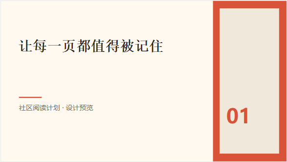
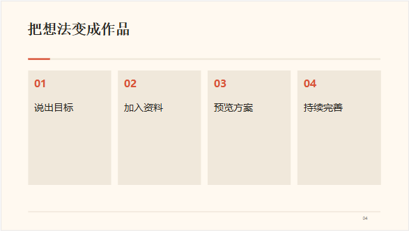
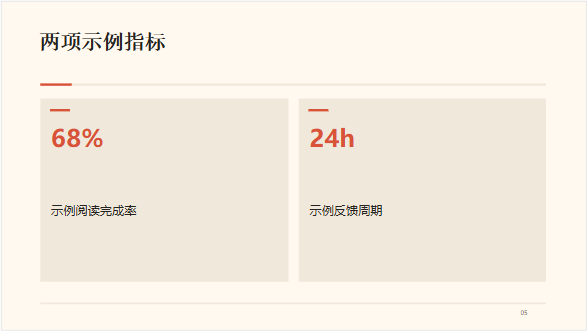

# v0.11.1：把设计指引接入 PPT 制作

[项目首页](../README.md) · [完整创作流程](CREATIVE_ACCEPTANCE_0.10.13.md) · [回答恢复](OUTPUT_RECOVERY_0.11.1.md) · [验证记录](VALIDATION_0.11.1.md)

## 使用

打开新建演示文稿，填写主题，选择页数和风格，点击“用 Agent 制作”。默认是杂志风格，另有纯白、墨黑和淡紫。也可以直接在 Agent 中提出 PPT 任务；原生任务会自动附上内置的演示设计工作流。

Agent 先组织每页要表达的内容，再选择封面、正文、两栏、对比、流程、卡片、指标、引言或章节页。长说明和出处放在演讲备注。指标只使用资料或用户提供的数据；没有数字时使用普通卡片。先预览完整方案，确认后保存为可编辑 PPTX。

选中一页继续改稿时，仍先读取现有页面。修改文字或备注保留其余元素；需要重新设计时仅替换指定页。整套主题、字体、原生图形和文字同时用于 Agent 预览、内置编辑器和 PPTX 导出。过密文字会要求模型精简或移入备注，避免静默裁掉正文。

## 简单编辑

- **改文字**：打开作品，双击页面里的文字直接输入；点空白处或按 Ctrl+Enter 结束。修改自动保存，Ctrl+S 可立即保存。
- **调整页面**：左侧缩略图选择页面，点击复制，或拖动缩略图排序；旁边保留新增、前移、后移与删除按钮。
- **撤销/重做**：使用顶部按钮或 Ctrl+Z / Ctrl+Shift+Z。文字输入时保留普通文本撤销。
- **让 Agent 修改**：选中页面，点唯一的“让 Agent 改这页”，补充要求后发送，先预览再确认。这个入口只填草稿，不自动发请求。
- **调整样式**：需要改字号、颜色、位置时打开“属性”；默认收起，让页面保持完整显示。

托管 PPTX 自动写入同一份作品；导入原件沿用保留原件、保存草稿与导出副本的规则。

## 实际内置范围

内置的是 baoyu-design 明确以 Apache 2.0 分发的 `frontend-design` 视觉指引，固定于上游提交 `609638de1594fe264f6e89b28cae986086093210`。PPT 工作流会加载这份指引并限制其用途为原生演示的视觉原则：统一方向、明确对比、字体层级、留白和不同信息任务使用不同构图。

原文位于 `ui/skills/slides/references/frontend-design.txt`，许可位于 [Apache 2.0 许可](licenses/Baoyu-Frontend-Design-Apache-2.0.txt)。kok 的 OOXML 版式代码是本轮原生实现，可编辑文字与平面图形不依赖外部编辑器。上游 [NOTICE](https://github.com/JimLiu/baoyu-design/blob/609638de1594fe264f6e89b28cae986086093210/NOTICE.md) 说明其重建编辑器、部分提示词及参考资料未授予开源许可，这些内容未复制进发行包。

## 边界

本轮提供四套主题、九种原生构图，改善默认视觉与继续修改体验。没有内置上游的完整重建编辑器；复杂图表、真实图片生成、动画和 PPT 版本可视化比较继续受当前演示能力限制。实际模型是否能形成高质量内容，仍取决于资料与所配置模型；固定夹具用于验证宿主行为与文件一致性。
