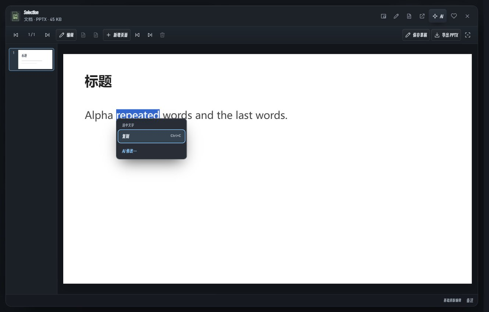
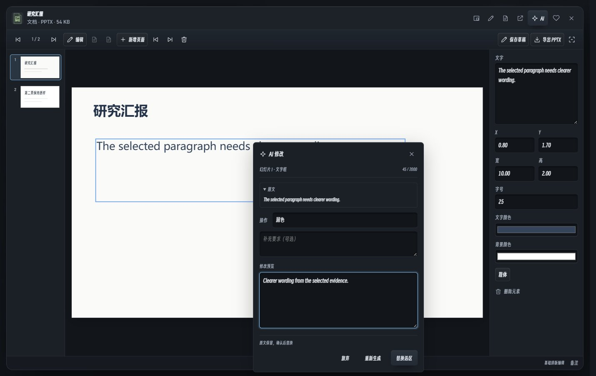

# v0.7.1 · 演示文稿与就地 AI 编辑

[English](PRESENTATION_AGENT_0.7.1.en.md) · [返回](../README.md)

本地预览，未发布。资料库按类型分区，同一区域统一封面尺寸；书本竖排，视频横排，照片与专辑保留各自形态。列表和排序继续可用。

## PPTX

导入 PPTX 可查看幻灯片、目录、备注与放映。点击编辑，可修改文字、字号、颜色、粗体和对象位置尺寸，添加或删除文字框，新增、删除、调整页面顺序；支持撤销、重做和本地草稿。新建文档中也可选择 PPTX。

保存草稿不改原件。导出生成新的 PPTX 基础排版副本，包含当前可见的文字、基础形状、内嵌位图和备注。复杂母版、组合、图表、动画、嵌入对象和混合文字样式不能完整还原，导出前应核对；检测到未还原元素时会再次提示。旧版 PPT 仍需系统应用或先转为 PPTX。

轻量预览上限：32 MB、100 页、每页 500 个对象；图片累计最多 20 MB。跳过外部图片链接，不执行宏。不会自动安装 Office 或下载运行时。

## 右键修改当前内容

右键先显示简短编辑菜单，保留复制、剪切、粘贴和全选等适用操作。智能模式下选择“AI 修改…”才进入面板，再选润色、精简、扩写、翻译或自定义要求；打开菜单和面板都不请求模型。

面板明确区分选中文字、当前段落、文字框和本页文字。在 PPTX 内选中几个字时，只替换这些字。Esc 返回原编辑位置，点击外部关闭；修改要求变化后旧预览失效，自定义要求为空或来源超过限制时禁止生成。支持方向键、Enter、Shift+F10 和 Ctrl+Enter 生成。

流程为“选区 → 生成修改 → 预览 → 应用”，应用后可撤销。整页修改保留每个文字对象的 ID，只替换本页文字，不合并或删除对象。切页、切文件、关闭、修改原文或进入纯净模式会取消旧任务，迟到的结果不能改到其他位置。

每次只发送所选文字（最多 2,000 字符）与附近上下文（最多 2,000 字符）；附近文字只用于理解。回答上限按输入设置为 900–3,000 token；不自动重试或循环调用。相同内容、要求和模型配置可复用最近 20 份本地结果。这些限制减少重复请求，不保证供应商的具体费用。

PDF 页面不能在此流程中直接替换文字；图像生成、任意工具执行与完整办公排版不在本版本范围。私密文件夹与纯净模式禁止 AI。

## 指令技能

“设置 → 指令技能”可导入简短的 SKILL.md 或 JSON 指令，并复制为 SKILL.md。最多 20 个自定义技能，单条正文不超过 800 字符；调用时只附带当前选择的指令，不发送整个技能库。这里的技能是文本提示词，不执行脚本或安装扩展。

## 开源参考

- [Pi 技能机制](https://github.com/earendil-works/pi/blob/main/packages/coding-agent/docs/skills.md)：本地元信息、按需载入指令。
- [tldraw Editor](https://tldraw.dev/docs/editor)：选择明确对象、保留页面边界和可撤销修改。
- [Radix Context Menu](https://www.radix-ui.com/primitives/docs/components/context-menu) 与 [Tiptap BubbleMenu](https://tiptap.dev/docs/editor/extensions/functionality/bubble-menu)：区分菜单和编辑浮层、键盘焦点、选区保留与窗口边缘避让。使用现有原生实现，不加入新的界面框架。
- [AFFiNE](https://github.com/toeverything/AFFiNE)：围绕当前内容提供编辑操作。
- [Jellyfin Web](https://github.com/jellyfin/jellyfin-web) 与 [Kavita](https://wiki.kavitareader.com/guides/admin-settings/media/)：按媒体类型陈列及合理封面比例。
- [PptxGenJS](https://github.com/gitbrent/PptxGenJS)：实际使用其 MIT 许可浏览器组件生成 PPTX；约 450 KiB，首次新建或导出时加载，许可随包保留。
- [Remotion](https://www.remotion.dev/docs/spring)：借鉴时间与阻尼思路；动画使用现有原生浏览器实现，不加入 Remotion 运行时。

原有图谱任务与用量范围见[图谱说明](WORKSPACE_0.7.1.md)。验证使用生成资料和本地模拟服务，不读取个人模型密钥或消耗真实 API 额度；覆盖导出回读、原件不变、对象边界、撤销、草稿恢复、中英文、紧凑窗口、快速缩放与减少动态效果。仍需更多真实文件、DPI 与硬件验证。
