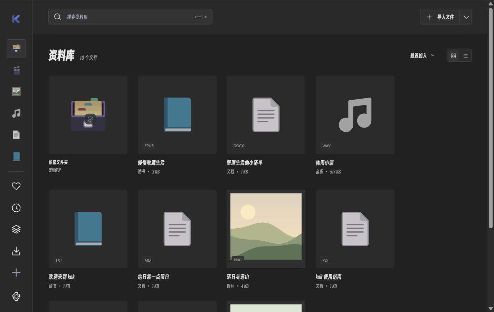

# v0.4.1 preview

[中文](PREVIEW_0.4.1.md) · English · [Documentation](README.en.md)

This version is provided as a GitHub preview release. Run `kok.exe` from the complete extracted folder. Existing libraries remain usable; new preferences and bookmarks stay in the current profile.

## Appearance

Neutral white / graphite defaults share materials and text colors across pages, navigation, tools and dialogs. The brand is redrawn as a blue geometric folded K, without the rounded tile, gradient highlights or heavy shadow.

The minimal window bar follows light, dark and custom backgrounds instead of showing a white system title bar. Dragging, double-click maximize, minimize, restore and close remain available. Buttons use subtle 4px corners, fields 6px and menus 8px, with fine borders, spacing and glass surfaces providing depth. Hover and keyboard-focus feedback remain clear.

A compact rail and continuous canvas replace repeated card framing. Classification entries are 44px squares with hover / keyboard-focus names; covers are squares up to 184px, with contextual open, favorite and menu controls. Touch layouts retain visible controls. Neutral colors, type hierarchy and dividers structure each page; paper, photo-print and record details add restrained depth. Press and overlay transitions share consistent motion and support reduced-motion preferences.

[Smiley Sans v2.0.1](https://github.com/atelier-anchor/smiley-sans/releases/tag/v2.0.1) is the bundled default, without network access or Windows font installation. Its full license is included. Settings retain system, Chinese and imported font choices; existing selections remain valid.

Category icons and fallback covers use one consistent set of [Microsoft Fluent Emoji Flat](https://github.com/microsoft/fluentui-emoji) assets, bundled locally with the MIT license, source version and file hashes.

Flat vectors remove heavy shading and highlights. Hover uses opacity feedback and press uses subtle scaling. The new geometric K is shared by startup, navigation and Windows application icons. Dark mode uses muted artwork colors and dark surfaces for import and primary buttons.

Sidebar categories, favorites, recents, organization, downloads and settings share 24px frames, 44px targets and 6px row gaps; visible artwork is normalized to a 20px longest edge. Centered fallback artwork has a 96px frame and an 80px visible longest edge, preserving aspect ratio. Legacy collection sizing and video placeholder positioning are fixed. List frames are 24px; top-bar and viewer action icons are 18px.

[Light interface](screenshots/overview-041-light.png) · [Music player](screenshots/music-041-dark.png) · [Document reader](screenshots/document-041-dark.png)

The redesign was checked in an isolated silent library: pointer / keyboard hints, square covers and actions, opening all five content types, video fullscreen, settings, font switching, compact layouts and reduced motion. Final font / icon loading and play-glyph contrast were then checked separately and the views above captured. A complete desktop regression was not repeated locally; cloud builds separately run native tests, audits and packaging.

Open **Settings → Custom colors → Customize** to enable background and glass colors, opacity and blur, with presets, live preview and reset. Light and dark palettes are saved separately; switch the app theme to edit that palette. Reading paper follows the interface by default, with separate paper choices still available.

## Documents and books

- **Contents**: filter chapter names; PDFs use their own outline when available.
- **Full-text search**: search chapters or PDF pages from the sidebar, jump to results, stop searching or return to the previous location. Up to 200 results are shown. `Ctrl Shift F` opens full search; existing current-chapter search remains. PDFs need selectable text; no OCR is provided.
- **Bookmarks**: save the current position from the toolbar and open / remove it in Bookmarks. PDFs store pages; text readers store chapters and positions. Ordinary and private libraries retain separate bookmarks.
- **Typography**: adjust font size, line / letter / paragraph spacing, text width and scrolling / paged layouts. In paged mode, arrows, Page Up / Down and Space turn pages without intercepting text inputs.
- **Resume and focus**: seek with the progress slider, resume after reopening or use Focus to hide contents and widen the reading area. Toggle Focus again to leave.
- **Notes**: existing underlines, highlights, thoughts and document insertions remain. Export Markdown notes and bookmarks from the bookmark pane, or keep using HTML reading-copy exports. Markdown exports are plaintext, including exports from the private folder.

Typography applies to the existing EPUB / TXT / DOCX text viewers; PDFs retain their page layout. Original files stay unchanged. [hectorqin/reader](https://github.com/hectorqin/reader) informed workflow ideas; kok's implementation and interface are independent and retain the local library approach.

## Photo zoom and free crop

- Use the wheel to zoom in both previews and the editor; drag to pan when enlarged. Double-click a preview to toggle zoom / fit, use `+` / `-` to zoom and `0` to fit. The editor also has zoom and fit buttons.
- Open **Edit photo → Crop and orientation → Free crop**. Draw a selection, move it or resize from any corner or edge; common aspect-ratio locks remain available. Apply it, then save a new photo.
- `Enter` applies and `Esc` cancels the crop. Arrow keys nudge the selection; Shift moves faster. Undo / redo and rotated / flipped selection mapping are supported.
- Selection borders and grids are excluded from exports. Originals remain unchanged; the output long edge is still capped at 4096 px. Apply or cancel a pending crop before saving.

## Video downloads

Use **Smart → Video downloads**. kok discovers and manages media locally, without an AI credential or external extraction service. Pure and the private folder block network downloads.

1. Paste page, media file, M3U8 or MPD links, one per line, up to 20.
2. Choose best / up to 1080p, 720p, 480p or audio only. Quality selection uses alternatives offered by the source, without resizing video. Analyze a single link first to choose a particular resource.
3. Optionally save existing page subtitles: public SRT / VTT files go beside the media. No speech recognition is performed. Subtitle failures do not discard completed media.
4. Start downloading. Queues, pause / resume, retry, cancellation, automatic import and revealing files are supported. Clearing history keeps files; resume manually after reopening. Existing history and media are retained.

**Site adapters and sign-in**: Bilibili regular videos / parts, YouTube and Douyin have dedicated adapters. Bilibili and YouTube download video / audio tracks separately and use FFmpeg to merge them. **Sites and sign-in** opens official sign-in, imports your own Netscape cookies.txt or clears saved information. Sessions are isolated by site and encrypted with Windows DPAPI for the current Windows user; they are not sent to AI. Saved sessions may expire and do not expand account permissions.

For a Bilibili / Douyin script verification page, use **Browser-assisted analysis**: open the target video in the muted official page, complete any required verification, then choose **Use detected media**. The temporary browser is isolated from kok’s host bridge; site session information is saved only when you choose media. Detected resources are cached in memory for 10 minutes. Reopening kok or expiration requires analyzing and adding the task again. Paused YouTube downloads restart; split-track downloads reuse completed tracks and valid partial files where possible.

**Pages**: HTML video / audio / source / track, Open Graph, JSON-LD and common static player configuration can expose media. A bounded search follows embedded players. Generic analysis does not execute page scripts or automatically read cookies from your existing browsers. Site adapters and manual browser assistance remain subject to network, verification, site restrictions and account permissions. Live, DRM, bypassing paid access and whole playlists are unsupported. Pages without public media show an explanation; try a direct link. Page parsing is capped at 4 MiB and a bounded candidate count.

**File links**: ETag / modification time and byte ranges validate resume. Changed files, missing validators or invalid ranges restart with a notice. Unicode filenames, redirects, unknown lengths and large files are supported without overwriting existing files.

**Media components**: stream merging and video-to-audio export need FFmpeg / FFprobe. Install the pinned 9.0.2 Gyan Windows build in one click, about 109 MiB compressed (201 MiB for the two executables). Archive / executable SHA-256 values are verified and licenses kept. Progress, cancellation and automatic discovery are included; an existing paired installation can also be selected. The base package excludes these tools.

**M3U8 / DASH**: common unencrypted HLS master / media playlists, static DASH and relative segments are supported. Available video quality and audio tracks are stream-copied into MP4 (audio only into M4A). Duration progress is shown. **Paused stream downloads restart from the beginning**. Codecs must fit MP4 / M4A. Overly nested, live, encrypted / DRM manifests are outside this stage; manifests cannot read local files. Audio export copies AAC / ALAC where possible and converts other tracks to AAC.

Completed media enters the ordinary library. Subtitles and source URLs stay local. Download history is ordinary plaintext data, is not sent to AI and is not encrypted private storage. Playback still depends on the current engine’s codec support.

Components: [FFmpeg](https://ffmpeg.org/), [Gyan Windows builds](https://github.com/GyanD/codexffmpeg/releases/tag/9.0.2), [third-party notices](../THIRD_PARTY_NOTICES.md).

## Development checks

The isolated, silent checks passed: native probes, validated range resume, changed files / invalid ranges, unknown lengths, large-file metadata, queues and cancellation; kok page discovery covered HTML media, Open Graph, JSON metadata, embedded players, source / quality choices, subtitles, audio export, HLS / DASH, import, retired-component cleanup, languages and compact layouts. Fixtures were original localhost media, without private movies, model services or external extractor APIs. External websites were not exhaustively tested.

Earlier native, appearance, photo, document and reading checks remain recorded; this round did not repeat every existing suite. Preview packaging audits staging and ZIP files to exclude model configuration, credentials and private data. Independent Windows 10 / 11 machine verification remains pending.

Site verification: public Bilibili / YouTube metadata resolved 7 / 8 sources, without downloading full external videos. Anonymous Douyin requests encountered script verification, so general automatic support is not established; manual browser assistance or a valid session may be needed. Local original fixtures verified split-track merging, audio export, site layouts and account UI; encryption, domain isolation, clearing and the real YouTube library were checked offline. No real account sign-in was tested.
