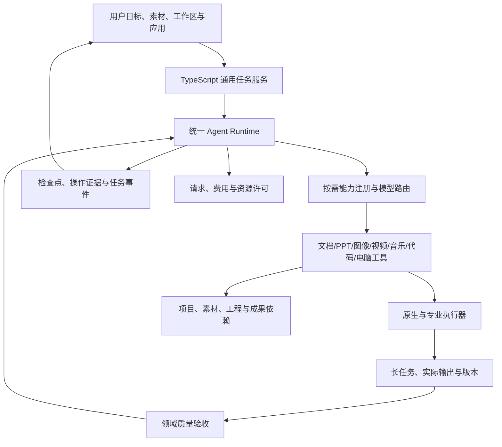

# kok 通用个人 Agent 重构与开发详细计划

> 文档版本：2.0  
> 更新日期：2026-11-13（Asia/Taipei）  
> 当前实现基线：v0.14.0 Preview（通用执行底座第一阶段）  
> 规划范围：v0.14.0 至 v1.0.0  
> 目标：兼顾通用任务执行、生产力、多媒体创作、代码开发和电脑操作  
> 状态：这是后续实施计划。能力被列入本文，不代表当前应用已经全部实现。

## 阅读与执行说明

v0.14.0 已进入实现与发布验收：TypeScript 运行时、版本化任务与资产投影、公开接口检查点、后台命令作业和九类能力状态已接通。A01–A10 的落实方式及剩余边界见[本版实现与验证](VALIDATION_0.14.0.md)。后续领域工作流仍按下列里程碑推进。

本文按新的产品范围重新编排，取代此前以研究与写作为主要范围的计划。

**研究、文档、PPT、表格、照片、视频、音乐、代码和电脑操作，都纳入核心能力。**

通用性来自统一执行底座、专业工具和跨领域组合；高质量来自实际成果、反馈修正与分领域验收。只增加工具名称、提示词或入口，不算完成对应能力。

建议一位主要开发者配合 AI 工具，先交付共用底座和首批可靠流程，再逐项提高专业质量。模块可以先提供已有的基础能力，版本顺序表示主要加固顺序，不表示其他能力必须等到很后面才能使用。

---

## 1. 产品定位

### 1.1 一句话目标

**用户提出目标，kok 能在授权范围内理解资料、使用软件和工具，完成实际工作，并交付可使用、可检查、可继续修改的成果。**

目标用户不需要理解内部工具回执、检查点、模型协议和执行器细节。

### 1.2 九个核心能力领域

| 编号 | 能力领域 | 代表任务 | 需要交付的事实 |
| --- | --- | --- | --- |
| G1 | 研究与知识处理 | 阅读、搜索、比较证据、整理资料 | 有依据的结论、来源与局限 |
| G2 | 文档与写作 | 报告、方案、文章、局部改稿 | 实际可读、可编辑的文件 |
| G3 | PPT 与演示 | 从资料到汇报、图表、逐页修改 | 实际可编辑 PPTX 和渲染检查 |
| G4 | 表格与数据 | 数据清洗、计算、图表、报表 | 可核对的数据、公式和文件 |
| G5 | 照片与视觉设计 | 修图、裁剪、调色、海报、批量处理 | 正确尺寸和色彩的成品及编辑记录 |
| G6 | 视频创作 | 选片、剪辑、字幕、配音、配乐与导出 | 可播放视频、时间线与素材关系 |
| G7 | 音乐与音频 | 剪辑、作词、作曲、编曲、分轨、混音 | 可试听音频、可续作工程及可用分轨 |
| G8 | 代码开发 | 理解仓库、实现、调试、测试和审查 | 实际代码变更及真实验证结果 |
| G9 | 浏览器与电脑操作 | 网页操作、桌面软件、跨应用任务 | 动作后真实状态、文件或其他结果 |

每个领域都需要明确支持范围、当前成熟度和质量标准。通用 Agent 不等于对所有软件、格式和任务保证成功。

### 1.3 第一批跨领域任务

1. 产品资料 → 调研摘要 → 12 页 PPT → 三张宣传图 → 60 秒介绍视频。
2. 旅行照片和视频 → 精选素材 → 统一调色 → 配乐短片 → 封面和分享文案。
3. 已有录音或音乐素材 → 剪辑与编排 → 人声/伴奏调整 → 成品音频 → 视频配乐版本。
4. 一个代码仓库 → 定位问题 → 修改代码 → 运行测试 → 浏览器验证 → 交付变更说明。
5. 网页和本地表格 → 提取与核算 → 研究报告 → 可编辑数据图表与 PPT。
6. 用户指定的软件任务 → 读取当前界面 → 执行操作 → 核对保存结果。

这些是目标场景。应按工具可用性、授权和资源选择执行方法，不为每个任务硬编码一条固定对话。

### 1.4 用户体验原则

- 目标驱动，内部复杂性由系统承担。
- 已明确授权的范围内继续工作，减少重复确认。
- 必要的审批围绕具体修改与影响，保留可审查结果。
- 文案、大纲、分镜、代码建议都有价值；任务要求成品时，必须继续产生对应文件或真实操作结果。
- 失败保留已完成部分，说明缺项与继续方式。
- 原始素材、用户手动修改、已有仓库工作和有效版本需要保留。
- 当前能力不足时说明原因和可行替代，不用虚假的完成状态掩盖问题。

---

## 2. 当前基线与能力差距

### 2.1 已有实现

当前采用 C# 桌面宿主、JavaScript/Node.js 研究运行时，以及锁定的 Deep Agents 1.16.4 / LangGraph 1.7.3。这个版本组合属于已有实现基线，不是对未来最新版本的推荐。

| 领域 | 现有代码或能力 | 主要差距 |
| --- | --- | --- |
| 研究与文档 | SDK 接入、精确读取、DOCX/MD、修改与回读 | 长任务、证据支持、稳定持久化与更多真实样例 |
| PPT | 原生 PPTX 创建、逐页读取、局部修改、PptxGenJS | 实际导出视觉质量、版式系统、数据图表和保真验证 |
| 照片 | Canvas 编辑、裁剪、色彩与副本输出 | 完整 Agent 工具闭环、非破坏编辑、高分辨率与色彩管理 |
| 视频 | FFmpeg/FFprobe 接口、已有片段剪辑与拼接 | 结构化时间线、多轨、字幕同步、视觉与音频检查 |
| 音乐与音频 | 音乐播放、音频片段编辑、拼接与导出基础 | 音乐项目、生成引擎、编曲、分轨、混音与完整验收 |
| 代码 | 工作区文件与受限命令执行工具 | 仓库理解、变更集、异步作业、构建测试与恢复闭环 |
| 网页/电脑 | 部分系统及 MCP 能力，开发测试使用浏览器自动化 | 尚缺完整可验收的通用网页与桌面操作流程 |
| 表格 | 文件收录及外部打开基础 | 可核对计算、结构化编辑、图表及公式验收 |

开发测试里使用了 Playwright，不等于用户已经获得产品级浏览器 Agent。

### 2.2 现状核对发现

- 当前照片源码出现“原始尺寸，最多 8192 px”的导出选项，部分格式说明仍写 4096 px。后续应核对实际限制并同步文档。
- 媒体导出已有固定帧率、画布大小等处理，不应直接当作任意高规格专业剪辑能力。
- 原生工作区执行工具已经存在，应该复用其边界并补强，不把它当作无用旧代码删除。
- 现有 PPT 基础预览不等于 PowerPoint/WPS 对导出文件的实际渲染。

### 2.3 已有验证成绩及范围

v0.13.0 记录了：

- 1318 项原生检查。
- 5 项 Node 研究运行时测试。
- 3 套相关桌面流程及压缩包解压复验。
- 一个修复后的真实 DeepSeek 研究任务：3 次请求、约 19 秒，交付并回读 501 汉字 DOCX。
- 修复前同类任务消耗 6 次请求后未完成，两次合计 9 次请求。

这些成绩只能支持对应验证范围。不能将其算成视频、音乐、代码或电脑操作已经成熟的证明。

---

## 3. 总体技术路线

### 3.1 一个执行内核，多套专业能力

继续以一个 Agent 运行时为执行中心。TypeScript 逐步承接通用任务与领域工作流；C# 保留成熟的本地、窗口、文件和系统能力。

模型负责理解、选择、规划与判断。确定性编辑和执行工具负责真正处理文件、代码、媒体与应用。

按任务加载能力说明和工具，不把九个领域的全部长提示与工具结构塞进每一次请求。

### 3.2 架构职责

| 层 | 负责内容 | 应避免的问题 |
| --- | --- | --- |
| 通用任务服务 | 当前目标、任务要求、选择能力、停止与恢复 | 与 SDK 同时驱动第二套模型循环 |
| Agent Runtime | 推理、工具循环、上下文和图状态 | 每个领域重新造一个通用内核 |
| 能力注册表 | 工具、模型模态、组件、版本与可用性 | 没有执行器却显示已支持 |
| 原生能力服务 | 文件、系统、版本、审批、进程与回执 | 绕过资料范围和当前版本 |
| 专业执行器 | 图像、PPT、视频、音乐、代码与电脑操作 | 只有文字方案没有真实结果 |
| 资产与项目层 | 素材、工程、来源、版本和导出依赖 | 各领域各自保存无法关联的文件 |
| 作业服务 | 长时间渲染、测试、批量处理、取消与缓存 | 进程失联或重启后重复执行 |
| 质量验收 | 可测事实、视觉/听觉/语义质量与修复反馈 | 只检查“文件存在” |
| 界面投影 | 对话、进度、预览、审批、版本和诊断 | 前端自行调度模型轮次 |

### 3.3 目标示意

以下为目标架构，不代表目前全部实现：



### 3.4 方法选择顺序

按可用性和可靠性，优先考虑：

1. 已接入的原生或专业 API。
2. 已授权的连接器/MCP。
3. 网页结构化自动化。
4. 桌面无障碍接口。
5. 视觉与鼠标键盘操作。

这是一条推荐选择策略。具体任务仍需根据软件能力与用户授权决定，不能因为有 API 就跳过验证。

### 3.5 TypeScript 与 C# 的分工

- 先将现有 worker、kernel 和边界类型迁到 TypeScript。
- 通过版本化协议继续调用 C# 本地能力。
- 通用任务、能力选择和领域流程逐步进入 TypeScript。
- 暂时保留已有效的编辑界面和原生文件能力。
- C# 职责变小后再评估整个桌面宿主的迁移。

TypeScript 主要改善类型、接口和维护，不直接保证更快。后续 Python 可以作为专用工具接入，避免同时维护多个通用 Agent 主体。

---

## 4. 任务、项目与能力契约

### 4.1 TaskSpec

TaskSpec 应表达：

| 类别 | 字段含义 |
| --- | --- |
| 目标 | 用户原始目标、当前要求版本、验收方式 |
| 输入 | 来源、素材、工作区、允许使用的应用和站点 |
| 能力 | 研究、PPT、图像、视频、音乐、代码、电脑操作等 |
| 输出 | 文件类型、长度、页数、时长、尺寸、可编辑性 |
| 风格 | 受众、用途、视觉/音乐方向、参考素材 |
| 修改 | 目标版本、允许改动范围、必须保留部分 |
| 质量 | 标准或高质量模式、必要检查与人工反馈 |
| 资源 | 模型、生成调用、渲染作业、时间和费用边界 |
| 状态 | 已完成部分、待确认信息、停止与恢复条件 |

示例为未来结构设计，不是当前已实现接口：

```json
{
  "schemaVersion": 1,
  "revision": 1,
  "goal": "制作产品介绍材料包",
  "capabilities": ["research", "presentation", "image", "video", "music"],
  "inputs": {
    "assetIds": ["brief", "photos", "clips"],
    "workspaceId": "selected-project"
  },
  "deliverables": [
    {"kind": "presentation", "format": "pptx", "pages": 12, "editable": true},
    {"kind": "image", "format": "png", "count": 3},
    {"kind": "video", "format": "mp4", "durationSeconds": 60},
    {"kind": "music", "format": "wav", "durationSeconds": 60}
  ],
  "quality": {
    "mode": "high",
    "checks": ["facts", "layout", "playback", "audio", "editability"]
  },
  "constraints": {
    "preserveOriginalAssets": true,
    "useConsistentFactsAndStyle": true
  }
}
```

资源额度需在实际执行时根据用户授权设置，示例不构成真实调用授权。

### 4.2 项目与资产

共用资产身份与版本：

- 原始资料、图片、视频、录音、乐器轨道和代码仓库引用。
- 工程数据、素材关系和编辑历史。
- 中间成果与最终导出副本。
- 来源版本、风格指南、字幕、脚本和配乐。
- 成果之间的依赖，例如报告变更后 PPT 的对应部分需更新。

原件、工程和导出副本需要明确区分。

### 4.3 不强行统一所有专业数据

可以共用任务、资产、版本和作业协议，但每个领域保留自己的结构：

| 结构 | 用途 |
| --- | --- |
| SlideScene | PPT 页面、对象、布局与数据 |
| PhotoEdit | 裁剪、调色、图层、蒙版与导出 |
| VideoTimeline | 视频/字幕/音频轨、片段与转场 |
| MusicArrangement | 节拍、速度图、乐器、人声、音频/MIDI 轨 |
| CodeChangeSet | 文件差异、命令、测试与变更说明 |
| ComputerActionPlan | 当前应用、目标对象、动作与后置条件 |

不要为了抽象统一，造出一个难以验证的万能编辑对象。

### 4.4 工具与作业结果

至少包含调用 ID、任务 ID、状态、实际结果、文件/资产版本、错误代码、是否可安全重试、作业进度和验收信息。

长任务返回作业 ID，允许查询与取消。原生工具已提供充分回读时，SDK 不重复读取相同文件。

### 4.5 要求更新

用户可以改变页数、时长、尺寸、曲风、修改范围或预算。更新后：

1. 增加要求版本。
2. 检查待审批动作是否仍有效。
3. 保留不受影响的素材和成果。
4. 只重做受影响部分。
5. 重新核对相关质量标准。

例如修改视频字幕不应重生成所有素材；修改一页 PPT 不应重做整套演示；调低伴奏不应替换整首歌。

---

## 5. 旧代码清理策略

### 5.1 保留有用能力，退出重复执行

| 内容 | 处理 |
| --- | --- |
| AgentTaskModel / AgentToolChat 的旧通用模型循环 | 隔离为兼容实现，停止增加新领域流程 |
| AgentContext 的旧压缩 | 与 SDK 上下文职责分离 |
| AgentCognition 的模型形式回执 | 与真实交付验收分离，逐步退出重复负担 |
| AgentToolHooks 等闲置接口 | 核对注册与外部使用后删减或收窄 |
| TerminateHint、未使用局部变量 | 确认兼容影响后清除 |
| 文件读取、审批、版本、撤销与交付验收 | 作为通用工具底座保留 |
| AgentExecution 工作区与命令能力 | 升级为代码与任务执行的基础 |
| PPT、照片、视频和音乐相关能力 | 纳入核心能力包，补齐质量和 Agent 调用闭环 |
| 纯播放、纯浏览功能 | 继续作为素材检查与作品预览能力，控制独立扩张 |
| 测试与历史记录 | 保留回归价值，修正只验证空接口的断言 |

不能再因“研究 Agent 不需要媒体”而把有效媒体实现判为无用。

### 5.2 删除前检查

- 查声明、调用、反射、字符串路由和界面入口。
- 确认是否被构建与发布。
- 区分默认路径、兼容路径和闲置扩展。
- 明确替代实现与行为差异。
- 运行相关检查，避免批量删除后难以定位回归。

旧文件整体行数不等于可删除行数。

### 5.3 兼容退出

历史任务至少可只读查看、导出并建立新任务接续。原成果、审批、素材和操作证据需要保留，不直接把旧检查点改写成新格式。

---

## 6. 共用底座实施任务（v0.14）

| ID | 任务 | 主要产物 | 验收 |
| --- | --- | --- | --- |
| A01 | 固定当前基线与能力清单 | 测试资料、可用性和限制矩阵 | 区分已实现与仅有入口 |
| A02 | 任务/工具/事件/作业契约 | 版本化结构和样例 | 两端一致接受与拒绝数据 |
| A03 | worker、kernel 迁 TypeScript | 类型检查与可运行入口 | 中文、取消、许可、中断恢复不回归 |
| A04 | 通用任务服务与能力选择 | 按需加载工具与领域指导 | 简单任务不附加全部工具 |
| A05 | 统一项目、资产与成果身份 | 资产关系与版本 | 原件、工程、导出可追踪 |
| A06 | 原生工具和 LegacyRuntime 分离 | 清楚的职责边界 | 新任务不触发旧补计划循环 |
| A07 | 长任务服务第一版 | 作业 ID、进度、查询与取消 | 超过短命令时限仍能受控执行 |
| A08 | 正式检查点适配设计 | 持久化与升级方案 | 不依赖无版本的私有容器快照 |
| A09 | 设置、组件与能力对齐 | 可用/试用/未配置状态 | 无执行器不显示已支持 |
| A10 | 构建、版本与包级验收 | 完整本地包 | 无需用户安装开发依赖即可使用基础能力 |

已发布协议中的 research 等名称可以先保留兼容别名。不要只为更名破坏旧日志恢复。


## 7. 代码开发能力（v0.15 主线）

### 7.1 支持路径

仓库与环境识别 → 理解目标 → 查找代码 → 小范围修改 → 运行构建/测试 → 必要的界面验证 → 交付变更与限制。

首批优先验证项目实际涉及的 TypeScript/JavaScript、C# 和 Python 场景。其他语言通过对应工具与环境扩展，不在未测试时宣称同等支持。

### 7.2 工具与能力

- 文件树、文本检索、符号定位和局部读取。
- 结构化补丁、文件创建、差异预览。
- 工作区终端与受控长进程。
- 构建、测试、格式和静态检查。
- 本地服务启动、日志、浏览器验证和停止。
- Git 状态、差异与用户已有改动识别。
- 失败定位、有限补救与变更说明。

现有 run_command、read_text_file、write_text_file 等是起点。需要补足工作区边界、补丁、异步作业和结果验证。

### 7.3 具体任务

| ID | 工作 | 验收 |
| --- | --- | --- |
| C01 | 仓库与环境探测 | 能识别项目入口、实际可用工具和已有改动 |
| C02 | 安全的文件/补丁工具 | 修改范围明确，原有改动保留 |
| C03 | 终端作业与取消 | 长命令返回作业 ID，能查询输出与退出码 |
| C04 | 构建与测试闭环 | 真实执行，失败能定位，不虚报通过 |
| C05 | 本地服务与浏览器验证 | 能启动、访问、检查并停止自己创建的服务 |
| C06 | 变更与恢复记录 | 任务恢复不重复套用补丁或混入旧结果 |
| C07 | 代码任务评测 | 修 bug、加功能、调试、重构、审查分别覆盖 |

### 7.4 高质量标准

- 目标行为经过实际验证，不只是代码看起来合理。
- 测试通过有命令、退出码和结果依据。
- 环境缺失时明确未验证部分。
- 不用只复述实现的测试充数。
- 不无关重构，不覆盖用户未提交的工作。
- 秘钥、环境配置和不相关私有文件不进入模型上下文。
- 只有自己的任务进程由取消动作停止。
- 提交、推送、发布和对外消息遵守用户明确授权，不自动扩大任务范围。

### 7.5 首批可演示任务

1. 为现有小型 TypeScript 项目修复一个失败测试。
2. 修改 C# 功能并完成项目适用的编译验证。
3. 给 Python 小工具增加功能并检查输入输出。
4. 修改网页交互，在浏览器实际确认结果。
5. 中途取消和恢复，保留已完成的文件修改。

---

## 8. 浏览器与 Computer Use（v0.15 基础，v0.20 加固）

### 8.1 定位

电脑操作是核心能力：当任务需要使用网站、桌面软件或跨应用工作时，Agent 能观察、执行并验证结果。

已有原生工具适合做的工作优先用工具，必要时再操作界面。电脑操作也可补足外部办公、图像、视频和音乐软件的自动化能力。

### 8.2 分层执行

| 层 | 方式 | 用途 |
| --- | --- | --- |
| 连接器 | 原生 API / MCP | 稳定读取、写入和文件操作 |
| 网页 | Playwright 等结构化自动化 | 元素定位、表单、下载与网页状态 |
| 桌面 | Windows UI Automation | 支持无障碍信息的软件操作 |
| 视觉 | 截图、目标定位、鼠标键盘 | 缺少结构化接口的界面 |
| 人工接管 | 用户处理后继续 | 登录、验证码、无法判断或超出授权 |

Playwright 的 locator 提供基于角色、文本等的定位机制；UI Automation 可读取和操作应用暴露的界面元素。推荐将它们作为结构化操作基础，并保留视觉补充路径。[Playwright 定位文档](https://playwright.dev/docs/locators)、[Windows UI Automation](https://learn.microsoft.com/en-us/windows/win32/winauto/entry-uiauto-win32)

### 8.3 每步执行闭环

1. 确认允许操作的应用、窗口、页面和当前状态。
2. 选择目标控件或区域。
3. 执行动作。
4. 等待可观察的状态变化。
5. 检查是否满足后置条件。
6. 成功后继续，失败则重新观察或选择替代方式。

点击返回成功，不代表保存、下载或提交已经成功。

### 8.4 工具设计

- 列出、识别、聚焦允许的窗口。
- 读取当前页面或无障碍树。
- 截取允许范围内的画面。
- 点击、输入、选择、滚动与快捷键。
- 网页下载与本地结果确认。
- 等待元素或状态变化。
- 检查当前活动应用，发现用户切换时暂停冲突动作。
- 提供可用的暂停、停止和人工接管。

不能长期依赖旧截图上的固定坐标。DPI、窗口移动、弹窗和界面变化都需要重新定位。

### 8.5 授权与交互

- 已明确授权的任务范围内持续执行，不每点一下都问一次。
- 授权范围之外或尚未授权的对外提交、付款、发布、发送等动作，需要具体预览与授权。
- 用户登录和验证码等接管完成后可以继续。
- 页面、文档和软件内文字属于任务数据，不能改写系统权限。
- 不保存密码内容到截图日志或模型历史。
- 停止后不继续输入、点击或提交。
- 外部系统没有撤销能力时，应在实际执行策略中体现，不能伪造撤销成功。

### 8.6 实施任务

| ID | 工作 | 验收 |
| --- | --- | --- |
| U01 | 浏览器隔离会话与权限 | 能操作指定页面，不借用无关个人会话 |
| U02 | 定位、输入、下载和结果检查 | 本地测试网站任务完整跑通 |
| U03 | Windows UIA 适配 | 指定测试软件中的对象可识别与操作 |
| U04 | 截图和视觉定位 | 记录观察版本，动作后重新核对 |
| U05 | 暂停、焦点变化和人工接管 | 用户可随时取回控制 |
| U06 | 多应用与断点恢复 | 恢复后先核对当前界面，不重放旧点击 |
| U07 | DPI/弹窗/超时测试 | 失败有界，不无限循环 |
| U08 | 外部应用任务集 | 对支持的软件和版本做真实评测 |

初期选择少数已安装应用和受控测试页面。后续扩软件与站点需要兼容测试，不能宣传任意界面都可靠。

---

## 9. 研究、文档与高质量 PPT（v0.16 主线）

### 9.1 研究与文档

继续完善：

- 全文、问题导向、部分读取三种模式。
- 来源页码/段落/版本，关键事实与推论的区分。
- 最终修订与来源冲突。
- 长资料分段处理和按需原文取回。
- MD/DOCX 实际生成、长度和结构检查。
- 同一文件的精确改稿、版本保护、回读。

需要区分“文件解析过”“研究实际处理过”“成果引用过”。只返回开头节选不能标成已完整处理全文。

### 9.2 PPT 的完整链路

资料/数据 → 受众和表达目标 → 叙事结构 → 页面设计 → 实际 PPTX → 导出渲染 → 视觉和数据检查 → 定向修复。

高质量 PPT 需要内容与设计共同成立。大纲或模板选择只是中间步骤。

### 9.3 PPT 必备能力

- 主题与设计规范：字体、配色、栅格、留白、图标与图表风格。
- 多样布局：封面、分节、观点、对比、流程、时间线、图表和结论。
- 可编辑文字、图形、表格和适用的数据图表。
- 图片比例、裁切、清晰度与来源记录。
- 按页/对象修改，保留其他页与对象身份。
- 演讲备注、引用与附录。
- 实际导出后的逐页渲染和缺陷定位。

现有 PptxGenJS 可作为实际文字和图表生成能力之一，原生 OOXML 定点修改继续用于保护未涉及内容。库能生成对象，不自动代表排版已经达到产品质量。[文字接口](https://gitbrent.github.io/PptxGenJS/docs/api-text/)、[图表接口](https://gitbrent.github.io/PptxGenJS/docs/api-charts/)

### 9.4 PPT 质量标准

| 维度 | 要求 |
| --- | --- |
| 内容 | 主题、受众、页数、事实与来源正确 |
| 可编辑 | 需要编辑的文字和图表不全部压成图片 |
| 布局 | 无非预期溢出、遮挡、错误裁切或空白页 |
| 视觉 | 风格一致、层级明确、留白和对齐合理 |
| 可读 | 正文和图表标签在目标放映环境可读 |
| 数据 | 图表数据与来源一致，不由模型猜数 |
| 兼容 | 在指定目标应用打开并检查实际导出 |
| 修改 | 定向修改不破坏无关页面与原包内容 |

可以将常规正文约 18pt 作为首批设计参考，密集图表和具体用途需例外处理，不能用一个字号规则替代视觉评审。

现有基础预览不等于实际 PPTX 渲染。渲染适配器可评估已安装的目标办公软件或可选转换工具；实施时再验证依赖与兼容范围。

### 9.5 实施任务

| ID | 工作 | 验收 |
| --- | --- | --- |
| P01 | CreativeBrief 与设计规范 | 根据用途生成一致风格 |
| P02 | SlideScene 与布局组件 | 实际可编辑对象而非纯图片页 |
| P03 | 图表、图片与来源 | 数据一致，素材清楚 |
| P04 | 导出渲染适配 | 能检查实际产物，不只内部预览 |
| P05 | 几何与视觉检查 | 全页自动检查，疑难页进一步审查 |
| P06 | 定向修复与保持身份 | 修改一页不重做整套 |
| P07 | 真实演示样例 | 8—12 页汇报、方案与数据演示 |

---

## 10. 照片编辑与视觉设计（v0.17 主线）

### 10.1 基础与增强分层

第一层：裁剪、旋转、曝光、白平衡、色彩、曲线、锐化、降噪、尺寸与格式。

第二层：文字、图层、蒙版、局部调整、批量统一风格、封面和海报。

第三层：抠图、背景替换、修复、扩图或图像生成，通过具备相应能力的独立模型/工具接入。

文本模型可以决定编辑方案，但不能直接代替像素处理或图像生成引擎。

### 10.2 非破坏编辑

原图保留；工程保存编辑参数与图层，预览可用较低分辨率，最终导出使用明确的目标尺寸。

需要保留：

- 原图 ID、方向、尺寸和版本。
- 编辑顺序、参数、图层与蒙版。
- 色彩配置、目标格式与压缩设置。
- 使用的字体、素材和生成内容。
- 导出副本与原工程关系。

### 10.3 执行器选择

现有 Canvas 适合交互预览。最终高分辨率处理可评估 Sharp/libvips 等专业图像执行器，需先验证 Windows 打包、操作一致性、色彩与资源开销。Sharp 的输出接口提供元数据与 ICC 相关能力，但项目是否正确使用必须另行验证。[Sharp 输出选项](https://sharp.pixelplumbing.com/api-output/)

不直接假定当前模型支持抠图、修复或生成；能力未配置时提供已有可完成的编辑方式。

### 10.4 高质量标准

- 不静默把原图降到预览尺寸。
- EXIF 方向正确，输出尺寸和画幅符合要求。
- 明确处理色彩配置，首批可先稳定支持常用 sRGB 照片。
- 导出无非预期裁切、透明边缘、色带或明显光晕。
- 海报文字与标识由可靠排版产生并检查，不依赖生成图把文字画对。
- 原图、工程、导出可以继续编辑和对比。
- RAW、复杂 HDR、专业印刷色彩等按独立支持范围评估。

### 10.5 实施任务

| ID | 工作 | 验收 |
| --- | --- | --- |
| I01 | PhotoEdit 与原图版本 | 编辑可撤销、重启可续作 |
| I02 | 高分辨率处理与方向/色彩 | 实际导出符合目标 |
| I03 | 图层、文字与局部调整 | 预览和导出一致 |
| I04 | 批量统一与风格参考 | 处理一致，同时保留例外 |
| I05 | 图像模型适配 | 真正执行生成/修复并记录输入输出 |
| I06 | 照片与海报评测 | 人像、风景、产品、透明图和文字图 |

---

## 11. 视频剪辑与制作（v0.18 主线）

### 11.1 首批范围

优先做到高质量的 30—180 秒成片，支持用户已有视频、照片、文字、配音与音乐素材。首批以常用横屏/竖屏和 1080p 输出为明确目标，再扩展高分辨率、长片与复杂特效。

先把已有素材剪辑做好；从零视频生成作为独立能力接入，不把分镜文本当作视频交付。

### 11.2 完整流程

素材探测 → 内容理解与选片 → 脚本/分镜 → 时间线 → 代理预览 → 渲染 → 播放和质量检查 → 定向修复。

### 11.3 时间线数据

- 视频、图片、字幕、旁白、音乐及效果轨。
- 来源起止点、工程位置、速度、裁切、变换与转场。
- 帧率、画布、时间基、音频采样率与版本。
- 素材关系、缓存条件和导出设置。

视频使用明确的帧时间，音频使用采样或可靠时间基，避免只用浮点秒数累积偏差。

### 11.4 工具底座

继续复用 FFmpeg/FFprobe。FFprobe 用于机器可读的媒体属性，FFmpeg 提供图像与音频滤镜能力；实际可用编码器、滤镜和性能取决于安装组件及构建版本。[FFprobe](https://ffmpeg.org/ffprobe.html)、[FFmpeg Filters](https://ffmpeg.org/ffmpeg-filters.html)

由验证过的时间线生成执行参数，不让模型直接拼出不可审查的大段命令。保留当前受控本地文件处理边界。

### 11.5 必备功能

- 精确裁切、拼接、变速和基本转场。
- 多素材画幅适配与主体保留。
- 字幕导入、识别适配、校对和时间对齐。
- 配音、音乐、音量包络、淡入淡出与基础混音。
- 代理预览、指定区间试听与对比。
- 异步渲染、进度、取消、失败保留和版本缓存。

### 11.6 高质量验收

| 类别 | 检查 |
| --- | --- |
| 播放 | 实际文件完整解码和播放 |
| 画面 | 无非预期黑帧、冻结、拉伸、错误旋转和裁切 |
| 时间 | 起止、时长与转场符合工程，测试样例误差控制到约一帧 |
| 字幕 | 中文字体、断句、时间、安全区和清晰度 |
| 音频 | 无非预期静音、爆音、截断；人声与音乐平衡 |
| 同步 | 不引入可观察的音画错位，按已知样例核对 |
| 输出 | 实际分辨率、帧率、编码与目标设备兼容 |
| 风格 | 节奏、镜头选择、过渡和信息表达经过评审 |

低分辨率或质量较差的源素材不能仅通过升采样就承诺高质量。

### 11.7 实施任务

| ID | 工作 | 验收 |
| --- | --- | --- |
| V01 | 探测与素材索引 | 时长、画面、音轨、旋转与版本可查 |
| V02 | VideoTimeline | 可保存、修改、重启与定位片段 |
| V03 | 渲染与代理预览 | 编辑预览和最终成片关系明确 |
| V04 | 字幕、配音与音乐轨 | 对齐正确，音量可控 |
| V05 | 缓存、取消与续作 | 只重做受影响片段，保留有效结果 |
| V06 | 自动检查与试听审查 | 真实成片，不只检查文件存在 |
| V07 | 成片样例 | 介绍、旅行、口播、图片混剪 |

---

## 12. 音乐与音频创作（独立核心领域，v0.19 主线）

### 12.1 产品目标

音乐能力既服务视频配乐，也支持独立音乐创作和音频工作。用户可以从已有素材开始，也可在接入相应引擎后从创作要求开始。

需要支持的工作包括：

- 音频裁切、拼接、速度、淡入淡出与格式转换。
- 作词、歌曲结构、曲风、节奏和情绪设计。
- 旋律或 MIDI 草稿、乐器编配与段落组织。
- 人声、伴奏和乐器分轨管理。
- 混音、音量自动化、EQ、动态与响度处理。
- 导出完整音乐、短版、循环版及可续作工程。

### 12.2 能力层级与交付

| 层级 | 工作 | 必须交付 |
| --- | --- | --- |
| 音频编辑 | 使用已有素材剪辑与调整 | 可播放音频与工程记录 |
| 辅助创作 | 歌词、结构、和声/旋律构思 | 明确的创作稿；要求试听时继续渲染 |
| 音乐生成 | 接入音乐/人声/乐器引擎 | 实际生成的可播放音频 |
| 编曲续作 | MIDI、音频、分轨与段落编辑 | 可继续调整的工程和可用轨道 |
| 混音与交付 | 声部平衡、效果与目标输出 | WAV/FLAC/MP3 等实际成品及核对结果 |

歌词、创作方案或未渲染的 MIDI，不能替代用户要求的音乐成品。

### 12.3 音乐工程数据

- 曲目、素材、段落、轨道和版本身份。
- 速度、节拍、调性，以及需要时的速度变化图。
- MIDI 音符、音频片段、音源与效果链。
- 音量、声像、自动化、循环与导出区间。
- 采样率、位深、声道和目标格式。
- 有效分轨、合成器或其他渲染依赖。

视频与音乐可共享资产身份，但音乐节拍结构不应被强行压成简单的视频片段列表。

### 12.4 执行器策略

1. 复用现有音频编辑、拼接和导出。
2. 接入确定性的基础音频处理。
3. 评估真实可用的音乐生成、分轨和语音能力。
4. 根据接口能力增加 MIDI、音源或专业音乐软件适配。
5. 有授权且工具适用时，通过 Computer Use 使用用户已有音乐软件。

当前文字模型或单一文字 API 密钥，不自动具备作曲音频、演唱、分轨和音色生成能力。新引擎需要按音质、接口、费用、硬件和可用条件做独立验证。

### 12.5 特别要区分的事实

- 估计分离出的轨道与原始分轨不同，需正确标注。
- 从音频推断的节拍、调性或音符可能不准确，允许核对与纠正。
- 只有真实结构化来源时才承诺对应的 MIDI/乐谱可编辑性。
- 试听依赖实际音源时，应记录并验证渲染环境。
- 素材与音源记录来源、可用范围和未知状态，不给出无依据的商用保证。

### 12.6 音乐高质量标准

| 维度 | 验收要求 |
| --- | --- |
| 可播放 | 完整音频可解码，声道与时长正确 |
| 技术质量 | 无非预期削波、爆音、断裂、静音或截尾 |
| 节奏 | 节拍、速度和段落衔接符合要求 |
| 创作质量 | 情绪、旋律、配器和结构有实际听审 |
| 人声 | 使用人声时检查自然度、清晰度和与伴奏平衡 |
| 混音 | 声部可辨，效果和响度适合用途 |
| 可编辑 | 工程、已有分轨和 MIDI 等按实际能力交付 |
| 视频配乐 | 时长、节拍点、淡出、循环与旁白避让正确 |

响度或音量统一只是技术处理，不能代替音乐表现力。母带规格需要按输出用途设定，不给所有曲目套用单一参数。

### 12.7 实施任务

| ID | 工作 | 验收 |
| --- | --- | --- |
| M01 | MusicArrangement 与多轨工程 | 可保存、重启、继续编辑 |
| M02 | 既有音频编辑增强 | 精确剪辑、循环、速度与格式输出 |
| M03 | 音乐/音源生成能力验证 | 实际生成音频，计费与限制明确 |
| M04 | MIDI、音源与编曲适配 | 可试听，结构编辑与音频结果一致 |
| M05 | 分轨、人声与伴奏处理 | 轨道同步，来源与分离性质清楚 |
| M06 | 混音与交付检查 | 有试听和技术检测，不只验文件 |
| M07 | 视频配乐与短版适配 | 30/60 秒、循环和旁白配乐样例 |
| M08 | 独立音乐样例 | 片头、环境音乐、伴奏、歌曲草稿与已有曲目编辑 |

第一阶段已有素材编辑可以早于完整音乐生成上线。音乐生成未接入时，界面必须明确可用范围。

---

## 13. 表格、数据与跨领域生产力（v0.20）

### 13.1 表格与数据

首批支持可核对的 CSV/XLSX 数据整理、计算与图表，逐步增加公式、格式和模板。

- 读取与写入保留字段含义和数据类型。
- 实际计算，核对公式、单位和汇总。
- 图表与报告/PPT 使用同一份有效数据。
- 导出后重新打开核对。
- 复杂宏、外部链接或高级表格特性按支持范围评估。

计算和图表数据不交给语言模型猜测。专用工具优先，必要时使用已授权办公软件。

### 13.2 跨领域工作流

| ID | 场景 | 交付要求 |
| --- | --- | --- |
| X01 | 产品介绍材料包 | 报告、PPT、图片、视频和配乐事实一致 |
| X02 | 活动或旅行素材包 | 照片、视频、音乐和文案风格一致 |
| X03 | 软件功能交付 | 代码、测试、浏览器效果与说明相符 |
| X04 | 数据汇报 | 表格数值、图表、报告和 PPT 一致 |
| X05 | 音乐与视频联合创作 | 工程引用明确，音乐修改只重做相关输出 |

### 13.3 关键设计

- 同一项目共享约束、素材和风格指南。
- 领域工具各自输出可验证结果。
- 更新依赖只影响相关成果。
- 不用多个独立对话反复询问同一背景。
- 多领域分工可以由同一 Agent 的阶段流程完成，不强制启动多个模型角色。
- 任务中某一成果失败时保留其他已完成产物，最终状态与缺项一致。


## 14. 模型、工具与资源配置

### 14.1 能力需要匹配真实模型模态

| 任务 | 需要的能力 | 不能自动假定 |
| --- | --- | --- |
| 文字推理与代码 | 文本、工具调用、适用上下文 | 文字模型同时生成图片或音乐 |
| 截图与素材理解 | 图像输入与可靠定位/判断 | 能看图就能稳定操作所有软件 |
| 图片生成与修复 | 图像输出或编辑引擎 | 普通聊天接口可以直接输出成品像素 |
| 音频识别与配音 | ASR/TTS 或相应音频接口 | 一把文字 API 密钥覆盖所有声音能力 |
| 音乐生成与编曲 | 音乐/音源/分轨或专业软件 | 返回歌词就等于生成歌曲 |
| 视频生成 | 具备视频输出的独立服务 | 生成脚本就等于生成视频 |

保留当前已验证的模型路径，再按真实任务评估视觉、图像、语音、音乐与视频引擎。本文没有替用户购买或默认启用新的付费服务。

### 14.2 工具注册与技能

- 工具登记能力、输入、输出、组件、权限和可重试性质。
- 技能保存适用工作流与质量规则，按需加载。
- 技能文本不代表已安装执行工具。
- MCP 和外部软件接入后先做契约与实际结果验证。
- 没有配置的能力应显示未配置及可用替代。
- 调度可以组合能力处理新任务，不局限于固定模板。

### 14.3 费用与作业资源

统一记录：

- 模型 HTTP 尝试、输入/输出/缓存用量。
- 图像、音乐、视频生成等独立调用与费用单位。
- 外部生成作业 ID、状态和已知计费信息。
- 渲染、测试、CPU/GPU、内存与磁盘开销。
- 等待用户审批的时间和系统处理时间。

同一项目的失败、重试、子任务和内部压缩计入同一资源边界。没有实际价格数据时不编造金额。

### 14.4 标准与高质量模式

| 模式 | 目标 | 典型策略 |
| --- | --- | --- |
| 标准 | 快速得到合格结果 | 必要工具、充分的事实检查、针对性预览 |
| 高质量 | 更充分的打磨与成品验证 | 视觉/听觉/语义复查、必要的局部修复、更多渲染或试听 |

高质量模式应增加有效检查，而不是无限自评。修复轮次和生成次数有上限，达到额度后保留当前版本并说明缺项。

### 14.5 兼顾轻量与通用

- 默认单 Agent，按需激活专业能力。
- 大组件、模型和浏览器不全部常驻。
- 界面预览使用合适的代理或缩略图，最终输出按目标规格处理。
- 原文、素材和模型上下文按任务取用。
- 支持局部重渲染与缓存，缓存键包含素材、参数、字体和引擎版本。
- 多 Agent 只在完成质量或总成本有实测收益时加入。
- 不为减少时间而静默漏读、降低输出规格或省略重要检查。

---

## 15. 通用高质量的验收定义

### 15.1 共通六层

1. **事实**：真实文件、状态或代码是否存在。
2. **规格**：格式、页数、尺寸、时长、范围等是否符合。
3. **内容**：事实、数据、来源与用户目标是否一致。
4. **感知质量**：视觉、听觉、语言与交互是否可用。
5. **可继续修改**：工程、对象、代码和版本是否保留。
6. **可恢复与效率**：失败能否继续，重复工作和用量是否合理。

### 15.2 分领域门槛

| 领域 | 自动/结构检查 | 必须补充的实际检查 |
| --- | --- | --- |
| 研究 | 覆盖、版本、引用位置 | 关键结论是否被原文支持 |
| 文档 | 文件、格式、长度、回读 | 结构、表达与用途适配 |
| PPT | 页数、对象、数据、几何 | 导出后的逐页视觉检查 |
| 表格 | 类型、公式、汇总、导出 | 数字含义、单位与图表解释 |
| 照片 | 尺寸、方向、色彩与工程 | 裁切、边缘、肤色/产品与视觉效果 |
| 视频 | 解码、时长、帧率、轨道 | 画面、字幕、节奏、音画与音量 |
| 音乐 | 解码、时长、轨道、技术指标 | 完整试听、结构、编曲与混音 |
| 代码 | 差异、构建、测试、退出码 | 真实行为与必要界面验证 |
| 电脑操作 | 目标应用、动作和后置条件 | 当前界面、保存或外部结果 |

可测量检查与模型评审、人工试听/审查分别记录，不混成一个不透明的分数。

### 15.3 主观质量

建议对代表性成品按 1—5 分评价：

- 目标与受众适配。
- 内容和结构。
- 专业表达或创作完成度。
- 视觉/听觉一致性。
- 可继续使用和修改。

可先以平均至少 4 分、关键维度无低于 3 分作为建议门槛，再用首轮真实样例校准。严重的事实、数据、画面、音频或行为错误直接阻断，不由平均分抵消。

---

## 16. 评测：既验证专业能力，也验证通用组合

### 16.1 当前成绩与未来目标分开

已有研究测试不能算成音乐和电脑任务成绩。每项能力记录稳定、试用、未接入与不支持范围。

### 16.2 离线与确定性场景

在现有测试上补真正缺少的行为，覆盖：

- 协议、中文、大小限制、错误和取消。
- 任务要求更新与能力选择。
- 文件版本、审批、幂等与恢复。
- 各领域工程、导出与实际内容。
- 用量与生成作业统计。
- 软件状态变化、冲突和后台进程。
- 时间线、采样、帧时间与素材失效。

可将约 180 个有意义的场景作为后续规模参考，不为凑数量重复实现细节断言。

### 16.3 长期真实任务库：100 项

| 领域 | 建议数量 |
| --- | ---: |
| 研究 | 8 |
| 文档 | 8 |
| PPT | 10 |
| 表格 | 8 |
| 照片 | 10 |
| 视频 | 10 |
| 音乐 | 10 |
| 代码 | 8 |
| 网页/电脑 | 8 |
| 单领域合计 | 80 |
| 跨领域组合 | 20 |
| 总计 | 100 |

这是逐步积累的题库，不要求每次小改动都运行全部付费任务。

### 16.4 发布评测

建议正式发布抽取每领域 5 个任务，加 10 个组合任务，共 55 项；其中至少 20% 使用未参与调优的素材、表述或组合。

连续两轮评测，建议：

- 每个已声明稳定的核心领域至少 4/5 完整完成。
- 整体完整完成率至少 85%。
- 关键文件、审批、重复写入和额度检查全部满足。
- 创作成品达到约定的人工质量门槛。
- 不用强领域平均分掩盖某一领域明显失效。

这些是建议目标，不是当前成绩，也不构成任意真实任务的成功保证。

### 16.5 通用性检查

- 换一种表达方式，仍能理解同一目标。
- 换资料、图片、音频或仓库，不依赖固定内容。
- 新的能力组合可以合理拆解。
- 支持范围内的软件界面变化能重新观察。
- 工具不可用时选择可行替代，或诚实给出限制。
- 分阶段要求变化时保留已完成部分。

### 16.6 状态口径

completed、partial、needs_input、limited、stopped、failed 分开记录。完整完成率只计算满足交付要求的 completed。

等待真实用户决定与任务失败分别计时；无法执行的模型或组件不算完成。

### 16.7 公平效率比较

固定模型配置、素材版本、输出规格和评分规则，报告完成率、请求/用量、总耗时、系统处理耗时、失败补救与质量。

视频渲染和音乐生成的耗时需要记录硬件、编码/生成配置和素材规格。不得只用 SDK 加载速度证明实际任务效率。

---

## 17. 持久化、作业与恢复

### 17.1 唯一执行状态

SDK/通用任务层驱动执行。原生工具提供文件和动作事实，界面消费事件投影。避免两个循环各自主动重试和宣布完成。

### 17.2 检查点

通过正式 checkpointer 接口适配，结构有版本；保留现有本地敏感数据保护。

记录：

- 当前目标和要求版本。
- 已处理来源与证据。
- 待审批工具与对应版本。
- 领域工程、已完成作业与输出。
- 模型/生成作业状态和资源记录。
- 可恢复的位置与必要的环境核对。

### 17.3 不同领域的恢复规则

| 类型 | 恢复时先确认 |
| --- | --- |
| 文件写入 | 当前文件版本和实际写入结果 |
| 渲染 | 输出是否完整、参数和素材版本是否一致 |
| 音乐/图像生成 | 已有服务作业 ID 和结果，避免重复付费提交 |
| 代码 | 当前差异、用户新增改动、进程和测试状态 |
| 网页/桌面 | 当前应用与页面，不重放旧坐标操作 |
| 批量任务 | 已完成条目、缓存与失败条目 |

外部操作结果不确定时先对账。服务不支持幂等或查询时，说明不确定状态，不盲目重试。

### 17.4 数据升级

备份原结构；升级失败保留原文件；旧检查点不兼容时允许只读与新任务接续。应用、协议、SDK、工程结构、素材和评测均有版本。

---

## 18. 界面与工作方式

### 18.1 通用入口

用户可以说目标，也可以带入资料、仓库、图片、音视频、已有作品或应用。入口帮助选择合适能力，不要求先选一个内部 Agent 角色。

### 18.2 项目工作区

根据当前任务展示：

- 对话与目标。
- 素材、来源和文件。
- PPT 页面或文档。
- 照片画布与前后对比。
- 视频时间线与播放器。
- 音乐轨道与试听。
- 代码差异、终端与测试。
- 电脑操作状态、暂停与接管。

只在任务需要时出现对应专业界面，避免所有面板同时挤在首屏。

### 18.3 进度与反馈

展示真实阶段，例如分析素材、生成、渲染、试听核对、等待审批和修复缺项。没有依据时不显示精确百分比。

用户可以针对具体页、对象、片段、轨道、小节或代码提出修改。

### 18.4 失败说明

说明哪一步失败、已保存什么、哪些尚未完成、能否继续、是否达到额度。保留已完成结果，不要求每次重发全部背景。

### 18.5 诊断

诊断界面提供工具/模型/作业时间线、版本、用量、环境和验收结果。密钥与不相关敏感内容不进入导出日志。

---

## 19. 分版本路线与合理排期

### 19.1 阶段安排

| 版本 | 重点 | 估计投入 | 阶段完成条件 |
| --- | --- | --- | --- |
| v0.14 | TypeScript、通用契约、能力注册、作业和旧循环隔离 | 2—3 周 | 共用底座不回归，已有能力可按需接入 |
| v0.15 | 代码开发、浏览器、基础桌面操作 | 3—4 周 | 修改—测试—界面验证及基础电脑任务真实闭环 |
| v0.16 | 研究、文档、高质量 PPT | 3—4 周 | 有依据的内容与实际可编辑、可检查的成品 |
| v0.17 | 照片、视觉设计、批量与图像适配 | 2—3 周 | 高分辨率与非破坏编辑、真实视觉验收 |
| v0.18 | 视频、多轨、字幕、渲染和质量检查 | 4—6 周 | 代表性短片成片与工程可续作 |
| v0.19 | 音乐项目、生成适配、编曲、分轨与混音 | 4—6 周 | 可试听音频、可用轨道/工程与听审 |
| v0.20 | 电脑操作加固、表格、跨应用与跨领域组合 | 3—4 周 | 多领域素材一致、动作与输出可核对 |
| v0.21 | 全领域评测、性能、恢复与兼容退出评审 | 3—4 周 | 指标透明、弱项可定位、未完成不伪装 |
| v1.0 | 试用修复、升级备份和实际发布包验收 | 3—4 周 | 满足支持范围与发布门槛 |

单主要开发者配合 AI 的粗排期为约 27—38 周，另预留 2—4 周机动，预算上按约 7—10 个月理解。投入时间、素材复杂度、已有实现质量与外部引擎可用性会改变实际排期。

**首批通用可用能力可以在约 8—12 周阶段性交付；这不等于全部领域已经达到高质量。**

### 19.2 能力不是到对应版本才允许出现

- 现有照片、视频、音频和 PPT 基础工具可在共用底座阶段接入。
- 版本主线负责把对应领域提升到更完整、可验证的质量。
- 每阶段结束都有可运行产物。
- 用户更重视某一领域时，可在依赖成立后调整排序。
- 关键质量未达标时延后版本，不降低验收来追日历。

### 19.3 每周纪律

一次只推进一个高风险核心改造。每周选择真实目标、实现、演示、记录失败和用量，下周优先修复影响交付的问题。

---

## 20. 第一阶段执行清单

### 第 1 周：基线、契约与迁移

- [ ] 保存当前可运行基线和相关证据位置。
- [ ] 建立九领域能力清单，标注当前实现和成熟度。
- [ ] 固定研究、PPT、照片、视频、音乐、代码和电脑操作的代表任务。
- [ ] 定义 TaskSpec、资产、工具、作业、事件与错误。
- [ ] 迁 worker 到 TypeScript，再迁 kernel。
- [ ] 验证中文、许可、审批、取消和恢复。
- [ ] 明确现有工具怎样注册为通用能力。

产物：可运行 TypeScript 内核、契约样例、能力与测试矩阵。

### 第 2—3 周：接入底座

- [ ] 引入任务能力选择和按需工具加载。
- [ ] 隔离 LegacyRuntime，保留历史兼容。
- [ ] 统一项目、资产、工程与导出身份。
- [ ] 建立长作业查询、取消与错误反馈。
- [ ] 复用现有 PPT、照片、媒体和工作区工具。
- [ ] 处理无行为字段与闲置扩展，保留有效专业能力。
- [ ] 从实际发布包验证可用性。

### 之后优先启动

- [ ] 代码补丁—测试—浏览器检查。
- [ ] 浏览器真实下载和结果确认。
- [ ] 基础桌面读取、定位、动作与停止。
- [ ] 报告—PPT 实际导出与视觉检查。
- [ ] 照片和媒体工程结构设计。
- [ ] 音乐工程与引擎小样验证计划。

这些是未来任务，只有实际实现和验收成立后才能勾选。

---

## 21. 风险、范围与优先级

| 风险 | 应对 |
| --- | --- |
| 范围扩大但每项只有入口 | 分领域明确成品和成熟度，不把提示词算完成 |
| 两套状态机继续竞争 | 共用任务、检查点与原生事实边界 |
| 语言、宿主和界面一起重写 | 先稳定协议和 TypeScript，再逐步缩小 C# |
| 视觉/听觉质量只靠模型自评 | 自动检查、实际渲染/试听和人工评审结合 |
| 数据和素材处理不一致 | 共享版本、事实、风格与依赖 |
| 电脑操作目标变化 | 动作前后观察，DPI/焦点/弹窗测试 |
| 代码已有改动被覆盖 | 基线差异与小范围补丁 |
| 生成能力不存在或接口受限 | 引擎验证后登记，未配置时诚实说明 |
| 长作业重启后重复提交 | 作业 ID、幂等、对账与有限恢复 |
| 高质量变成无限打磨 | 修复和用量有界，保留当前成果与缺项 |
| 多 Agent 放大成本 | 单内核优先，按实际收益决定委派 |
| 依赖越来越重 | 组件按需安装/加载，评估内存、包体和部署 |
| SDK 升级破坏旧任务 | 固定版本，先测检查点与恢复 |
| 音乐/图片素材可用范围不明 | 记录来源和未知状态，不给无据保证 |

优先级：

- P0：数据损失、未经授权修改、重复写入/提交、错误完成、用量失控。
- P1：核心任务完成、成品质量、恢复和准确修改。
- P2：额外格式、普通效率改善、快捷操作。
- P3：超出首批支持范围的复杂效果、任意软件兼容与未证明有收益的大型扩展。

---

## 22. 每个版本的完成定义

- [ ] 对应领域有实际可运行任务与真实产物。
- [ ] 当前支持范围和未接入能力明确。
- [ ] 核心任务通过结构、内容和感知质量检查。
- [ ] 用户原资料、工程、已有改动和版本保留。
- [ ] 取消、审批、作业和恢复符合约定。
- [ ] 实际模型与生成请求全部记录。
- [ ] 设置与可用工具一致。
- [ ] 版本、协议、依赖和组件一致。
- [ ] 受影响的测试和实际包级流程通过。
- [ ] 文档说明已验证、未验证和未来计划。

代码审查、文档或小范围可逆修改只执行适用检查，不为每次小改重复全部真实付费评测。

---

## 23. 开发任务与交接模板

```text
任务 ID 与领域：
用户目标与预期成果：
当前基线和适用项目指令：
已有可复用能力：
本次允许修改的模块：
需要保持的行为和素材：
依赖组件/模型及可用性：
实现任务与边界：
验收输入、实际操作和质量标准：
资源授权、请求/费用/时间额度：
需要运行的检查：
交付文件、演示、验证结果与剩余限制：
恢复与回退方法：
```

执行规则：

1. 先核对当前源码，不假设规划描述永远与代码一致。
2. 保留用户未提交的修改和原始素材。
3. 每次推进一个可验收目标。
4. 先完成已授权的工作，不以反复确认替代执行。
5. 对超出既有授权或不可逆影响的动作准备具体审查结果。
6. 所有实际调用和作业进入记录。
7. 未运行的测试、未试听的音乐、未检查的渲染不得写成已通过。
8. 不以代码、工具或测试数量代替完成质量。

---

## 24. 技术依据、待决事项与基线文档

### 24.1 已查阅的官方资料

查阅日期：2026-11-13。用于确认候选工具职责，不代表已将其新增到产品。

| 资料 | 对应设计依据 |
| --- | --- |
| [FFprobe](https://ffmpeg.org/ffprobe.html) | 读取媒体与流属性 |
| [FFmpeg Filters](https://ffmpeg.org/ffmpeg-filters.html) | 图像、音频和时间线相关确定性处理 |
| [Sharp 输出](https://sharp.pixelplumbing.com/api-output/) | 图像输出、元数据和 ICC 接口评估 |
| [PptxGenJS 文字](https://gitbrent.github.io/PptxGenJS/docs/api-text/) | 可编辑文字对象 |
| [PptxGenJS 图表](https://gitbrent.github.io/PptxGenJS/docs/api-charts/) | 数据图表生成 |
| [Playwright Locators](https://playwright.dev/docs/locators) | 结构化网页定位 |
| [Windows UI Automation](https://learn.microsoft.com/en-us/windows/win32/winauto/entry-uiauto-win32) | 桌面无障碍信息与操作 |

实际依赖版本、平台、编译选项、引擎接口和可分发条件在实施阶段固定并验证，不随意追随最新版本。

### 24.2 需要用样例做出的决策

| 决策 | 阶段 | 依据 |
| --- | --- | --- |
| 检查点存储边界 | v0.14—v0.15 | 正式 SDK 接口、加密、迁移和恢复 |
| 首批代码语言与桌面软件 | v0.15 | 实际环境与目标任务 |
| PPT 导出渲染器 | v0.16 | 目标办公软件、视觉一致性与部署 |
| 图像执行器与模型 | v0.17 | 高分辨率、色彩、质量与成本 |
| 视频编码与硬件策略 | v0.18 | 规格、性能、组件与实际画质 |
| 音乐生成/分轨/音源 | v0.19 | 真实音频、可编辑性、成本与条件 |
| 多 Agent、向量检索与长期记忆 | 基础稳定后 | 真实完成收益与维护成本 |
| 整体桌面宿主迁移 | C# 边界稳定后 | 平台、资源、包体与开发成本 |

### 24.3 当前实现参考

- [v0.13.0 研究内核与语言迁移](RESEARCH_KERNEL_0.13.0.md)
- [v0.13.0 验证记录](VALIDATION_0.13.0.md)
- [现有创作流程](AGENT_CREATIVE_WORKFLOW.md)
- [作品与素材结构](CREATION_PRODUCT_FLOW.md)
- [格式与当前边界](FORMATS.md)
- [项目路线图](../ROADMAP.md)

历史材料用于追溯。遇到文档与源码不一致时先核实并更新，不直接把旧说明当作当前能力。

**最终标准：同一个 kok 能组合工具完成多种真实任务；文字、PPT、照片、视频、音乐、代码和电脑操作都有可验证结果；失败能继续，成果能修改，质量与用量可以解释。**
