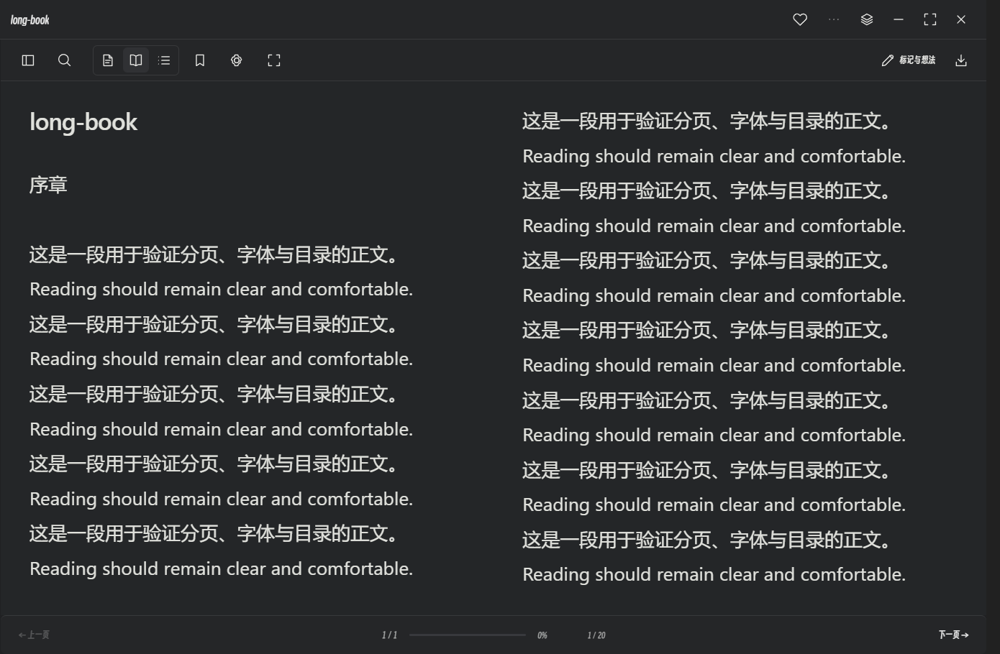

# 阅读布局与窗口流畅性 · v0.5.1

打开书籍默认收起目录和次要工具；目录、搜索、标记、字号、配色与导出功能仍可从工具栏或“更多”打开。

- **单页 / 双页 / 上下滚动**：在阅读工具栏或排版设置切换。双页会在窄窗口自动显示单页，放大后恢复双页；选择保存在本机。
- **滚轮翻页**：分页模式下上下滚动切换页面；连续的小幅触控板输入合并为一次操作，避免惯性连翻。上下滚动模式保留普通滚动，Ctrl / Command 滚轮与文字选择不被抢占。
- **快速缩放**：拖动期间暂停分页重算和布局动画，结束后恢复字号、分页和双语段落对齐；固定收藏及窗口控制按钮，窄窗口的次要命令收进菜单。
- **开窗**：字体和首张图片就绪后，先准备内容动画，再同步淡入原生窗口；避免先显示完整窗口再重播动画。使用短距离、无回弹的缓动，支持系统减少动态效果。
- **收藏**：预览、资料库和音乐收藏统一图标尺寸、留白与选中反馈，并提供 `aria-pressed` 状态。

测试使用合成书籍、原创媒体、隔离静音窗口及合成双语正文，不调用模型。覆盖三种阅读方式、滚轮、布局保存、窄窗口适配、原生快速缩放、最大化 / 全屏、键盘菜单、收藏完整显示、中英文、减少动态效果与双语重排。另通过 97 项原生回归测试。不同硬件、超大文档与多屏 DPI 环境仍可能有性能差异。

实现思路参考 [Foliate-js 分页器](https://github.com/johnfactotum/foliate-js/blob/main/paginator.js) 的分页与滚动处理、[Motion 布局实现](https://github.com/motiondivision/motion/blob/main/packages/motion-dom/src/projection/node/create-projection-node.ts) 的缩放期间暂停布局动画及合并帧处理，以及 [Radix Toolbar](https://github.com/radix-ui/primitives/blob/main/packages/react/toolbar/src/toolbar.tsx) 的分组和键盘访问。未复制组件代码或引入这些项目的运行库。

English: Books open with secondary UI collapsed. Choose single-page, adaptive two-page or vertical scrolling; wheel paging includes gesture guards. Resize work is deferred until the native gesture settles, essential buttons stay fixed and optional commands remain accessible through a keyboard-enabled menu. Prepared content motion and native opacity share one opening sequence. Favorite controls have consistent padding, complete icons and pressed state. Focused checks cover reading, resizing, windows, bilingual layout and accessibility using isolated silent fixtures, with no model calls; the native regression suite passes 97 checks. Referenced projects provide interaction ideas only, with no copied components or bundled runtimes.
