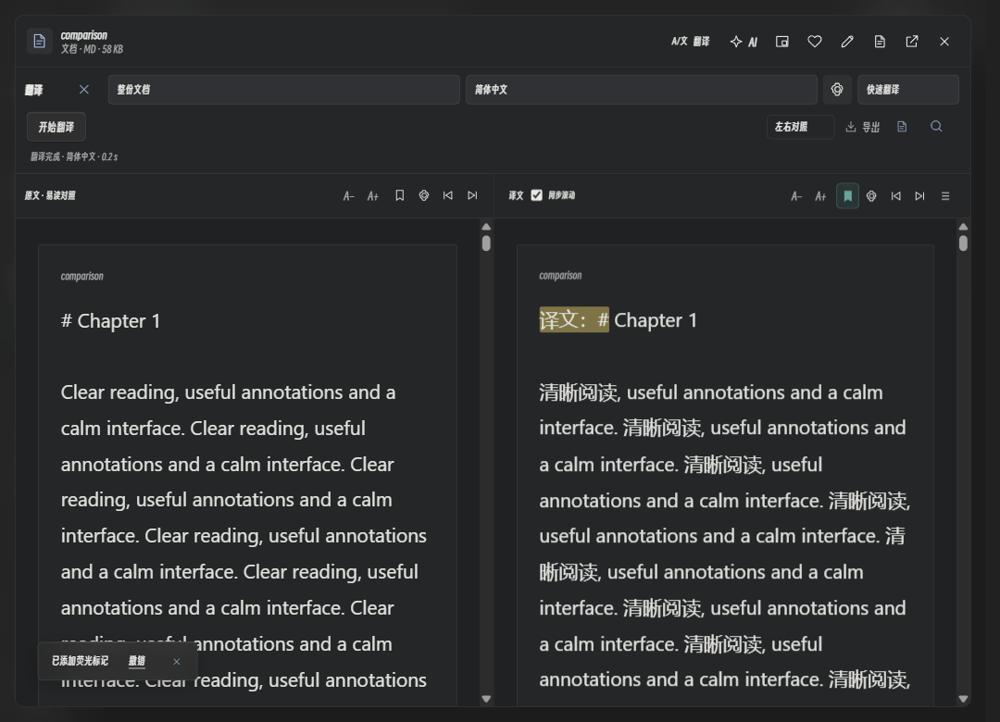

# 阅读与窗口修订 · v0.5.1 预览版

[English](READING_RENEWAL_0.5.1.en.md) · [返回文档](README.md)

本次集中修复读书、文档、双语翻译与预览窗口。当前阅读与窗口的后续调整见[布局与流畅性说明](READING_FLOW_0.5.1.md)。

| 场景 | 使用方式与变化 |
| --- | --- |
| 目录 | EPUB 优先读取书内 NAV，兼容 NCX、嵌套目录、片段锚点和重复标题；Word 识别标题、继承样式与大纲层级；TXT / Markdown 识别章节标题。无正式目录时才回退到正文分节 |
| 翻页 | 电子书默认左右分页，文档默认连续滚动，可分别更改；页内前后翻页、目录定位、进度与续读保留 |
| 字体与护眼 | 读书、文档分别设置字体、14–48 px 字号及跟随主题 / 纸色 / 护眼绿 / 夜间配色；默认采用清晰的系统正文字体，普通窗口 21 px，大屏 24 px。手动字号优先 |
| 书签与选字 | 当前位置书签可添加 / 取消，有颜色与填充反馈；选区可微调、划线、高亮、记想法与撤销。智能模式增加选文翻译和 AI 解释 |
| PDF 易读文字 | 从有文字层的 PDF 提取分页正文，支持独立字体、选字、标记与书签，可切回原版；不包含 OCR，不重建原页面布局 |
| 双语对照 | 默认左右易读正文，统一字体、字号、行距和段落高度；双向同步滚动，任一侧可调字号、划线、高亮、记想法与加书签。右侧列表可回到已保存的标记；也能切换原版或仅译文 |
| 译文保存 | 译文、局部结果、对照标记与书签保存到本机，重开自动恢复，无需再次调用 API；源文件或 kok 阅读正文改变后不恢复旧结果。可另行导出原格式副本 |
| 快速翻译 | 默认最多四个并发请求、较大批次与逐段缓存；标准模式保留三个并发。在精确匹配的 DeepSeek 官方服务上，快速模式显式关闭思考。实际速度取决于网络、模型与服务限流 |
| 窗口与颜色 | 普通窗口、小窗、最大化和全屏保持一致配色；阅读全屏使用真实全屏。视频 / 照片采用同一组深色材质，顶部按钮保持单排，小窗可横向滚动工具栏 |
| 动画与留白 | 点击文件后围绕点击位置平滑展开内容，独立预览在内容就绪后同步淡入；不重复播放开屏图标。闲置约 3.5 秒后淡出工具栏，移动鼠标或键盘操作唤回；选字、编辑和任务进行时保留操作栏 |
| 拖入分类 | 文件卡片可拖到侧栏分类；Ctrl / Shift 点击可选择多项。拖入私密文件夹必须确认并验证密码，只移动索引记录，不搬动原文件 |

截图使用隔离测试资料和虚拟译文，仅展示界面，不代表翻译质量。

普通译文位于数据目录的 `translations/view-*.json`，属于本地明文资料；对照标记保存在此文件中，不会直接写入原件或自动嵌入格式导出。原格式导出的边界见[翻译与字幕说明](TRANSLATION_CAPTIONS_0.5.1.md)。

私密文件夹只加密索引、笔记与封面。移入时删除对应的普通译文视图；原文件、以前导出的副本及共享翻译缓存不会因此加密。取消确认不会移动记录。

## 设计与实现参考

- [affectui](https://github.com/flohoeller/affectui)：中性色面、克制按钮、分组操作、选中反馈与键盘焦点。
- [Foliate-js EPUB 实现](https://github.com/johnfactotum/foliate-js/blob/main/epub.js)：NAV / NCX、阅读顺序与片段定位思路。
- [Koodo Reader](https://github.com/koodo-reader/koodo-reader)：独立正文排版、分页、护眼与选词操作。
- [DeepSeek 思考模式](https://api-docs.deepseek.com/guides/thinking_mode/)：使用 `thinking.type = disabled` 关闭官方服务的思考模式。

参考交互与格式思路，未复制这些项目的组件代码、品牌或截图，也未引入其运行时。

## 验证

合成 EPUB NAV / NCX（含重复标题、空锚点、转义路径）、中文 TXT、带继承标题样式的 Word、三页 PDF、原创视频与照片；使用独立资料库、静音窗口、内存翻译服务和本机 HTTP 模拟，不调用个人 API。

覆盖 650 × 520、普通窗口、1920 × 1080 视口及真实原生窗口缩放、最大化和无边框全屏；检查目录、分页、书签反馈、独立字体、深色 PDF、选文翻译 / 解释、双向滚动、段落对齐、译文恢复、对照标记、私密拖入确认及工具栏消失 / 唤回。

多显示器不同缩放率下的字体清晰度已改用 Per-Monitor V2 DPI 感知，旧系统回退兼容；仍需在实际多显示器环境观察。扫描 PDF、缺失目录和不规范电子书不保证自动恢复出准确章节。
