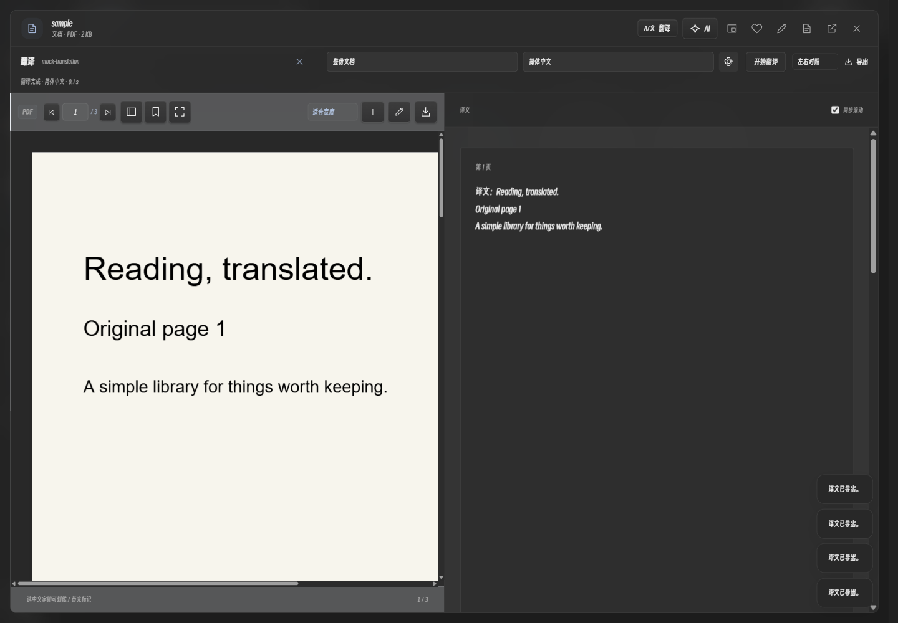
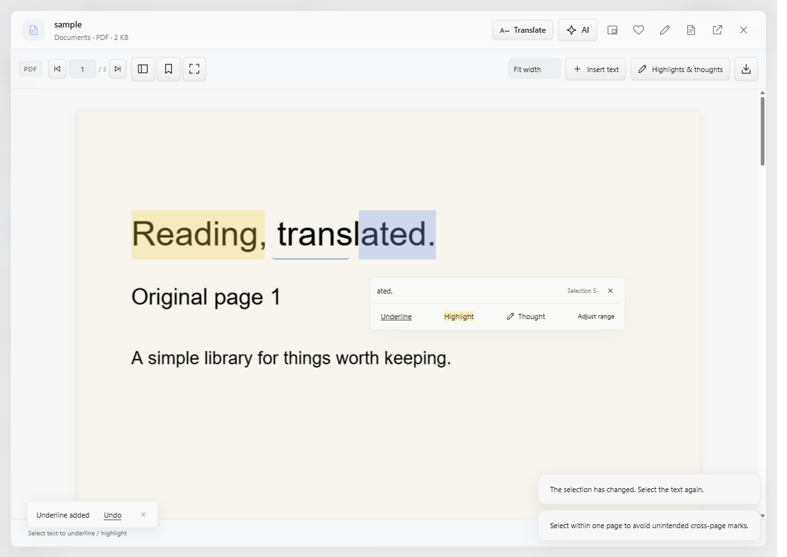

# 翻译、字幕与精准标记 · v0.5.1 预览版

文档标题栏点击「翻译」，选择语言和范围，再开始。默认左侧原文、右侧译文；可切换「仅译文」，例如只保留中文。双语与译文模式也决定导出内容。

界面使用隔离测试文档，截图中的译文为模拟服务输出，不代表真实翻译质量。

| 输入 | 导出与保留范围 |
| --- | --- |
| DOCX | 导出 DOCX；保留正文文字的原有样式、表格、图片与文件关系。双语版使用左右两栏重新排版，页数可能改变；页眉、页脚、图片内文字与文本框等复杂内容不保证全部翻译 |
| EPUB | 导出 EPUB；替换正文文字节点，保留书籍结构与资源；双语版为左右栏，具体分页取决于电子书阅读器 |
| PDF | 导出 PDF；双语版每页左侧保留原文页面，右侧为重新排版的译文图像页。译文图像不可直接选字搜索；文字溢出会续页，不截断。扫描件需先 OCR |
| TXT / Markdown | 保留 TXT / MD / Markdown 扩展名；双语文本按段落配对。HTML 等其他阅读格式提供安全的 HTML 对照副本，不声称重建所有原始数据格式 |
| 字幕 | 导出带原始时间戳的 SRT，可选择仅译文或双语 |

如果 DOCX / EPUB 已在 kok 内修改了阅读正文，导出按修改后的正文重建简洁文档，不沿用旧文件排版。原文件始终保留，不能用导出覆盖已收录原件。

## 长文档

默认快速模式最多四个并发请求，标准模式三个，返回后逐段显示；缓存按服务地址、模型、目标语言和原文区分。停止或失败后，重新开始会复用已经完成的段落。当前章节与整份文档也能复用相同段落。

格式标记由模型原样保留并在写入前验证，避免坏结果损坏文档。速度仍取决于模型、网络和服务限流，没有固定的加速倍数。正文会发送至已配置的翻译服务。翻译总量限 200 万字符，原格式 DOCX / EPUB 支持 64 MiB 以内；PDF 导出读取的源数据限 32 MiB。

## 视频生成字幕

智能模式下打开视频，点击「生成字幕」。首次需配置 FFmpeg / FFprobe，用于提取音轨，可按需安装或选择已有组件。

- **本地识别**：下载并校验官方 Whisper Windows CPU 组件和多语言 Tiny（约 74 MiB）或 Base（约 141 MiB）模型，也可选择已有 `whisper-cli.exe` 和模型。首次组件下载需要联网；安装后识别不上传音轨。模型单独保存，不增大便携包。
- **语音 API**：提供 Groq 和自定义兼容接口。服务需实现 `/audio/transcriptions` 文件上传，并返回带 `segments` 时间戳的 JSON 或 SRT。只有普通 `text` 返回值的接口不能用于真实定时字幕。见 [Groq 官方说明](https://console.groq.com/docs/speech-to-text)。

语音接口使用独立配置和独立密钥，Windows DPAPI 加密保存；更换服务必须重新填写对应密钥。**不会把 DeepSeek 聊天密钥发送给语音服务。** 开始在线识别后，只上传提取的单声道音轨；每段最多 8 分钟，回传时间戳会加上片段偏移，媒体最长 12 小时。

字幕生成后载入播放器并保存到资料库，可导出 SRT，再通过原有翻译服务生成中文或双语字幕。提供进度、停止操作和临时音轨清理。纯净模式和私密文件夹禁止 AI 识别及组件下载。

识别准确率受语言、噪声、配乐、模型大小和录音质量影响。长音轨在切段边界可能需要修正；当前不分离说话人、不进行字幕逐字校时，也不自动将字幕烧录进原视频。

## 划线与高亮

选区工具栏显示将保存的文字和字符数；「调整范围」逐个完整字符微调起点、终点，避免把 emoji 等字符截断。自动去掉首尾空白；同一位置不重复创建同类标记，失效选区会要求重新选择。

PDF 从实际文字片段计算矩形，去重、合并相邻片段并限制在页面内。每次只标记同一页；跨页选择不会沿用旧选区。保存后可直接「撤销」，也可在阅读区按 `Ctrl Z` 撤销最近添加的标记；输入框内仍由输入框处理撤销。

标记只更新正文和标记层，保留当前阅读位置。选区、标记、弹窗和窗口唤回使用短缓动，并遵循系统减少动态效果。窗口后退与唤回保留原生窗口位置，应用内容提供过渡，不替换 Windows 的窗口管理器。

设计参考 [finesse-ui](https://github.com/mouse-lin/finesse-skill)、[Motion 的公开弹簧实现](https://github.com/motiondivision/motion/blob/main/packages/motion-dom/src/animation/generators/spring.ts) 和 [Fluent 2 motion](https://fluent2.microsoft.design/motion)。采用现有 Web Animations API 与标准阻尼响应，没有额外引入动画运行库。

## 本次验证

使用合成文档、PDF、公开演讲样本和独立静音资料库：DOCX / EPUB 原格式与双语文件重开、样式和资源保留；翻译并发、顺序、分段缓存、取消；PDF 双栏与仅译文导出；真实 Whisper CPU 离线识别；模拟语音服务的音轨上传和时间戳；独立密钥加密、中英文及紧凑布局。没有使用个人音视频或付费模型密钥。

English: Translation offers equal-width original/translation panes, translation-only output, up to four concurrent requests in fast mode (three in standard mode), progressive results and reusable segment caches. DOCX and EPUB exports keep their containers and body styles/resources; bilingual layout reflows. PDF exports retain original pages on the left and render translated text as image pages on the right; translated text is not searchable. TXT/Markdown retain their extensions. Local Whisper and timestamped speech APIs generate video captions with separate encrypted credentials, progress, cancellation and SRT export. Models install on demand; local recognition does not upload audio. Pure mode and private folders disable these AI features. Annotation tools add previews, grapheme-safe adjustments, duplicate/stale-selection guards, page-bounded PDF rectangles and undo. Motion uses native WAAPI with damped timing and respects reduced motion. Tests use fixtures, a public speech sample and mock APIs; real Whisper CPU inference was checked separately.
