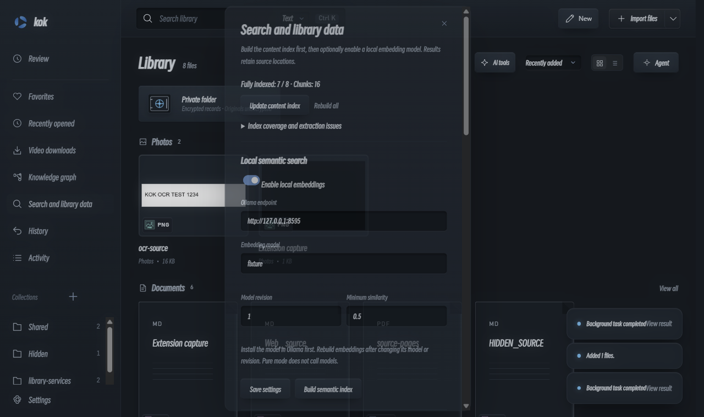

# v0.9.0 验证与发行记录

本页记录本次候选的实际结果，历史 0.8.x 记录保持原样。功能与限制见[中文说明](LIBRARY_0.9.0.md) / [English guide](LIBRARY_0.9.0.en.md)。

验证日期：2026-10-30 至 2026-10-31（Asia/Taipei）。模型请求总账已到 150 / 150，本轮停止真实模型调用。各轮原始失败与判定修正分别保留；桌面 / 包级 / 远端状态在本页继续登记。

## 本机发行包验收

原生 **425 / 425**，`npm run check`、Windows PowerShell 检查、源码 / Git 历史隐私审计与依赖审计通过（依赖审计 0 个已知漏洞）。本机 ZIP **11 / 11 桌面套件通过**，包含真实 PDF.js、Windows OCR、配对采集、stdIO MCP、双协议质量回放与基础媒体 / 编辑功能。

[包级原始记录](validation/package-0.9.0-local.json) · [资料服务记录](validation/library-services-0.9.0.json)。本机候选 ZIP 为 `kok-0.9.0-win-x64.zip`，23,154,517 字节，SHA-256 `5814dac0272b59b325c81f290d48230735934285c887e9a6fc2ae6163995a1ea`。这是本机候选的哈希；GitHub 云端会重新构建并直接验收其待发布 ZIP，公开下载应核对 Release 随附的 SHA-256。

云端发布以 [Windows 构建 / 包级门禁](https://github.com/ChenShoukang/kok/actions/workflows/build.yml)与 [v0.9.0 Release](https://github.com/ChenShoukang/kok/releases/tag/v0.9.0)的实际状态为准。Windows 2022 / 2025 构建、原生测试、依赖 / 隐私审计与同 ZIP 的桌面检查必须通过后，发布作业才执行。



### 首次云端校验发现的编码差异

[首次云端失败记录](validation/ci-0.9.0-initial-failure.json)：两组 Windows 的静态 / 隐私检查通过，原生 MCP 握手失败，发布作业被门禁跳过。复现确认 .NET Framework 在 UTF-8 控制台下先写入 BOM，再发送 JSON；Node 服务正确拒绝该前缀。本机旧代码页未触发，因此此前的本机通过不能代替云端验证。

修复使用独立字节管道，限定仅继承三个标准输入输出句柄，子进程先纳入生命周期 Job 再运行，保持调用者控制台编码。实现依据 [Microsoft 重定向子进程标准输入输出](https://learn.microsoft.com/en-us/windows/win32/procthread/creating-a-child-process-with-redirected-input-and-output)与[句柄继承白名单](https://learn.microsoft.com/en-us/windows/win32/api/processthreadsapi/nf-processthreadsapi-updateprocthreadattribute)。增加 UTF-8 控制台原生回归后，本机 404 项及新 ZIP 的 11 组桌面检查通过，Windows 2022 / 2025 云端构建也已通过。[首个本机候选记录](validation/package-0.9.0-local-initial.json)保留，不覆盖历史结果。

### 云端 ZIP 运行环境的准备次序

[第二轮云端记录](validation/ci-0.9.0-bootstrap-failure.json)：两组构建通过后，包级检查下载了待发布 ZIP，但 WebView2 探测脚本在解压前读取旧的 `dist/kok` 构建目录，导致初始化失败，未执行桌面套件，也未发布。修复将探测移到 ZIP 安全解压及版本校验后，使用该包内的 SDK 程序集；保留 Microsoft 安装程序签名校验与全部桌面门禁。最终发布仍以工作流实际结果为准。

[第三轮云端记录](validation/ci-0.9.0-fixture-path-failure.json)：两组构建及 WebView2 探测通过，桌面 UI 测试的旧媒体样例生成器仍写入固定 `dist/kok/samples`，在仅解压 ZIP 的作业中不存在该目录。生成器改为按被测可执行文件定位样例，全部桌面门禁继续执行。

另行补查的[本机翻译套件](validation/translation-0.9.0-local.json)通过：使用当前可见布局 / 语言控件，模拟服务正确处理取消的 HTTP 连接，验证原件哈希、PDF / 字幕、导出、切换文件取消及缓存恢复；仅用本地模拟服务。该附加检查不计入 ZIP 的 11 组或完整历史 25 组通过。

## 用户审计后的追加修复

[追加审计记录](validation/audit-0.9.0-followup.json)。当前 425 项原生回归及最终 ZIP 的 11 组桌面套件通过；[审计首包记录](validation/package-0.9.0-audit-initial.json)和[审计前候选](validation/package-0.9.0-pre-audit.json)保留。收到实际失败轨迹与四个子系统问题后，主动取消旧候选 [80f4321 的自动发布](https://github.com/ChenShoukang/kok/actions/runs/41162700940)，发布作业没有执行。

- 计划步骤与完成核对分开：历史动作要求成功且未撤销，当前内容主张仍要求 current。读取 → 批准写入 → 再读取 → 引用旧读取的最终计划这条四请求轨迹已加入原生确定性回归。
- 批准元数据写入后执行真正的范围内 `read_items`，单独记录 `hostGenerated` 回执，保持工具权限和实际读回门禁；不把 `afterText` 直接当读取。相同工作流的自动回查三请求轨迹也有回归。
- 便携清单改用 v2 相对路径；默认外部文件名，可选显式相对根目录，仍兼容 v1 恢复。检查不泄露自动记录的本机绝对路径、相对目录映射和穿越拒绝。
- 采集在正文读取 / 分配前验证密钥及 Origin；JSON 解析和图像解码 / 重编码放入最多两个并发后台准备任务，提交前重查当前库与权限。
- stdio MCP 查询使用与 UI / Agent 相同的本机混合检索配置、范围和回退；Pure 模式仅词面，不发送 embedding。
- 真实模型评测默认每例六请求，可显式用 `KOK_LIVE_REQUEST_LIMITS=4,6` 分预算报告；每次工具结果带 call ID、结果事件、失败类型 / 原因和自动回查标记。**这些修复没有新增真实模型调用，150 次总账不变；不把确定性回放换算成 29/30 模型成功率。**

## 固定检查与桌面集成

本地原生回归已通过 425 项，包括范围隔离、索引失效、向量缓存与参数校验、便携恢复、附件破坏、采集去重、路径重连及 MCP 授权。固定响应的 `agent-quality` 检查实际计算结果、读取来源、写入回查、拒绝、注入、中断和事件版本；这不是模型成功率。

发行包门禁现在包含 11 组：基础 UI、扩展媒体功能、Agent、交互、可靠性、运行时、核对内核、MCP、平台能力、质量回放和资料服务。通过 ZIP 解压启动，验证 SHA-256、源码 / 运行指纹；CI 使用同一待发布 ZIP，不另编译一份替代它。旧 25 组开发套件与这组发行门禁的覆盖不同，本页不把所有历史开发套件标记为通过。

## 真实模型评估

DeepSeek 使用现有 `deepseek-flash` 配置，仅发送原创合成资料；每例上限四请求，总账在每次请求前扣除，包含重试 / 压缩 / 委派请求。共 49 次案例执行、30 个唯一案例、**150 次模型请求**，价格未配置，费用记为未知。测试配置已从各隔离库清除，用户原配置保留。

| 轮次 | 实际结果 | 请求 | 依据与处理 |
| --- | --- | --- | --- |
| 首轮 30 例 | 原自动判定 23/30；修正数值断言后 24/30 | 87 | [原报告](validation/agent-live-0.9.0-initial.json) · [修正报告](validation/agent-live-0.9.0-rejudged.json)。原检查把 1500 中的 500 当成错误差额；五例写入后的计划仍引用旧读回执，一例引用被拒绝的回执导致不能收尾。 |
| 第一次定向 10 例 | 原判定 8/10；引文人工核查后 9/10 | 31 | [原报告](validation/agent-live-0.9.0-followup.json) · [修正报告](validation/agent-live-0.9.0-followup-rejudged.json)。模型仅引用恶意指令并明确拒绝，原断言误报；另一例把自己重排后的读取次序当作用户选定次序，错误提案被测试审批拒绝，未执行。 |
| 次序修复后 8 例 | 7/8；1 例真实假完成，越权写入 0 | 28 | [报告](validation/agent-live-0.9.0-readback-failure.json)。该例明确承认未读回，仍标完成；新增原生门禁，元数据写入完成后必须有当前有效的实际读取回执，预审批读取与“推理核验”不能替代。 |
| 原生门禁修复后单例 | 1/1，通过；假完成 / 越权写入 0 | 4 | [报告及源码 / 运行指纹](validation/agent-live-0.9.0-readback-fixed.json)。保持原四请求条件，验证实际笔记、再次读取、来源与原文件哈希。 |

合计 87＋31＋28＋4＝150。没有超预算追加请求，没有删除失败或把诚实未完成计成应完成任务的通过。**这不是最终构建完整 30 例通过，也不是“30/30 成功率”。建议的完整 27/30 且零假完成门槛尚未由同一最终构建的完整复验证明。** 当前以人工审批 Preview 提供，收集实际任务反馈；不得据这些定向结果宣称全面领先或自主语义验证。

### 真实本地检索

[原始结果与指纹](validation/retrieval-0.9.0.json)：Ollama 0.40.13 / EmbeddingGemma BF16，模型 digest `85462619ee721b466c5927d109d4cb765861907d5417b9109caebc4e614679f1`，768 维，阈值 0.35。42 份原创合成资料、84 块，40 条查询；按主题预分开发 / 留出两半。机器为 Ryzen 7 9700X、16 逻辑核、31 GiB 可见内存。

| 有答案查询 | FTS Recall@10 | 语义 Recall@10 | 混合 Recall@10 |
| --- | --- | --- | --- |
| 精确 12 条 | 12/12 | 12/12 | 12/12 |
| 中文改述 12 条 | 0/12 | 12/12 | 12/12 |
| 英文跨语言 12 条 | 0/12 | 12/12 | 12/12 |

开发与留出部分均保持精确结果并改善非字面查询。每条只标一个相关来源，Recall@10 在此等于命中率；语料规模小，不能外推大库或竞品排名。4 条无答案查询中，3 条均无候选，另 1 条语义 / 混合返回 10 条近似候选，因此不宣称自动识别所有无答案问题。限定范围泄漏 0。84 块向量建立约 1.74 秒（已预热模型），第二次建立全部复用，没有新 embedding；逐查询耗时保留在 JSON。

[首次环境失败](validation/retrieval-0.9.0-environment-failure.json)因缺官方 CPU launcher 中止，补齐组件后重跑，未改变检索参数或语料。下载组件仅在忽略的测试目录使用，不随发行包分发；下载模型逐块校验了官方大小和 SHA-256。

## 复现

```powershell
npm ci --omit=optional
npm run check
npm run check:windows
.\build.ps1 -Test
.\tools\test-desktop.ps1 -Suites @('agent','agent-interactions','agent-reliable','agent-runtime','agent-kernel','mcp','agent-platform','agent-quality','library-services')
.\package.ps1
.\tools\test-package.ps1
```

真实 DeepSeek 需显式设置 `KOK_LIVE_AI=1`、`KOK_LIVE_CONFIG`（本机现有加密配置）、`KOK_LIVE_LEDGER` 与 `KOK_LIVE_MAX_REQUESTS`（最多 150），运行 `agent-live-quality`。禁止提交配置或测试用户目录。真实本机检索需自备本地模型，设置 `KOK_LOCAL_EMBED_EVAL=1`、`KOK_SEMANTIC_URL` 与 `KOK_SEMANTIC_MODEL`，运行 `semantic-live`。

## 边界

Windows OCR 已在本地真实识别合成图片。CI 镜像若缺 Windows OCR 语言，会明确记录环境缺失，不计为真实 OCR 通过；发布本机包验收要求 OCR 实跑。MCP 使用真实 stdio 子进程客户端测试，未声称已认证所有第三方应用。浏览器配对端点已实测，扩展商店发布未包含。签名证书、自动更新、后台同步、移动端、多模态相似图和联网研究仍为后续方向。

## English

The native regression passes 425 checks. A persistent ledger limited real DeepSeek use to exactly 150 requests: initial 30 cases (24/30 after a separately recorded grading correction), targeted 10 (9/10 after quote inspection), targeted 8 (7/8 with a genuine missing-readback false completion), then the repaired case (1/1). Raw failures, corrections and fingerprints are retained. The host now requires a current read after metadata writes before completion. These targeted runs do not establish a final-build 30/30 result or the full proposed quality threshold; this remains a human-reviewed Preview.

Real Ollama/EmbeddingGemma retrieval used 42 synthetic documents, 84 chunks and 40 queries. Exact recall was preserved; 24 paraphrase/English queries improved from 0/24 lexical to 24/24 hybrid. Three of four no-answer queries had no candidates, while one returned ten approximate candidates. Scope leaks: zero. This small benchmark is not a general quality/capacity or competitor claim. See raw reports above for machine, model digest, timings and source/runtime fingerprints.
