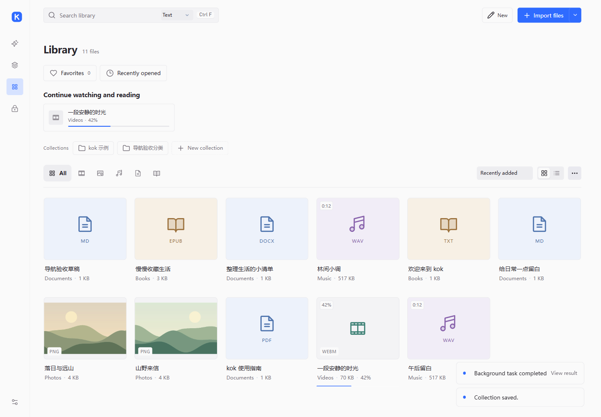

# 认识 kok

kok 是一个**本地优先的个人 AI Agent 工作台**。它把日常散落在电脑里的视频、照片、音乐、文档和电子书
收进同一个本地资料库，再把 AI 放在需要的时候才出现：你可以只播放和阅读，也可以让 Agent 规划、检索、
整理、写作，并生成可以继续编辑的成果。

使用本地播放、阅读和编辑无需注册。使用 AI 时，相关内容会发给你配置的服务。

> [!info]+ 本页是产品介绍
> 具体操作请从[帮助中心首页](index.md)进入。本页说明 kok 的定位、三个区域的分工、能力地图与边界。

## 为什么是“Agent 工作台”

常见的工具要么只负责**欣赏**（播放器、阅读器），要么只负责**创作**（编辑器、笔记软件），要么只负责
**问答**（聊天式 AI）。kok 想把三件事放在同一个本地资料库上：

- **欣赏**：视频、音乐、文档、电子书、照片有各自完整的播放与阅读体验。
- **创作**：文档、演示文稿、音视频剪辑、PDF 整理都有可继续的编辑过程，结果可以导出。
- **协作**：Agent 能读取你选定的资料，提出修改建议并交给你确认，而不是直接改动文件。

三件事共享同一份内容，但入口按使用场景分开，避免在文件类型和工具之间反复判断。

## 五个设计原则

| 原则 | 在 kok 里的含义 |
| --- | --- |
| 本地优先 | 资料索引、笔记、进度和历史保存在本机；导入不移动原文件 |
| AI 按需 | 进入智能模式本身不请求模型；只有执行 AI 功能时才发送所选内容 |
| 可核对 | Agent 的读取步骤、来源和修改建议都可以展开查看，写入前需要确认 |
| 可恢复 | 支持的修改进入操作历史，可以撤销；资料和笔记都会保留当前内容 |
| 内容可继续使用 | 作品导出后仍在资料库直接播放或阅读；资料可以按需成为创作素材 |

## 三个区域如何分工

| 区域 | 它负责 | 它不负责 |
| --- | --- | --- |
| **Agent** | 对话、任务、读取资料、提出修改、产出成果、查看任务记录 | 不替你决定是否执行修改；不替代编辑器 |
| **我的作品** | 新建、继续编辑、项目空间、素材摘录、配方、已有媒体剪辑 | 不保存一份与资料库重复的成品副本 |
| **资料库** | 观看、收听、阅读、浏览、进度、收藏、分类、检索、资料库工具 | 不负责章节策划或作品版本管理 |

> [!tip]- 作品和资料库的区别
> 从**我的作品**打开，默认是“继续创作”，进入文稿、演示或时间线编辑；从**资料库**打开，默认是
> “观看、收听、阅读”，优先提供进度、字幕、目录、书签、收藏和播放队列。同一份内容可以在两个区域
> 以不同目的出现，但文件只有一个。

## 一条完整路径

以旅行视频为例：

1. 在**资料库**导入相机和手机里的视频、照片。
2. 直接观看、标记进度，或选中精彩时间段保存成**摘录**。
3. 在**我的作品**里从已有视频开始剪辑，加入照片和字幕，导出成片。
4. 成片回到**资料库**，像其他视频一样播放和收藏。
5. 需要时让 **Agent** 根据字幕写一份旅行笔记或演示文稿。

写小说、做演示、整理阅读资料也是同样的路径：资料在资料库，过程在我的作品，协作出现在 Agent，
成果回到资料库或导出到你选择的位置。

## 能力地图

| 能力 | 具体内容 |
| --- | --- |
| 观看与收听 | 视频续播、倍速、全屏、外挂字幕；音乐专辑、队列与后台播放；照片浏览与编辑 |
| 阅读 | EPUB 目录与书签、TXT 章节、PDF 搜索与批注、阅读排版与护眼配色 |
| 管理 | 分类、收藏、最近打开、继续观看与阅读、搜索、智能集合、回顾 |
| 创作 | 新建 Markdown/DOCX/TXT/PPTX、正文编辑、演示文稿基础编辑、音视频剪辑、PDF 页面整理 |
| 协作 | Agent 任务、资料范围、修改审核、长期记忆、计划任务、外部工具 MCP、指令技能 |
| 组织 | 空间（网格/画布/时间线/图谱）、摘录、配方、知识图谱、智能整理 |
| 获取 | 网页、选区与图片采集；Bilibili / YouTube / 抖音等视频下载；Windows OCR |

## 它和常见工具的区别

- **比播放器、阅读器多一层**：也能管理、检索、写作和制作，不只是打开文件。
- **比笔记软件多一层**：直接管理原始媒体文件，播放和阅读不必先“导入成笔记”。
- **比聊天式 AI 多一层**：有真实资料库、可审核的写入、操作历史和可导出的成果，而不是只有对话记录。
- **不是云服务**：没有账号体系、云同步或在线协作；资料留在你的电脑上。

## 它明确不做或暂不提供

- 不提供云同步、手机版、自动更新或在线发布；升级需要下载并替换程序文件。
- 不搬动、不加密原文件；私密文件夹保护的是应用内记录，原文件仍需你自己保管。
- 不内置独立解码器，播放能力取决于 WebView2 和系统编码；不处理 DRM。
- 不完整还原复杂 Office 版式，也不保证所有网页下载场景可用。
- 小说可以用文字文档写作，音视频可以从已有素材剪辑。托管文档提供历史版本和命名检查点，PPTX 暂无同样的版本对比面板。[能力边界](reference/boundaries.md)

> [!warning]+ 预览版说明
> 当前版本是未签名的 **Preview 预览版**。请保留资料备份，不要把它作为唯一副本；重要原始文件请另行备份。

---

**相关**

- [帮助中心首页](index.md)
- [能力边界与未实现](reference/boundaries.md)
- [功能结构（作品、资料与 Agent 的关系）](../CREATION_PRODUCT_FLOW.md)
- [版本与更新](reference/versions.md)
