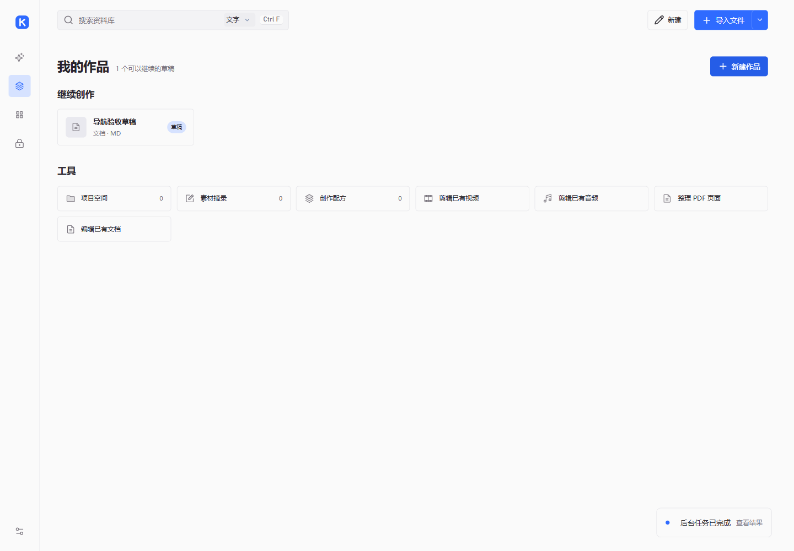

# kok 帮助中心

kok 是一个**本地优先的个人 AI Agent 工作台**：把视频、照片、音乐、文档和电子书收进本机资料库，
需要时交给 Agent 整理、阅读、写作和制作可继续编辑的成果；不需要 AI 时，也可以只把它当作播放器、
阅读器和资料管理器使用。

> [!info]+ 这份帮助说明的是 v0.10.1 Preview
> 可见入口会随使用模式、模块开关和文件格式变化。本版把一级入口按使用场景组织为 **Agent**、
> **我的作品** 和 **资料库**；小说章节/设定管理与从零生成音视频仍分阶段接入，详见[能力边界](reference/boundaries.md)。

## 从这里开始

| 想做的事 | 从这里开始 |
| --- | --- |
| 第一次安装并打开 kok | [安装 kok](getting-started/install.md) |
| 决定用纯净模式还是智能模式 | [选择使用模式](getting-started/modes.md) |
| 把文件放进资料库 | [导入第一份资料](getting-started/import.md) |
| 先认识界面 | [认识界面](getting-started/interface.md) |

## 三个工作区域

kok 的一级入口按“你要做什么”组织，而不是按文件类型组织。文件类型和工具留在各自区域内部。

| 区域 | 适合做什么 | 进入后从哪开始 |
| --- | --- | --- |
| **Agent** | 说出目标，让 Agent 规划、检索、整理、写作、制作可审核的成果 | [Agent 概览](agent/index.md) |
| **我的作品** | 新建文档或演示文稿，继续编辑草稿，组织项目空间、摘录和配方 | [我的作品概览](works/index.md) |
| **资料库** | 看视频、听音乐、阅读文档和电子书、浏览照片，管理进度与收藏 | [资料库概览](library/index.md) |

> [!tip]- 一个区域，一条完整路径
> 想看电影：从**资料库**直接播放。想写点东西：在**我的作品**新建文档。想请 Agent 帮你处理资料：
> 在 **Agent** 里添加资料并说出要求。三条路径互不冲突，资料也可以在创作时按需引用。

## 常用任务

- 给 Agent 一个范围清楚的任务：[发起一个 Agent 任务](agent/start-task.md)
- 审查 Agent 提出的修改：[审查与撤销修改](agent/review-changes.md)
- 新建并编辑文档：[新建与编辑文档](works/create-documents.md)
- 把已有视频或音频剪成新内容：[剪辑已有音视频与整理 PDF](works/edit-media.md)
- 接着上次的位置看或读：[继续、收藏、最近与分类](library/continue-favorites.md)
- 把看过的内容留下来：[保存摘录](library/clips.md)
- 把重复步骤存成配方：[项目空间、素材摘录与配方](works/projects-clips-recipes.md)
- 配置自己的 AI 服务：[配置 AI 服务](settings/ai-service.md)

找不到入口时，可以先读[认识 kok](about-kok.md)了解整体设计，再按下面的完整目录查找。

## 完整目录

### 开始使用

- [安装 kok](getting-started/install.md)
- [选择使用模式](getting-started/modes.md)
- [导入第一份资料](getting-started/import.md)
- [认识界面](getting-started/interface.md)

### Agent

- [Agent 概览](agent/index.md)
- [发起一个 Agent 任务](agent/start-task.md)
- [审查与撤销修改](agent/review-changes.md)
- [成果、任务记录与会话](agent/results-history.md)
- [长期记忆与计划任务](agent/memory-schedules.md)
- [外部工具 MCP](agent/mcp.md)
- [技能、用量与费用](agent/skills-budget.md)

### 我的作品

- [我的作品概览](works/index.md)
- [新建与编辑文档](works/create-documents.md)
- [制作演示文稿](works/presentations.md)
- [继续创作与草稿](works/continue-editing.md)
- [项目空间、素材摘录与配方](works/projects-clips-recipes.md)
- [剪辑已有音视频与整理 PDF](works/edit-media.md)

### 资料库

- [资料库概览](library/index.md)
- [观看视频](library/watch-video.md)
- [收听音乐与音频](library/listen-music.md)
- [阅读文档与电子书](library/read-documents-books.md)
- [浏览与编辑照片](library/view-photos.md)
- [继续、收藏、最近与分类](library/continue-favorites.md)
- [搜索与检索](library/search.md)
- [保存摘录](library/clips.md)
- [使用智能集合](library/smart-collections.md)
- [回顾使用记录](library/review.md)
- [查看知识图谱](library/knowledge-graph.md)
- [智能整理](library/organize.md)
- [下载网络视频](library/video-downloads.md)
- [资料库工具、历史与备份](library/library-tools-backup.md)

### 设置

- [设置概览](settings/index.md)
- [外观与字体](settings/appearance.md)
- [阅读与播放偏好](settings/reading-playback.md)
- [配置 AI 服务](settings/ai-service.md)
- [模块管理](settings/modules.md)
- [私密文件夹](settings/private-folder.md)
- [数据、备份与更新](settings/data-backup.md)

### 参考资料

- [支持的格式](reference/formats.md)
- [键盘快捷键](reference/shortcuts.md)
- [术语表](reference/glossary.md)
- [能力边界与未实现](reference/boundaries.md)
- [常见问题](reference/faq.md)
- [版本与更新](reference/versions.md)

### 关于 kok

- [认识 kok](about-kok.md)
- [帮助与支持](help-and-support.md)

---

**相关**

- [认识 kok：它解决什么问题，不做什么](about-kok.md)
- [帮助与支持：反馈、文档与许可](help-and-support.md)
- [当前用户指南](../GUIDE.md) · [功能结构](../CREATION_PRODUCT_FLOW.md) · [文档目录](../README.md)
