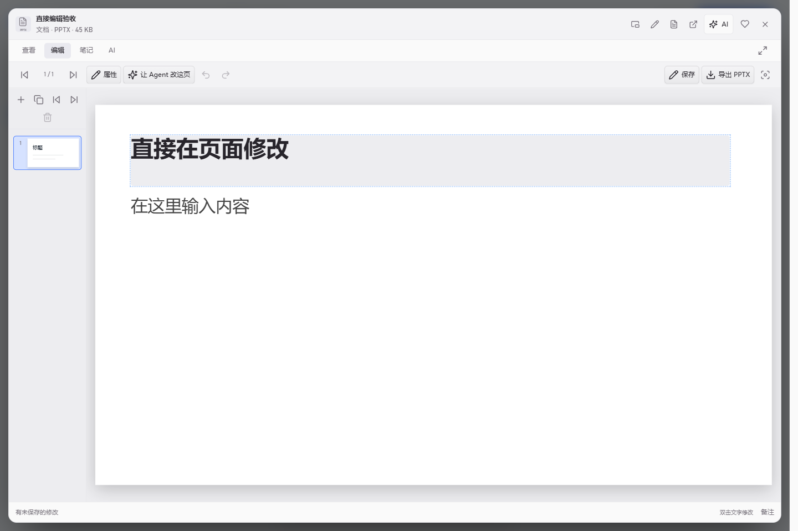

# 制作与编辑演示文稿

[帮助中心](../index.md) / [我的作品](index.md)

在 kok 里可以从空白页开始，也可以让 Agent 根据主题或资料做一份可编辑的 PPTX。

## 创建空白演示

打开 **我的作品 → 新建作品 → PowerPoint**，填写名称，点 **创建并编辑**。也可以按 `Ctrl+N` 打开新建窗口。手动创建时从一张空白页面开始。

## 用 Agent 制作

1. 启用智能模式并[配置 AI 服务](../settings/ai-service.md)。
2. 在 PowerPoint 新建窗口填写 **主题**，选 **页数** 和 **风格**。默认 8 页、杂志风格，也可选择纯白、墨黑或淡紫。
3. 点 **用 Agent 制作** 会开始任务。查看生成的页面和备注，满意后点 **执行** 保存，再从 **成果** 打开。

如果已有参考资料，先在 Agent 中 **添加资料**，或在[创作项目](continue-editing.md)中继续，再说清楚主题和页数。生成版式的文字和图形可继续编辑。[版式和视觉指引](../../PPT_DESIGN_0.11.1.md)

## 直接编辑幻灯片

打开演示，切到 **编辑**。从「继续创作」打开时会直接进入编辑。

| 操作 | 怎么做 |
| --- | --- |
| 改字 | 双击页面上的文字直接输入。点空白处或按 `Ctrl+Enter` 结束。 |
| 调字号、颜色或位置 | 选中文字框，打开 **属性**。 |
| 新增、复制、删除或排序 | 使用左侧缩略图上方的按钮。也可以拖动缩略图排序。 |
| 撤销、重做 | 使用工具栏按钮，或按 `Ctrl+Z`、`Ctrl+Shift+Z`。 |
| 写演讲备注、放映 | 用底部 **备注** 编辑当前页备注，用工具栏 **放映** 全屏展示。 |

kok 创建且支持直接保存的 PPTX 会自动写入当前文件，也可以按 `Ctrl+S`。导入的 PPTX 使用 **保存草稿**，需要文件时导出副本。

## 让 Agent 改当前页

对 kok 管理的演示，先保存修改，再选中页面，点 **让 Agent 改这页**。它会将页码和本页文字填入输入框。你可以加一句「精简成三点，保留数字和其他页面」，发送后先看方案，再决定是否应用。

只想润色某个文字框时，也可右键选中内容并使用 **AI 修改…**。[演示文稿与就地 AI 编辑](../../PRESENTATION_AGENT_0.7.1.md)

## 导出与兼容性

点 **导出 PPTX**，选择新位置保存副本。核对关键页和备注，再用于交付。复杂母版、图表、动画、嵌入对象和混合文字样式可能无法还原。需要保留完整排版时，可用系统应用打开原件。

预览支持最大 32 MB、最多 100 页、每页最多 500 个对象，内嵌图片合计最多 20 MB。旧版 `.ppt` 需要先转为 `.pptx`。

[继续创作项目](continue-editing.md) · [支持的格式](../reference/formats.md) · [返回帮助中心](../index.md)
